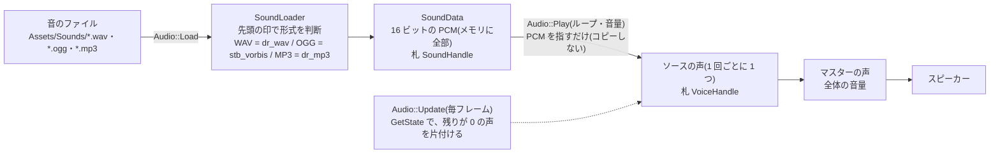

# 音(Audio)

効果音と BGM を鳴らす仕組み(2026-10-14。段階 S-1〜S-4。同じ日に、MP3 の読み込みを追加)。使い方だけなら [Usage.md](Usage.md) の「9. 音」。

[← 資料の案内(Structure.md)に戻る](Structure.md)

**実装状況**:S-1(読み込み)・S-2(鳴らす)・S-3(サンプル KRAudio)・S-4(docs)済み。機能は**最低限**(Ryusei の判断):読む・捨てる・鳴らす(ループ・音量)・止める・全体の音量。

---

## 1. 音の基本(この資料で使う言葉)

| 言葉 | 意味 |
|---|---|
| **PCM** | 音の波を、決まった間隔で測った数の並び。圧縮していない、そのままの音。スピーカーに送るのは、これ |
| **サンプリング周波数** | 1 秒に何回測るか。44100 Hz(CD)・48000 Hz(動画・ゲーム)が多い |
| **チャンネル** | 1 = モノラル、2 = ステレオ(左右)。ステレオの PCM は「左, 右, 左, 右, …」と交互に並ぶ |
| **フレーム** | 同じ瞬間の、全部のチャンネルの値(ステレオなら 2 つ)。「長さ = フレーム数 ÷ 周波数」秒 |
| **声(voice)** | XAudio2 の言葉。音を流す通り道。**1 回鳴らすごとに、ソースの声を 1 つ**作る。全部の声は、最後に**マスターの声**(スピーカーへの出口)で混ぜられる |

## 2. 流れ

- 音を混ぜる計算は、**XAudio2 が、自分のスレッドで**続けている。エンジンは、声を作って PCM を渡し、「始め」「止め」を言うだけ。
- 周波数が違う音(44100 Hz の音を、48000 Hz のスピーカーで)は、XAudio2 が自動で変換する。

## 3. どこに何を置いたか

| 処理 | 置いた場所 | なぜそこか |
|---|---|---|
| 窓口 `Audio`(Load / Unload / Play / Stop / 全体の音量 / Update)・札 `SoundHandle` / `VoiceHandle` | [Audio.h](../include/KR/Audio/Audio.h)(公開)・[Audio.cpp](../src/Audio/Audio.cpp) | ゲームが使う入口。**XAudio2 と Windows の型は、公開ヘッダーに出さない**(`Impl` を .cpp の中だけで定義する = pimpl。Renderer の DX12 と同じ考え方) |
| ファイル → PCM(`LoadSoundFile`・`SoundData`) | [SoundLoader.h](../src/Audio/SoundLoader.h) / [.cpp](../src/Audio/SoundLoader.cpp)(非公開) | **データと計算**だけ。XAudio2 を知らない(アニメーションの GltfLoader と同じ分け方)。ライブラリを替えても、ここだけ直せばよい |
| ライブラリの本体 | [AudioCodecs.cpp](../src/Audio/AudioCodecs.cpp) | dr_wav・dr_mp3・stb_vorbis は「1 つの .cpp にだけ、本体を入れる」決まりのライブラリ。他人のコードの警告を出さないよう、このファイルだけ `/W0` |
| 持ち主・毎フレームの `Update` | [Application](../src/Core/Application.cpp)(`GetAudio()`) | Ryusei の判断(Renderer と同じ形)。作る・捨てる時期がはっきりする |
| 見本 | [サンプル KRAudio](../samples/Audio/AudioApp.cpp)・音は `samples/Assets/Sounds/` | Space = 効果音・B = BGM・上下 = 全体の音量 |

## 4. 決めたこと・理由・選ばなかった案

| 決めたこと | 理由 | 選ばなかった案 |
|---|---|---|
| **XAudio2 + dr_wav・stb_vorbis**(Ryusei の判断) | XAudio2 は Windows 10 以降に最初から入っている、DirectX の音の部品(追加の DLL が要らない)。混ぜる・音量・ループは XAudio2 がする。読み込み・番号札の管理はエンジンで書くので、**中で何をしているかが見える** | **miniaudio**:1 ファイルで、読み込み・混ぜる・3D の音まで全部入り。コードは一番少ないが、中が見えにくい(前回のエンジンのブラックボックス化に近づく)。**XAudio2 だけ**(WAV を自分で読む):OGG が使えない |
| **WAV と OGG**(Ryusei の判断) | 効果音は WAV(短いので大きさは問題にならず、読むのが一瞬)、BGM は OGG(WAV の約 1/10。3 分の曲で WAV 約 31 MB → OGG 約 3 MB) | **WAV だけ**:BGM でリポジトリが重くなる。**MP3 も**:MP3 は、先頭と最後に無音を足す決まりがあり、**ループの継ぎ目に、すき間ができやすい**。MP3 の素材は、Audacity などで OGG に変換して使う |
| **MP3 も読めるようにした**(2026-10-14。0.8.0 のあと、Ryusei の判断) | 配られている素材に MP3 が多く、毎回 OGG に変換するのは手間。読むライブラリ **dr_mp3** は、取り込み済みの dr_libs(同じコミット)に入っているので、新しい取り込みが要らない。**ループさせる BGM には、今までどおり OGG がおすすめ**(MP3 は、先頭と最後の無音で、継ぎ目にすき間が出やすい。これは MP3 の決まりで、ライブラリでは直らない) | OGG への変換だけで済ませる(最初はこちらを選んでいた)。minimp3(dr_mp3 の元になったライブラリ。別の取り込みが要る) |
| **MP3 の印**:"ID3"(曲名などのタグ)か、フレームの印(先頭の 11 ビットが全部 1 で、「レイヤー III」の 2 ビットが 01) | タグの無い MP3 は、いきなり音のかたまり(フレーム)で始まる。「レイヤー III」まで見るのは、同じく 0xFF で始まる AAC(レイヤーの 2 ビットが 00)を、MP3 と取り違えないため | 拡張子 `.mp3` で決める(ほかの形式と同じく、印で決めることにそろえた) |
| **全部を、最初にメモリに読む**(Ryusei の判断) | 簡単。読む・鳴らすが、全部メインのスレッドで済む | **ストリーミング**(鳴らしながら少しずつ読む):メモリは少ないが、別のスレッドとバッファの受け渡しが要る。BGM が多くなってメモリが問題になったら、足す |
| **WAV も OGG も、16 ビットの整数の PCM にそろえる** | 声を作るときの形式(`WAVEFORMATEX`)が 1 種類で済む。dr_wav・stb_vorbis の両方に、16 ビットで出す関数がある。音質は、ゲームには十分 | 32 ビットの小数(float)にそろえる(メモリが 2 倍。差は耳では分からない)・元の形式のまま(形式ごとに、声の作り方が変わる) |
| **ファイルは、自分でメモリに読んでから、ライブラリに渡す** | stb_vorbis は、ファイル名を `char`(日本語の Windows では CP932)で開くため、**日本語のフォルダーで開けない**。`std::ifstream` に `path` を渡せば、Windows の UTF-16 で開ける | ライブラリにファイル名を渡す(日本語のフォルダーで失敗する) |
| **形式は、ファイルの先頭の印で決める**("RIFF" = WAV、"OggS" = OGG、"ID3" か MP3 のフレームの印 = MP3) | 拡張子を間違えても読める。中身が違えば、はっきりエラーになる | 拡張子で決める(`LoadModel` はこちら。音は印が確実なので、印にした) |
| **声は、PCM を指すだけ(コピーしない)** | 同じ効果音を 10 回重ねても、メモリが増えない | 声ごとに PCM をコピーする(安全だが、無駄)。**そのため、`Unload` は、その音で鳴っている声を、先に止める**(捨てた PCM を、XAudio2 が読まないように) |
| **鳴り終わりは、毎フレーム `Update` で、`GetState` を見に行く** | 全部の処理が、メインのスレッドで済む(鍵 = ロックが要らない)。声の数は多くても数十なので、毎フレーム見ても軽い。ループの声は、Stop するまで残り続ける | XAudio2 の「終わった」の知らせ(`IXAudio2VoiceCallback`)を使う:XAudio2 のスレッドで呼ばれるので、表を触るには鍵が要る。また、その知らせの中では、声を消してはいけない決まりがある |
| **札の番号は使い回さない** | 古い札(もう Unload した音・鳴り終わった声)で、別の音を鳴らす・止める事故を防ぐ。古い札は、何もしないだけ | 空いた番号を使い回す(番号は小さく済むが、古い札が、別の物を指してしまう) |
| **音の機器が無い・準備に失敗 → 警告を 1 回出して、音なしで動く** | 学校の PC・スピーカーの無い PC で、ゲームが落ちない。Load は読むので札は有効、Play は無効の札を返す。ゲーム側は、分岐を書かなくてよい | 失敗したら、止める(KR_LOG_FATAL)。描画と違い、音が無くてもゲームは遊べる |
| **COM の準備は STA**(`CoInitializeEx(COINIT_APARTMENTTHREADED)`)。成功したときだけ、最後に `CoUninitialize` | XAudio2 は COM の仕組みを使う。ツールのフォルダー選択の窓(`tools/Common/FolderDialog.cpp`)が STA で準備しているので、形をそろえた(違う形 = MTA で先に準備すると、そちらが `RPC_E_CHANGED_MODE` で失敗する) | MTA(マルチスレッドの形):XAudio2 だけなら動くが、ツールの窓と衝突する |
| **音量は 0〜1 に収める** | 1 を超える(元より大きくする)と、音が割れやすい。最低限の機能では、要らない | 1 を超えても許す |
| **Application の中で、最後に作り、最初に捨てる**(ウィンドウ・Renderer の後) | 音は、ウィンドウにも Renderer にも頼らない。最初に捨てるので、ゲームの `OnShutdown` の後、残った声と PCM は、ここで全部片付く | — |

**外部ライブラリの固定**
- **dr_wav・dr_mp3**:`mackron/dr_libs` のコミット `dfe8377`(2026-09-01。dr_wav 0.14.6・dr_mp3 0.7.4。同じ取り込みに、両方が入っている)。パブリックドメイン / MIT-0。`CMakeLists.txt` で、URL と SHA256 を固定。
- **stb_vorbis**:取り込み済みの `stb`(stb_image と同じコミット)の中の `stb_vorbis.c`。パブリックドメイン / MIT。新しい取り込みは無い。
- どちらも PRIVATE(ゲームには見えない)。リンクは `xaudio2`・`ole32`(Windows SDK)。

## 5. 確認したこと(2026-10-14)

- ビルド(Debug):全部のターゲットで、エラー・警告なし。Release の KRAudio も、警告なし
- サンプル KRAudio に、ウィンドウへ直接キーを送って(PostMessage)、ログで確かめた
  - `XAudio2 初期化(出力 2 ch・48000 Hz)`・`Beep.wav(WAV・1 ch・44100 Hz・0.15 秒)`・`Jingle.ogg(OGG・2 ch・44100 Hz・1.76 秒)`
  - Space を 3 回 → 声が 2 つ同時に鳴り(重ねて鳴る)、鳴り終わった声から片付いた
  - B → 1.76 秒の BGM が、約 7 秒、鳴り続けた(ループ)。もう一度 B → 止まった(声 0 個)
  - 上下キー → 全体の音量が 0.9・0.8・0.7・0.8 に変わった
  - BGM を鳴らしたまま終了 → 正常に終了し、DX12 の解放漏れなし。ウィンドウのタイトルが取れて、エラーのダイアログなし
- 失敗:壊れた WAV(先頭だけ "RIFF" のでたらめ)・無い OGG → 落ちずに、エラーのログ。Play しても、何も起きない
- **日本語のフォルダー**(`…\音のテスト\Sounds\`)から、WAV・OGG の両方を読めた
- **耳での確認**:Ryusei が、KRAudio で行った(0.8.0 の merge の前)
- **MP3(追加の分)**:Ryusei の手元の MP3(`斬撃4.mp3`。ライセンスが分からないので、リポジトリには入れていない)を、一時的にサンプルの音のフォルダーに置いて確かめた
  - ID3 のタグつき・日本語のファイル名 → `斬撃4.mp3(MP3・2 ch・44100 Hz・0.57 秒)` と読めて、3 つ重ねて鳴り、鳴り終わって片付いた
  - 同じファイルからタグを取り除いた物(フレームの印 `FF FB` で始まる)→ MP3 として読めて、ループ・停止もできた
  - 先頭が AAC の形(`FF F1`)のでたらめ → 「形式が分かりません」のエラー(MP3 と取り違えない)
  - 一時的に変えたサンプルのコードと、置いたファイルは、元に戻した
- **確かめていないこと**:
  - 音の機器が無いときの動き(この PC では、機器を外せない)。コードの上では、警告を出して、音なしで動く
  - ツール(KRAnimationEditor など)のフォルダー選択の窓が、今までどおり開くこと(COM の形を STA にそろえたので、影響しないはず)

## 6. 既知の制限(最初の版)

| 無いもの | 足すときの形 |
|---|---|
| 一時停止 | 声に `Stop()`(XAudio2 の Stop は、位置を覚えている)/`Start()` を呼ぶ関数を足す |
| BGM と効果音で、別々の音量 | マスターの前に「サブミックスの声」を 2 つ挟み、声の出力先を分ける |
| フェード(徐々に大きく・小さく) | `Update` で、声ごとに音量を少しずつ変える(声に、目標の音量と速さを持たせる) |
| ピッチ(音の高さ) | `SetFrequencyRatio` を呼ぶ |
| 3D の音(位置で左右・距離で大きさ) | X3DAudio(XAudio2 の仲間)で、声ごとの左右の割合を計算する |
| ストリーミング | BGM 用に、少しずつ読んで、バッファを足していく声を作る |
| 同時に鳴らせる数の上限 | 無い(連打すると、声がどんどん増える)。必要なら、同じ音の声の数に上限を付ける |
| 3 チャンネル以上(5.1ch など)の音 | 読み込みで、エラーにしている |
| 鳴っている途中の、声ごとの音量の変更 | `SetVolume` を呼ぶ関数を足す |
