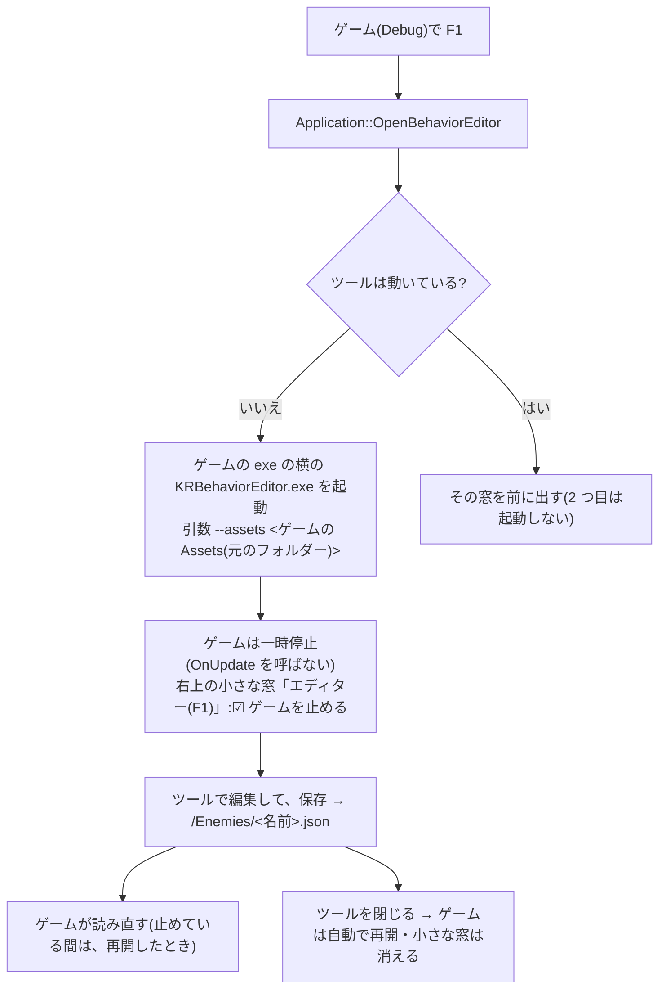
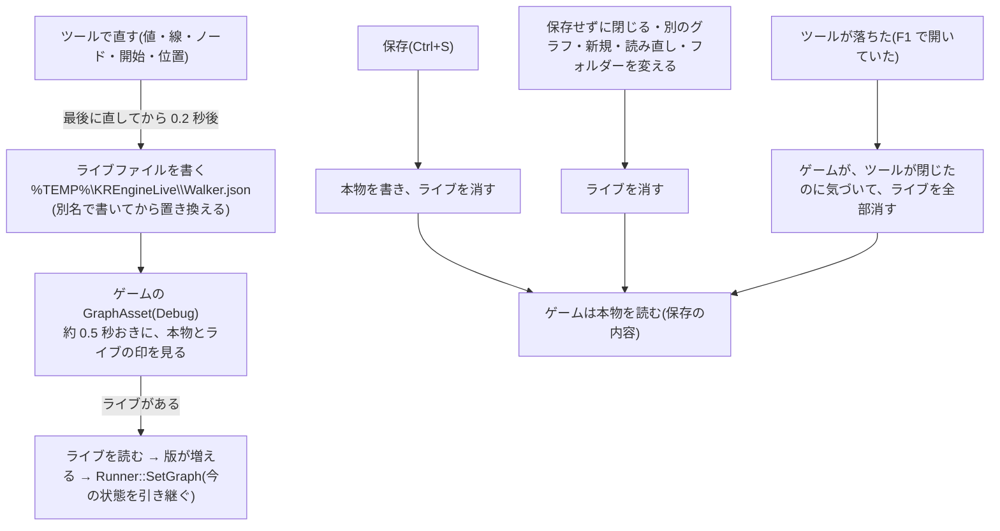
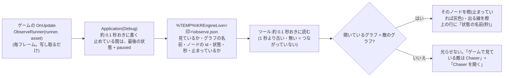

# 敵の行動の調整ツール KRBehaviorEditor

敵の行動のグラフ(`docs/Behavior.md`)を、ノードで作る・直すツール。`tools/BehaviorEditor/`。前例は `KRAnimationEditor`(`docs/AnimationEditor.md`)。
**今は作成中**(ツール本体は、B4-11 まで完成。このあとは、動いている敵のノードを光らせる表示 = B5、サンプル = B6)。

## 今できること(B4-11)
- **アセットのフォルダーを開く**:画面の左上の文字欄に、フォルダー(ゲームの `Assets`)を書いて、Enter。`KR::SetAssetRoot` で、エンジンの読み書きの場所が、そのフォルダーに切り替わる(= `GetAssetDirectory("Enemies")` が、`<フォルダー>/Enemies` を返す)。**`SetAssetRoot` は、ツール用。ゲームは、呼ばない**。
  - 起動時のフォルダー:引数 `--assets <フォルダー>` があれば、それ。無ければ、ビルドで決まっているゲームのアセットのフォルダー。
  - フォルダーが無いときは、断って、理由を画面に出す(今の状態のまま)。`Enemies/` が、まだ無いのは、よい(保存したときに、作られる = B4-9)。
- **一覧**:`<フォルダー>/Enemies/*.json`(直下だけ)を、名前順に、`.json` を除いた名前で出す。「一覧を更新」で、読み直す。
- **選んで開く**:一覧の名前を押すと、そのグラフが開く(`LoadGraphFile`)。**読めないファイル(壊れている・版が違う・未知の種類)は、今のグラフのまま、「読み込めません(壊れています)」と出す**(落ちない。理由は、ログにも出る)。開いたグラフの名前は、左下に出る。
- **保存・新規・読み直し(B4-9)**:左の「このグラフ」の区画。
  - **保存**:名前の文字欄(`.json` は、不要)+「保存」ボタン(Enter・Ctrl+S でも)。`<フォルダー>/Enemies/<名前>.json` に、書く(`SaveGraph`。一時ファイル経由)。`Enemies/` が無ければ、作られる。保存すると、一覧に名前が出て、「保存しました」(緑)と出る。**名前を変えて保存すると、別のファイル**になる(元のファイルは、そのまま)。
  - **名前の決まり**:空・前後の空白や「.」・`\ / : * ? " < > |`・制御文字は、使えない(`IsValidGraphName`)。**なぜ**:`..` や `/` を許すと、`Enemies/` の外に書けてしまう。ゲームのアセットの中の、意図しない場所を、壊さないため。
  - **上書きの確認**:今開いている名前と**違う**名前で、同じ名前のファイルが既にあるときは、「上書きしますか?」の窓が出る(開いているファイルを、そのまま保存するときは、出さない = いつもの上書き保存)。**選ばなかった案**:いつも確認する(保存のたびに、窓が出て、うっとうしい)。
  - **新規**:待機 1 つの、まっさらなグラフ(`MakeDefaultGraph`)。名前は、まだ無い(保存のとき、付ける)。見本のグラフ(`MakeStarterGraph`)は、起動時だけ。
  - **読み直し**:今の名前のファイルを、読み直す(今のグラフの変更は、捨てられる)。まだ保存していないグラフは、読み直せない(理由を出す)。
  - 確認:日本語の名前のフォルダー(`Enemies/` が、まだ無い)で、名前 `a/b` の保存は断られ(理由が出る)、`TestEnemy` で保存すると、`Enemies/TestEnemy.json` ができた(フォルダーも作られた)。新規 → 待機 1 つ(警告 1 件「行き止まり」)。一覧の `TestEnemy` を選ぶと、保存した内容に戻った。リポジトリの中には、何も増えなかった(`git status`)。
- **保存していない変更の確認(B4-10)**:グラフを編集すると(ノードを動かす・値を変える・線やノードを足す / 消す)、左下に「● 保存していない変更があります」(橙)が出る。保存・開く・新規・読み直しで、消える。
  - **フォルダーを変える・別のグラフを開く・新規・読み直し**を、変更があるときにすると、確認の窓が出る:「**保存して続ける**」(名前のないグラフは、名前の文字欄の名前で保存。名前が使えなければ、続けずに、理由を出す)/「**捨てて続ける**」/「**やめる**」(何も変えない)。
  - フォルダーを変えると、**新規(待機 1 つ)の状態になる**(前のフォルダーのグラフを、持ち越して、間違えて、別のフォルダーに保存しない)。
  - **窓の閉じるボタン(×)では、確認が出ない**(エンジンの `Application` に、閉じる前の確認の仕組みがない)。**既知の制限**。閉じる前に、保存すること。選ばなかった案:エンジンに、閉じる前のフックを足す(エンジンの `Application` を変える大きさになるため、今回は見送り)。
- **設定の記憶**:exe の隣の `KRBehaviorEditor.txt`(1 行 1 項目・UTF-8。`assets=<フォルダー>`・`graph=<名前>`)。フォルダーを開く・グラフを開く・保存・新規のたびに書く。次の起動で、同じフォルダーと、同じグラフが開く。書けなくても、ツールは使える。
- **引数**:`--assets <フォルダー>`・`--graph <名前>`(`Walker` でも `Walker.json` でも)。優先順位:引数 → 前回の設定 → ビルドで決まっているゲームのアセットのフォルダー。`--assets` だけを渡したときは、前回のグラフ(別のフォルダーのもの)は、開かない。
- 確認:`--assets <日本語のフォルダー> --graph TestEnemy` で起動 → そのグラフが開く / 右クリックでノードを足す → 「● 保存していない変更があります」/ 「新規」→ 確認の窓 / 「やめる」→ グラフも印もそのまま / 「保存して続ける」→ 保存されて、新規になる(一覧から開くと、足したノードが残っている)/ 引数なしで起動 → 前回のフォルダーと `TestEnemy` が、自動で開く。
- **「参照...」と「最近...」(B4-11)**:アセットのフォルダーの文字欄の下の 2 つのボタン(`KRAnimationEditor` と同じ操作)。
  - 「参照...」:Windows の「フォルダーの選択」窓(`PickFolder`)。最初に開く場所は、今のアセットのフォルダー。キャンセルしても、何も変わらない。
  - 「最近...」:最近使ったフォルダーの一覧(新しい順に、8 件まで。設定ファイルに `recent=` で記憶)。選ぶと、そのフォルダーに切り替わる。
  - どちらも、文字欄の Enter と同じ道(`RequestAction` → 未保存の確認 → `ApplyFolder`)を通る。
- **`FolderDialog` の共有(B4-11)**:`tools/AnimationEditor/` にあった `FolderDialog` を、`tools/Common/` に移して、静的ライブラリ `KRToolCommon` にした(`ole32` / `shell32` / `uuid` も、ここで持つ)。`KRAnimationEditor` と `KRBehaviorEditor` が、リンクして使う。**なぜ**:同じファイルを、2 つのツールに、コピーすると、片方だけ直し忘れる。**選ばなかった案**:`FolderDialog` を、エンジン本体(`src/`)に入れる(エンジンが、Windows の画面に依存しない、という決まりに反する)/ ソースファイルを、2 つのツールの `CMakeLists.txt` に、直接書く(同じコンパイルが、2 回走る・設定が、2 か所になる)。移したのは、エディター強化担当の merge(版 0.3.0)のあと(`main` を取り込んでから)。`tools/AnimationEditor/` の変更は、`CMakeLists.txt` の 2 行(ソース一覧とリンク先)だけ。
- 見本のグラフ(`MakeStarterGraph()`:待機 → [半径 3] → 移動 → [半径 1] → 攻撃 → [攻撃が終わった] → 待機)が、起動時に出る。
- グラフの操作は、`GraphEditor`(部品)のとおり(`docs/Behavior.md` の 9)。上に、検証の警告の一覧が出る。
- 窓のタイトルに、エンジンの版が出る(`KR Behavior Editor (KR Engine 0.2.1)`)。

## 日本語を含むフォルダー
- ImGui の文字欄は UTF-8。`path` との行き来は、`ToUtf8` / `FromUtf8`(`u8string()` / `char8_t`)で行う(`path(const char*)` は、日本語 Windows で、CP932 として読まれて、例外になる)。
- 確認:`日本語のフォルダー\ゲームの Assets\Enemies\` に、日本語の名前のファイル(`歩く敵.json`・`壊れた.json`)と、英語の名前のファイルを置いて、`--assets` で開く → 3 つとも、一覧に出た。正常なファイルは開き、壊れたファイルは、理由が出て、今のグラフのままだった。

## つくり
- 窓の中身は、`GraphEditor`(エンジンの中。imgui-node-editor を使う)に、任せる。ツールは、`KREngine` にリンクするだけ(imnodes の型は見えない)。
- 画面いっぱいの 1 枚の窓(タイトルバー・移動・大きさ変更なし)。左 = フォルダー・一覧(幅 280)/ 右 = 警告 + グラフ。
- ビルド:`KR_BUILD_TOOLS` が ON のとき(エンジン単体のビルドでは、既定で ON)。Visual Studio の既定のスタートアップは、変えていない(`KRAnimationEditor` のまま)。

## まだ、ないこと

- 元に戻す・コピー(ズームは、ホイールでできる = imgui-node-editor。`docs/Behavior.md` の 15 節)

## 最初の 1 回(使い方)
1. ビルド:`cmake --preset vs2026` → `cmake --build build --config Debug`(`KRBehaviorEditor` は、一緒にビルドされる)。実行ファイルは、`build/tools/BehaviorEditor/Debug/KRBehaviorEditor.exe`。
2. 起動:`KRBehaviorEditor.exe --assets "<ゲームの Assets フォルダー>"`(「参照...」でも選べる。2 回目からは、前回のフォルダーとグラフが、自動で開く)。
3. グラフを作る(右クリックでノードを足す・遷移の行ごとのピンからピンへドラッグ(かつ / または でネスト)・ホイールでズーム・値を直す・「ここから始める」)。上の「警告」を、見る。
4. 名前を書いて「保存」→ `<Assets>/Enemies/<名前>.json`。ゲームでの使い方は、[Usage.md](Usage.md) の 8。サンプル `KRBehavior` が、動く見本(`samples/Assets/Enemies/Walker.json`)。
- ゲームが動いている間に保存すると、約 0.5 秒で、反映される(ゲームが `GraphAsset` を使っているとき)。

## ゲームから F1 で開く(2026-10-14)

Debug のゲームを動かしている途中で **F1** を押すと、このツールが開く。ツールで保存すると、ゲームが読み直す(`GraphAsset::ReloadIfChanged` を使っているゲーム。Action2D は対応済み)。

### 流れ



### 使うには(ゲーム側)
- ゲームの CMake で、エンジンを取り込む**前**に、`set(KR_BUILD_TOOLS ON CACHE BOOL "" FORCE)` を書く(ゲームの一部としてビルドするとき、ツールは既定で OFF のため)。
- すると、ゲームをビルドするとツールもビルドされ、**Debug のときだけ**、ゲームの exe の横に `KRBehaviorEditor.exe` がコピーされる(`kr_copy_runtime_files`)。
- ゲームのコードは、何も書かなくてよい。OFF のまま F1 を押すと、警告のログ(「ツールがありません」)だけ。

### どこに何を置いたか

| 処理 | 置いた場所 | なぜそこか |
|---|---|---|
| ツールの起動・前に出す・動いているか | [EditorLauncher](../src/Core/EditorLauncher.cpp)(非公開) | Windows のプロセスの扱い(`CreateProcessW`・`WaitForSingleObject`・`EnumWindows`)を、1 か所に集める。ほかのツール(KRAnimationEditor)も、同じ係で開ける |
| F1・一時停止・小さな窓 | [Application](../src/Core/Application.cpp)(`OnKeyDown`・`Run`・`DrawEditorPanel`) | メインループを持つのは Application。ゲームのコードを直さずに、どのゲームでも使える |
| ツールを exe の横にコピー・一緒にビルド | `CMakeLists.txt` の `kr_copy_runtime_files` | ゲームの exe ごとに、もう呼ばれている関数。Debug だけコピー(Release は `cmake -E true` = 何もしない) |
| ツール自身では F1 を使わない | `ApplicationDesc::enableEditorKey`(ツールの 2 つは `false`) | ツールも Application なので、F1 で自分を開いてしまうのを防ぐ |

### 決めたこと・理由・選ばなかった案

| 決めたこと | 理由 | 選ばなかった案 |
|---|---|---|
| **別のツール(exe)を開く**(Ryusei の判断) | 今のツールがそのまま使える。ツールが落ちても、ゲームは落ちない | **ゲームの中に、エディターを重ねる**(動いている敵を選んで、その場で直せるが、ツールをゲームに入れられる部品に分け直す作業が多い)・両方 |
| キーは **F1**(Ryusei の判断。エンジンが決める) | 今、何にも使っていない | Tab・F3 と同じ・ゲームが決める |
| **止める / 動かすを切り替えられる**(Ryusei の判断)。開くたびに、まず止める | 直してから再開して確かめるのが基本。動きを見ながら直したいときは、☑ を外す | いつも止める・いつも動かしたまま |
| 止めるのは「**`OnUpdate` を呼ばない**」 | ゲームのコードを直さずに、移動・タイマー・敵の行動が全部止まる。描画・ImGui・音は続く | `deltaTime` を 0 にする(押した瞬間の処理 = ジャンプなどは止まらない)・ゲームに「止まっているか」を聞かせて、ゲームが止める(ゲームごとに書く必要がある) |
| **Debug だけ**(Ryusei の判断) | 配るゲームに、編集の機能・ツールの exe を残さない。Release は exe の横のコピーを読むので、編集しても元のファイルに届かない | Release でも使える |
| ツールの場所は「**ゲームの exe の横**」(ビルドでコピー) | ツールが要る DLL・Shaders は、もうゲームの横にある。場所を CMake から埋め込まずに済み、日本語のフォルダーでも安全(`GetModuleFileNameW`) | ビルドしたツールの場所を、CMake から埋め込む(設定ごとに場所が違い、文字列の受け渡しが複雑)・`dist\`(Publish-Tools.ps1)の場所を設定で指す |
| ゲームでツールを使うかは、ゲームの CMake が決める(`KR_BUILD_TOOLS`) | ツールのビルドの分、ビルドが長くなる。エンジンの既定は変えない | ゲームの一部でも、ツールを既定で ON にする |
| ゲームを閉じても、ツールは閉じない | 保存していない編集が、消えないように | ゲームと一緒に閉じる |

### 確認したこと(2026-10-14。サンプル KRMinimal。押したキーをログに出すので、止まっているかが分かる)
- F1 の前の A → ログに出た。F1 → `KRBehaviorEditor` が 1 つ起動(窓のタイトル「KR Behavior Editor (KR Engine 0.9.0)」)。ツールのログに、渡したフォルダー `samples\Assets`(グラフ 1 個)
- 止めている間の S → ログに**出ない**(`OnUpdate` が止まっている)
- もう一度 F1 → ツールは 1 つのまま
- ツールを閉じる → 「ツールが閉じられました」。そのあとの D → ログに出た(再開)
- ツールの exe が無い → 警告のログだけで、ゲームは止まらず動き続けた
- ツールを開いたまま、ゲームを閉じる → ゲームは正常に終了(解放漏れなし)。ツールは開いたまま
- Release のビルド:サンプルの exe の横に、ツールは**コピーされない**
- **手で確かめること**:右上の小さな窓の「ゲームを止める」の ☑ を外すと、ゲームが動くこと(ImGui の窓の操作は、自動では確かめられなかった = [Input.md](Input.md) と同じ理由)

### 既知の制限
- 開くのは、敵の行動のツールだけ(KRAnimationEditor は、同じ係 `EditorLauncher` で、あとから足せる)
- どのグラフを開くかは、ゲームから指定できない(ツールの一覧から選ぶ・前回のグラフ)。ツールは `--graph <名前>` を受け取れるので、ゲームから名前を渡す関数を、あとで足せる
- 止めている間は、保存しても、再開するまで反映されない(読み直しは、ゲームの `OnUpdate` の中のため)
- F1 を押したフレームは、ゲームの `OnUpdate` が呼ばれないので、ゲームは F1 の「押した」を受け取らない(ツールが無いときは、受け取る)

## リアルタイムに編集する(2026-10-14。Action2D からの依頼)

ゲームを動かしたまま、ツールで直すと、**保存しなくても**、約 0.2〜0.7 秒で、動いている敵に反映する。本物のファイル(`Assets/Enemies/<名前>.json`)は、今までどおり、**保存(Ctrl+S)したときだけ**書き換わる。依頼書は、Action2D の `docs/EngineRequest_LiveEdit.md`。

### 流れ



### ゲーム側で使うには
- ゲームのコードは、**何も書かなくてよい**(`GraphAsset` を使っていれば、自動でライブも見る)。
- F1 で開いたとき、ゲームを動かしたままにしたいなら:`KR::ApplicationDesc{ ..., .pauseGameWhileEditing = false }`(既定 true = 今までどおり止める)。右上の小さな窓の ☑ で、今までどおり切り替えられる(開くたびに、この初期値に戻る)。
- 止めている間は、ゲームの `OnUpdate` が呼ばれないので、ライブも、再開するまで反映されない。

### どこに何を置いたか

| 処理 | 置いた場所 | なぜそこか |
|---|---|---|
| ライブファイルの場所の計算・書く・消す | [LiveGraph.h](../include/KR/Behavior/LiveGraph.h) / [.cpp](../src/Behavior/LiveGraph.cpp)(公開。ツールとエンジン用) | ツールは公開ヘッダーしか見えない。ツールとゲームが、**同じ計算**で同じ場所を出せるよう、1 か所にまとめた |
| ライブも見る | [GraphAsset.cpp](../src/Behavior/GraphAsset.cpp)(Debug だけ) | 今の「印を見て読み直す」を、そのまま 2 つに広げた。ゲームのコードが変わらない |
| 直したら書く・消す | [ツール EditorApp.cpp](../tools/BehaviorEditor/EditorApp.cpp)(`OnUpdate`・`DeleteCurrentLiveFile`・`DeleteLiveFiles`) | 直したこと(`GraphEditor::Draw` が true)を知っているのは、ツール |
| ツールが閉じたら消す・止める初期値 | [Application.cpp](../src/Core/Application.cpp)(`Run`・`OpenBehaviorEditor`) | F1 のツールの見張り(`EditorLauncher`)が、もうここにある |

### 決めたこと・理由・選ばなかった案

| 決めたこと | 理由 | 選ばなかった案 |
|---|---|---|
| **一時ファイル(ライブファイル)で渡す**(Ryusei の判断) | 今のファイルを見る仕組み(約 0.5 秒おき)を、ほぼそのまま使える。簡単で、中身が見える(ファイルを開けば、送った物が分かる) | **名前付きパイプ**(遅れはほぼ無いが、ゲームに非同期の受け取りが要り、仕組みが複雑。ゲーム側にも受け取りのコードが要る)・共有メモリ |
| **置き場所は Windows の一時フォルダー**(Ryusei の判断) | ゲームの Assets に何も出ないので、Git の無視リストへの追加が要らない(ゲーム側で必要な変更が無い) | 本物の横(`Assets/Enemies/.live/`。見つけやすいが、ゲームの `.gitignore` に 1 行要る) |
| 一時フォルダーの下は「**Enemies フォルダーの印**」ごとに分ける(場所を正規化・小文字にして、FNV-1a の 64 ビットの 16 進) | ツールとゲームが、同じフォルダーから同じ場所を出せる。別のゲーム・別の worktree のライブと混ざらない。ゲームとツールの間で、場所を受け渡さなくてよい | ゲームの名前で分ける(同じゲームの別の作業フォルダーと混ざる)・場所を引数で渡す(ツールを単独で開いたときに、困る) |
| **最後に直してから 0.2 秒後に書く**(続けて直したら、待ちをやり直す) | ノードをドラッグしている間、毎フレーム書かないように | 直すたびに、すぐ書く(書く回数が多い)・保存のボタンを別に作る(依頼は「直した瞬間に反映」) |
| **名前の付いたグラフだけ**送る | ゲームは、名前(ファイル名)でグラフを読む。名前の無いグラフは、ゲームに関係が無い | — |
| **保存・閉じる・別のグラフ・新規・読み直し・フォルダーの変更で、ライブを消す**。ツールの起動時も消す。F1 で開いたツールが閉じたら、ゲームも消す | 試しの変更を、ゲームに残さない(依頼の条件)。ツールが落ちても、残りが片付く | ゲームが「ツールが動いているか」で、ライブを使うかを決める(ツールを単独で開いたときに、使えない) |
| **Debug だけ** | Release は exe の横のコピーを読む(編集の対象ではない)。配るゲームが、一時フォルダーを見ない | Release でも見る |
| **止める初期値は `ApplicationDesc::pauseGameWhileEditing`**(Action2D の判断 = ゲームの起動時の設定) | ゲームごとに決まった初期値のほうが、分かりやすい。既定 true で、今までのゲームの動きは変わらない | 前に選んだ状態を覚えておく |
| 遅れは**最大で約 0.7 秒**(ツールの待ち 0.2 + ゲームの見る間隔 0.5) | 依頼の「0.5 秒くらいまで」に近い。もっと縮めたいゲームは、`GraphAsset::SetCheckInterval` で、見る間隔を短くできる | ゲームの見る間隔を、既定で短くする(グラフの数だけ、ファイルの時刻を読む回数が増える) |

### 確認したこと(2026-10-14)
- **サンプル KRBehavior**(エンジン単体):ゲームを動かしたまま、ライブの場所に値を変えたグラフを置く → 「ツールで編集中のグラフ(ライブファイル)を読み直しました(版 2)」/ 壊れたライブ → 「前のグラフのまま」(落ちない)/ 直す → 版 3 / ライブを消す → 「ライブファイルが消えたので、保存の内容に戻す」(版 4)/ F1 でツールを開き、ライブを置いて、ツールを強制終了(落ちた代わり)→ ゲームがライブを消した
- **ツール**:古いライブを置いてから起動 → 起動時に消えた / ライブを置いて、ふつうに閉じる → 消えた
- **`pauseGameWhileEditing = false`**:KRMinimal を一時的に false にして、F1 のあとに押したキーが、ゲームに届いた(止まらない)→ 元に戻した
- **日本語のフォルダー(Action2D)**:ゲームのリポジトリは変えずに、作業用の一時フォルダーで、手元のエンジン(`KR_ENGINE_PATH`)を使って Action2D をビルド(ゲームの /W4 で、**警告なし** = C4456 も直った)。上の KRBehavior と同じ確認が、`C:\SchoolProgram\Game\2Dアクションゲーム\Assets\Enemies` で、全部通った。F1 のツールは `2Dアクションゲーム\Assets`(グラフ 3 個)を開いた
- **手で確かめること**:ツールでノードの値を変えたときに、ツールのログ「ライブファイルを書きました」が出て、動いている敵が変わること(ImGui の操作は、自動で送れない)

### 既知の制限
- 名前の無い(一度も保存していない)グラフは、ゲームに送らない
- ツールが落ちて、ゲームも F1 で開いていなかった場合は、ライブが残る(次にツールを起動したときに消える)
- 止めている間は、再開するまで反映されない

## 動いている敵の今の状態を光らせる(2026-10-14。Action2D からの依頼)

ゲームを動かしながら、F1 のツールの**グラフの上で**、ゲームが見せている敵 1 体の「今の状態」のノードを光らせる(リアルタイムの観測)。リアルタイム編集(ツール → ゲーム)の逆向き(**ゲーム → ツール**)。依頼書は、Action2D の `docs/EngineRequest_LiveObserve.md`。

### 呼び方(ゲーム)

見てほしい敵を 1 体、**毎フレーム**、`OnUpdate` の中で(`Runner::Update` の後に)知らせる。

```cpp
#include <KR/KR.h>   // KR/Behavior/Observe.h が入っている

void OnUpdate(float deltaTime) override
{
    // … 敵ごとに runner.Update(deltaTime, context) …
    if (Enemy* selected = GetSelectedEnemy())   // 例:F3 の窓で選んでいる敵
    {
        KR::Behavior::ObserveRunner(selected->runner, selected->asset);   // asset = その敵の GraphAsset(グラフの名前を知るため)
    }
}
```
- 呼ばなかったフレームは「見ている敵なし」。**敵が倒されて消えたら、呼ぶのをやめるだけ**(エンジンは、その場で状態を写し取るだけで、敵を持たない)。
- Release では何もしない(`#ifdef` を書かなくてよい)。一度も呼ばないゲーム(すれすれ飛行など)は、観測ファイルも書かない。
- ツールは、F1 で開いても、単独で開いても(`--assets` で同じフォルダー)、同じように光る。

### 流れ



### ツールの上の行の表示
| 表示 | 意味 |
|---|---|
| ゲームの敵:巡回(1.3 秒) | 開いているグラフの、そのノードが橙に光っている |
| …(灰色)— ゲームは止まっています | F1 の「ゲームを止める」中。最後の状態を灰色で光らせる |
| …(このノードは、今のグラフにありません) | 直している途中で、そのノードを消した。光らせない |
| ゲームで見ている敵は Chaser [Chaser を開く] | 違うグラフ。ボタンで開く(保存していない変更があれば、確認の窓) |
| ゲーム:見ている敵なし | ゲームが、このフレームに `ObserveRunner` を呼んでいない |
| ゲーム:つながっていません | 観測ファイルが無い・約 1 秒より古い(ゲームが閉じた・落ちた・まだ呼んでいない) |

### どこに何を置いたか

| 処理 | 置いた場所 | なぜそこか |
|---|---|---|
| ゲームが呼ぶ `ObserveRunner`・ツールが読む `ReadObservation`(型 `Observation`) | [Observe.h](../include/KR/Behavior/Observe.h) / [.cpp](../src/Behavior/Observe.cpp)(公開) | ゲームもツールも、公開ヘッダーしか見えない。ファイルの形(JSON)は、エンジンの中に閉じ込める(ツールは nlohmann を使えない) |
| 書き出し(0.1 秒おき・止まっている・終了で消す) | [ObserveState.h](../src/Behavior/ObserveState.h)(非公開)を [Application](../src/Core/Application.cpp) が呼ぶ | 書く時期と「止まっているか」を知っているのはメインループ。InputState と同じ「書き込み口」の形 |
| 光らせる | [GraphEditor](../src/Behavior/GraphEditor.cpp) の `SetObservedNode` | ノードと線の色を決めているのは GraphEditor。ツールは、どのノードかを渡すだけ |
| 読む・上の行・開くボタン | [ツール EditorApp.cpp](../tools/BehaviorEditor/EditorApp.cpp)(`UpdateObservation`・`DrawObservationLine`) | 開いているグラフを知っているのはツール |
| 見本 | [サンプル KRBehavior](../samples/Behavior/BehaviorApp.cpp) の 1 行 | 使い方の見本 |

### 決めたこと・理由・選ばなかった案

| 決めたこと | 理由 | 選ばなかった案 |
|---|---|---|
| **観測ファイルで渡す**(Ryusei の判断) | リアルタイム編集と同じ「ファイル」の仕組みで、わかりやすい。ファイルを開けば、何を送っているかが見える。遅れは最大で約 0.2 秒(書く 0.1 + 読む 0.1) | **共有メモリ**(遅れはほぼ無いが、新しい Windows の仕組み = ファイルマッピングと、書いている途中を読まない工夫が要る) |
| **違うグラフは、光らせずに知らせ + 「開く」ボタン**(Ryusei の判断) | 直している途中で、勝手にグラフが変わらない。開くときは、今の確認の窓を通るので、直した物が消えない | **自動で開く**(ゲームで見る敵を変えると、ツールのグラフが切り替わる)・知らせだけ |
| **毎フレーム `ObserveRunner` を呼ぶ**(Ryusei の判断)。エンジンは、その場で写し取る | 敵が消えても、呼ぶのをやめるだけで安全(消えた敵を指したまま、の事故が起きない) | **選び直したときだけ `SetObservedRunner(&runner)` / `nullptr`**(敵が消える前に nullptr を忘れると、落ちる) |
| **止まっている = 灰色で光らせたまま / 閉じた = 光を消す**(Ryusei の判断) | 止めて直しているときも、どこにいたかが分かる。閉じたのに光っていると、まだ動いているように見える | どちらも光を消す |
| 「つながっている」は、**ファイルの更新時刻が約 1 秒以内** | ゲームは、変わらなくても 0.1 秒おきに書く(生きている印)。ゲームが落ちても、ツールが気づける | ゲームのプロセスを、ツールが探す(ツールを単独で開いたときにも使えるよう、ファイルだけで決める) |
| **一度も呼ばないゲームは書かない** | すれすれ飛行など、使わないゲームが、一時フォルダーに 1 秒 10 回、無駄に書かないように | いつも書く |
| グラフの名前は、`GraphAsset` のファイル名(拡張子なし)。大文字・小文字は区別しない | ツールは、グラフをファイル名で開いている。Windows のファイル名は、大文字・小文字を区別しない | `Graph` に名前を持たせる(ファイルの形が変わる) |
| 状態の名前は、ツールが種類から表示名にする(`FindNodeType`) | ゲームは種類(`Patrol`)だけ送ればよい。表示名は、ツールの言葉 | ゲームが表示名を送る |

### 確認したこと(2026-10-14)
- **サンプル KRBehavior**:観測ファイルの中身が、Patrol → MoveToPlayer → Attack と変わり、秒が増えていく / F1(止める)→ `paused: true`・秒が止まる / ツールを閉じる → また動く / ゲームを閉じる → ファイルが消える
- **ツール**(単独で開く・ゲームは動いたまま):ログが「ゲームの敵:Walker の Patrol → MoveToPlayer → Attack」と、状態が変わるたびに出た / ゲームを閉じる → 約 1 秒で「つながっていません」/ 違うグラフ(Chaser)の観測ファイルを手で置く → 読めた / F1 で開く → 「Patrol・ゲームは止まっています」
- **日本語のフォルダー(Action2D)**:ゲームのリポジトリは変えずに、作業用のフォルダーで、手元のエンジンでビルド(/W4 で警告なし)。Action2D は、まだ `ObserveRunner` を呼ばない → **観測ファイルを書かない**ことを確認。F1 のツール(`2Dアクションゲーム\Assets`)が、手で置いた観測ファイル(Walker・止まっている Chaser)を読み、消すと「つながっていません」
- ビルド:Debug・Release とも、エラー・警告なし
- **手で確かめること**:ツールの画面で、ノードが橙に光る・線が橙になる・止めると灰色・違うグラフで「開く」ボタン(画面は、自動では見られない)

### 既知の制限
- 見られる敵は 1 体だけ(依頼のとおり)
- 止めている間は、ゲームの `OnUpdate` が呼ばれないので、敵を選び直せない(最後の敵のまま)
