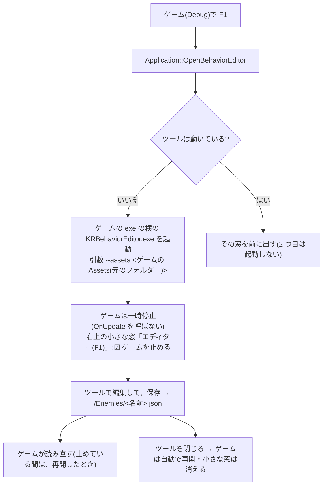

# 敵の行動の調整ツール KRBehaviorEditor

敵の行動のグラフ(`docs/Behavior.md`)を、ノードで作る・直すツール。`tools/BehaviorEditor/`。前例は `KRAnimationEditor`(`docs/AnimationEditor.md`)。
**今は作成中**(ツール本体は、B4-11 まで完成。このあとは、動いている敵のノードを光らせる表示 = B5、サンプル = B6)。

## 今できること(B4-11)
- **アセットのフォルダーを開く**:画面の左上の文字欄に、フォルダー(ゲームの `Assets`)を書いて、Enter。`KR::SetAssetRoot` で、エンジンの読み書きの場所が、そのフォルダーに切り替わる(= `GetAssetDirectory("Enemies")` が、`<フォルダー>/Enemies` を返す)。**`SetAssetRoot` は、ツール用。ゲームは、呼ばない**。
  - 起動時のフォルダー:引数 `--assets <フォルダー>` があれば、それ。無ければ、ビルドで決まっているゲームのアセットのフォルダー。
  - フォルダーが無いときは、断って、理由を画面に出す(今の状態のまま)。`Enemies/` が、まだ無いのは、よい(保存したときに、作られる = B4-9)。
- **一覧**:`<フォルダー>/Enemies/*.json`(直下だけ)を、名前順に、`.json` を除いた名前で出す。「一覧を更新」で、読み直す。
- **選んで開く**:一覧の名前を押すと、そのグラフが開く(`LoadGraphFile`)。**読めないファイル(壊れている・版が違う・未知の種類)は、今のグラフのまま、「読み込めません(壊れています)」と出す**(落ちない。理由は、ログにも出る)。開いたグラフの名前は、左下に出る。
- **保存・新規・読み直し(B4-9)**:左の「このグラフ」の区画。
  - **保存**:名前の文字欄(`.json` は、不要)+「保存」ボタン(Enter・Ctrl+S でも)。`<フォルダー>/Enemies/<名前>.json` に、書く(`SaveGraph`。一時ファイル経由)。`Enemies/` が無ければ、作られる。保存すると、一覧に名前が出て、「保存しました」(緑)と出る。**名前を変えて保存すると、別のファイル**になる(元のファイルは、そのまま)。
  - **名前の決まり**:空・前後の空白や「.」・`\ / : * ? " < > |`・制御文字は、使えない(`IsValidGraphName`)。**なぜ**:`..` や `/` を許すと、`Enemies/` の外に書けてしまう。ゲームのアセットの中の、意図しない場所を、壊さないため。
  - **上書きの確認**:今開いている名前と**違う**名前で、同じ名前のファイルが既にあるときは、「上書きしますか?」の窓が出る(開いているファイルを、そのまま保存するときは、出さない = いつもの上書き保存)。**選ばなかった案**:いつも確認する(保存のたびに、窓が出て、うっとうしい)。
  - **新規**:待機 1 つの、まっさらなグラフ(`MakeDefaultGraph`)。名前は、まだ無い(保存のとき、付ける)。見本のグラフ(`MakeStarterGraph`)は、起動時だけ。
  - **読み直し**:今の名前のファイルを、読み直す(今のグラフの変更は、捨てられる)。まだ保存していないグラフは、読み直せない(理由を出す)。
  - 確認:日本語の名前のフォルダー(`Enemies/` が、まだ無い)で、名前 `a/b` の保存は断られ(理由が出る)、`TestEnemy` で保存すると、`Enemies/TestEnemy.json` ができた(フォルダーも作られた)。新規 → 待機 1 つ(警告 1 件「行き止まり」)。一覧の `TestEnemy` を選ぶと、保存した内容に戻った。リポジトリの中には、何も増えなかった(`git status`)。
- **保存していない変更の確認(B4-10)**:グラフを編集すると(ノードを動かす・値を変える・線やノードを足す / 消す)、左下に「● 保存していない変更があります」(橙)が出る。保存・開く・新規・読み直しで、消える。
  - **フォルダーを変える・別のグラフを開く・新規・読み直し**を、変更があるときにすると、確認の窓が出る:「**保存して続ける**」(名前のないグラフは、名前の文字欄の名前で保存。名前が使えなければ、続けずに、理由を出す)/「**捨てて続ける**」/「**やめる**」(何も変えない)。
  - フォルダーを変えると、**新規(待機 1 つ)の状態になる**(前のフォルダーのグラフを、持ち越して、間違えて、別のフォルダーに保存しない)。
  - **窓の閉じるボタン(×)では、確認が出ない**(エンジンの `Application` に、閉じる前の確認の仕組みがない)。**既知の制限**。閉じる前に、保存すること。選ばなかった案:エンジンに、閉じる前のフックを足す(エンジンの `Application` を変える大きさになるため、今回は見送り)。
- **設定の記憶**:exe の隣の `KRBehaviorEditor.txt`(1 行 1 項目・UTF-8。`assets=<フォルダー>`・`graph=<名前>`)。フォルダーを開く・グラフを開く・保存・新規のたびに書く。次の起動で、同じフォルダーと、同じグラフが開く。書けなくても、ツールは使える。
- **引数**:`--assets <フォルダー>`・`--graph <名前>`(`Walker` でも `Walker.json` でも)。優先順位:引数 → 前回の設定 → ビルドで決まっているゲームのアセットのフォルダー。`--assets` だけを渡したときは、前回のグラフ(別のフォルダーのもの)は、開かない。
- 確認:`--assets <日本語のフォルダー> --graph TestEnemy` で起動 → そのグラフが開く / 右クリックでノードを足す → 「● 保存していない変更があります」/ 「新規」→ 確認の窓 / 「やめる」→ グラフも印もそのまま / 「保存して続ける」→ 保存されて、新規になる(一覧から開くと、足したノードが残っている)/ 引数なしで起動 → 前回のフォルダーと `TestEnemy` が、自動で開く。
- **「参照...」と「最近...」(B4-11)**:アセットのフォルダーの文字欄の下の 2 つのボタン(`KRAnimationEditor` と同じ操作)。
  - 「参照...」:Windows の「フォルダーの選択」窓(`PickFolder`)。最初に開く場所は、今のアセットのフォルダー。キャンセルしても、何も変わらない。
  - 「最近...」:最近使ったフォルダーの一覧(新しい順に、8 件まで。設定ファイルに `recent=` で記憶)。選ぶと、そのフォルダーに切り替わる。
  - どちらも、文字欄の Enter と同じ道(`RequestAction` → 未保存の確認 → `ApplyFolder`)を通る。
- **`FolderDialog` の共有(B4-11)**:`tools/AnimationEditor/` にあった `FolderDialog` を、`tools/Common/` に移して、静的ライブラリ `KRToolCommon` にした(`ole32` / `shell32` / `uuid` も、ここで持つ)。`KRAnimationEditor` と `KRBehaviorEditor` が、リンクして使う。**なぜ**:同じファイルを、2 つのツールに、コピーすると、片方だけ直し忘れる。**選ばなかった案**:`FolderDialog` を、エンジン本体(`src/`)に入れる(エンジンが、Windows の画面に依存しない、という決まりに反する)/ ソースファイルを、2 つのツールの `CMakeLists.txt` に、直接書く(同じコンパイルが、2 回走る・設定が、2 か所になる)。移したのは、エディター強化担当の merge(版 0.3.0)のあと(`main` を取り込んでから)。`tools/AnimationEditor/` の変更は、`CMakeLists.txt` の 2 行(ソース一覧とリンク先)だけ。
- 見本のグラフ(`MakeStarterGraph()`:待機 → [半径 3] → 移動 → [半径 1] → 攻撃 → [攻撃が終わった] → 待機)が、起動時に出る。
- グラフの操作は、`GraphEditor`(部品)のとおり(`docs/Behavior.md` の 9)。上に、検証の警告の一覧が出る。
- 窓のタイトルに、エンジンの版が出る(`KR Behavior Editor (KR Engine 0.2.1)`)。

## 日本語を含むフォルダー
- ImGui の文字欄は UTF-8。`path` との行き来は、`ToUtf8` / `FromUtf8`(`u8string()` / `char8_t`)で行う(`path(const char*)` は、日本語 Windows で、CP932 として読まれて、例外になる)。
- 確認:`日本語のフォルダー\ゲームの Assets\Enemies\` に、日本語の名前のファイル(`歩く敵.json`・`壊れた.json`)と、英語の名前のファイルを置いて、`--assets` で開く → 3 つとも、一覧に出た。正常なファイルは開き、壊れたファイルは、理由が出て、今のグラフのままだった。

## つくり
- 窓の中身は、`GraphEditor`(エンジンの中。imnodes を使う)に、任せる。ツールは、`KREngine` にリンクするだけ(imnodes の型は見えない)。
- 画面いっぱいの 1 枚の窓(タイトルバー・移動・大きさ変更なし)。左 = フォルダー・一覧(幅 280)/ 右 = 警告 + グラフ。
- ビルド:`KR_BUILD_TOOLS` が ON のとき(エンジン単体のビルドでは、既定で ON)。Visual Studio の既定のスタートアップは、変えていない(`KRAnimationEditor` のまま)。

## まだ、ないこと

- 元に戻す・コピー・ズーム(imnodes に、ズームの機能がない = `docs/Behavior.md` の相性の記録)

## 最初の 1 回(使い方)
1. ビルド:`cmake --preset vs2026` → `cmake --build build --config Debug`(`KRBehaviorEditor` は、一緒にビルドされる)。実行ファイルは、`build/tools/BehaviorEditor/Debug/KRBehaviorEditor.exe`。
2. 起動:`KRBehaviorEditor.exe --assets "<ゲームの Assets フォルダー>"`(「参照...」でも選べる。2 回目からは、前回のフォルダーとグラフが、自動で開く)。
3. グラフを作る(右クリックでノードを足す・ピンからピンへドラッグ・値を直す・「ここから始める」)。上の「警告」を、見る。
4. 名前を書いて「保存」→ `<Assets>/Enemies/<名前>.json`。ゲームでの使い方は、[Usage.md](Usage.md) の 8。サンプル `KRBehavior` が、動く見本(`samples/Assets/Enemies/Walker.json`)。
- ゲームが動いている間に保存すると、約 0.5 秒で、反映される(ゲームが `GraphAsset` を使っているとき)。

## ゲームから F1 で開く(2026-10-14)

Debug のゲームを動かしている途中で **F1** を押すと、このツールが開く。ツールで保存すると、ゲームが読み直す(`GraphAsset::ReloadIfChanged` を使っているゲーム。Action2D は対応済み)。

### 流れ

### 使うには(ゲーム側)
- ゲームの CMake で、エンジンを取り込む**前**に、`set(KR_BUILD_TOOLS ON CACHE BOOL "" FORCE)` を書く(ゲームの一部としてビルドするとき、ツールは既定で OFF のため)。
- すると、ゲームをビルドするとツールもビルドされ、**Debug のときだけ**、ゲームの exe の横に `KRBehaviorEditor.exe` がコピーされる(`kr_copy_runtime_files`)。
- ゲームのコードは、何も書かなくてよい。OFF のまま F1 を押すと、警告のログ(「ツールがありません」)だけ。

### どこに何を置いたか

| 処理 | 置いた場所 | なぜそこか |
|---|---|---|
| ツールの起動・前に出す・動いているか | [EditorLauncher](../src/Core/EditorLauncher.cpp)(非公開) | Windows のプロセスの扱い(`CreateProcessW`・`WaitForSingleObject`・`EnumWindows`)を、1 か所に集める。ほかのツール(KRAnimationEditor)も、同じ係で開ける |
| F1・一時停止・小さな窓 | [Application](../src/Core/Application.cpp)(`OnKeyDown`・`Run`・`DrawEditorPanel`) | メインループを持つのは Application。ゲームのコードを直さずに、どのゲームでも使える |
| ツールを exe の横にコピー・一緒にビルド | `CMakeLists.txt` の `kr_copy_runtime_files` | ゲームの exe ごとに、もう呼ばれている関数。Debug だけコピー(Release は `cmake -E true` = 何もしない) |
| ツール自身では F1 を使わない | `ApplicationDesc::enableEditorKey`(ツールの 2 つは `false`) | ツールも Application なので、F1 で自分を開いてしまうのを防ぐ |

### 決めたこと・理由・選ばなかった案

| 決めたこと | 理由 | 選ばなかった案 |
|---|---|---|
| **別のツール(exe)を開く**(Ryusei の判断) | 今のツールがそのまま使える。ツールが落ちても、ゲームは落ちない | **ゲームの中に、エディターを重ねる**(動いている敵を選んで、その場で直せるが、ツールをゲームに入れられる部品に分け直す作業が多い)・両方 |
| キーは **F1**(Ryusei の判断。エンジンが決める) | 今、何にも使っていない | Tab・F3 と同じ・ゲームが決める |
| **止める / 動かすを切り替えられる**(Ryusei の判断)。開くたびに、まず止める | 直してから再開して確かめるのが基本。動きを見ながら直したいときは、☑ を外す | いつも止める・いつも動かしたまま |
| 止めるのは「**`OnUpdate` を呼ばない**」 | ゲームのコードを直さずに、移動・タイマー・敵の行動が全部止まる。描画・ImGui・音は続く | `deltaTime` を 0 にする(押した瞬間の処理 = ジャンプなどは止まらない)・ゲームに「止まっているか」を聞かせて、ゲームが止める(ゲームごとに書く必要がある) |
| **Debug だけ**(Ryusei の判断) | 配るゲームに、編集の機能・ツールの exe を残さない。Release は exe の横のコピーを読むので、編集しても元のファイルに届かない | Release でも使える |
| ツールの場所は「**ゲームの exe の横**」(ビルドでコピー) | ツールが要る DLL・Shaders は、もうゲームの横にある。場所を CMake から埋め込まずに済み、日本語のフォルダーでも安全(`GetModuleFileNameW`) | ビルドしたツールの場所を、CMake から埋め込む(設定ごとに場所が違い、文字列の受け渡しが複雑)・`dist\`(Publish-Tools.ps1)の場所を設定で指す |
| ゲームでツールを使うかは、ゲームの CMake が決める(`KR_BUILD_TOOLS`) | ツールのビルドの分、ビルドが長くなる。エンジンの既定は変えない | ゲームの一部でも、ツールを既定で ON にする |
| ゲームを閉じても、ツールは閉じない | 保存していない編集が、消えないように | ゲームと一緒に閉じる |

### 確認したこと(2026-10-14。サンプル KRMinimal。押したキーをログに出すので、止まっているかが分かる)
- F1 の前の A → ログに出た。F1 → `KRBehaviorEditor` が 1 つ起動(窓のタイトル「KR Behavior Editor (KR Engine 0.9.0)」)。ツールのログに、渡したフォルダー `samples\Assets`(グラフ 1 個)
- 止めている間の S → ログに**出ない**(`OnUpdate` が止まっている)
- もう一度 F1 → ツールは 1 つのまま
- ツールを閉じる → 「ツールが閉じられました」。そのあとの D → ログに出た(再開)
- ツールの exe が無い → 警告のログだけで、ゲームは止まらず動き続けた
- ツールを開いたまま、ゲームを閉じる → ゲームは正常に終了(解放漏れなし)。ツールは開いたまま
- Release のビルド:サンプルの exe の横に、ツールは**コピーされない**
- **手で確かめること**:右上の小さな窓の「ゲームを止める」の ☑ を外すと、ゲームが動くこと(ImGui の窓の操作は、自動では確かめられなかった = [Input.md](Input.md) と同じ理由)

### 既知の制限
- 開くのは、敵の行動のツールだけ(KRAnimationEditor は、同じ係 `EditorLauncher` で、あとから足せる)
- どのグラフを開くかは、ゲームから指定できない(ツールの一覧から選ぶ・前回のグラフ)。ツールは `--graph <名前>` を受け取れるので、ゲームから名前を渡す関数を、あとで足せる
- 止めている間は、保存しても、再開するまで反映されない(読み直しは、ゲームの `OnUpdate` の中のため)
- F1 を押したフレームは、ゲームの `OnUpdate` が呼ばれないので、ゲームは F1 の「押した」を受け取らない(ツールが無いときは、受け取る)
