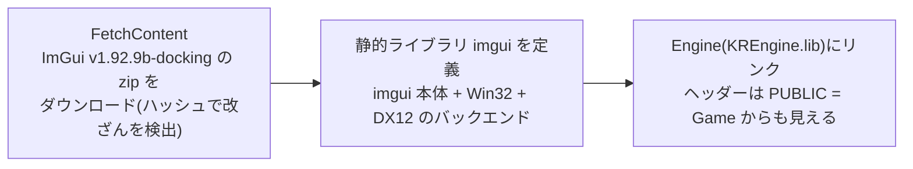
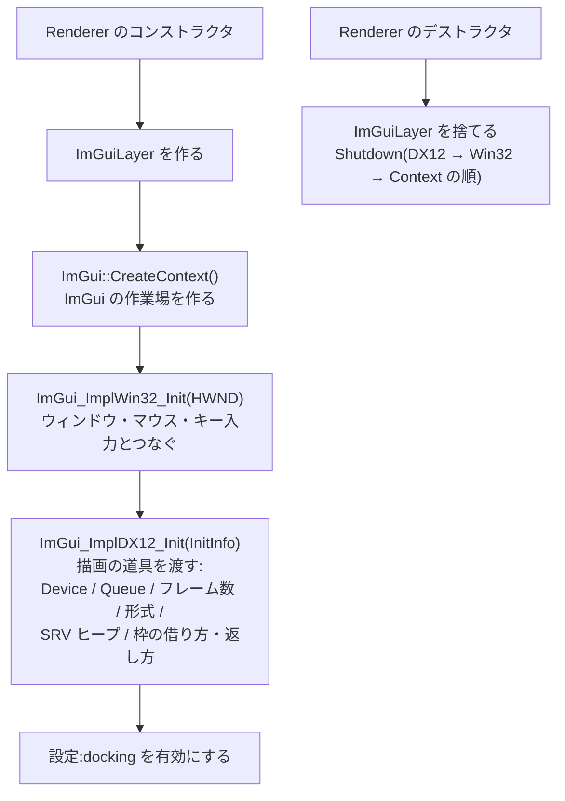
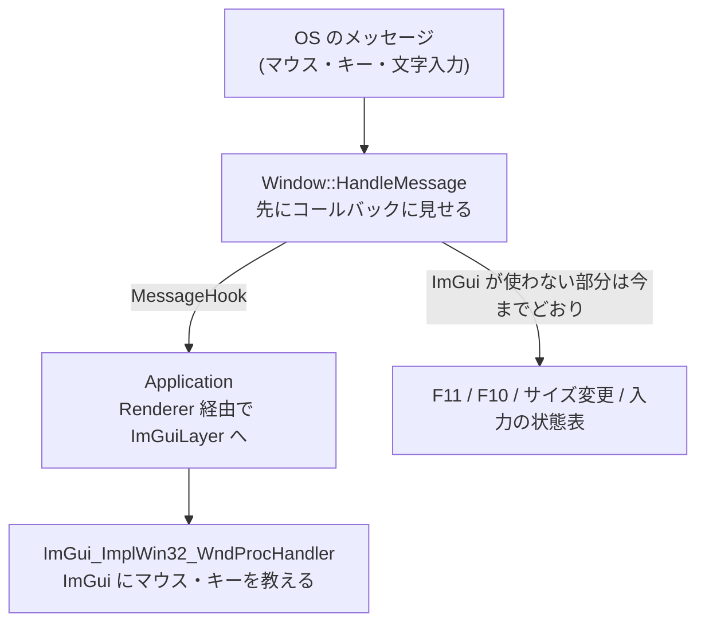
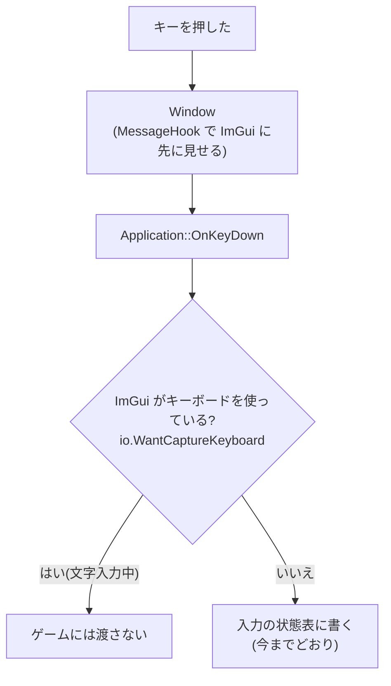
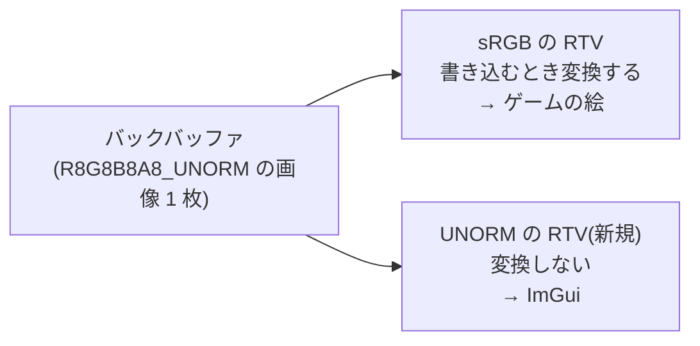
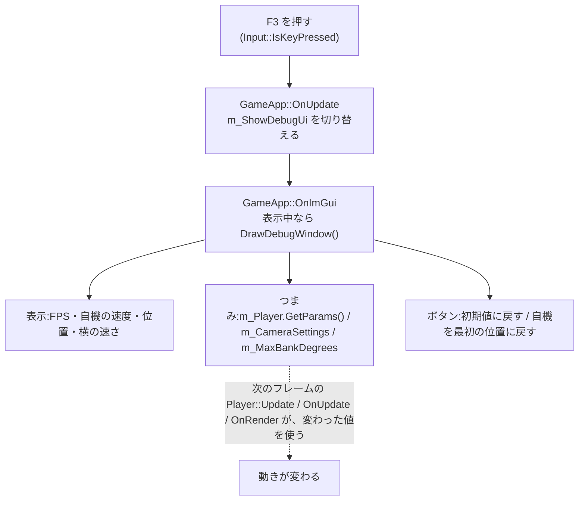
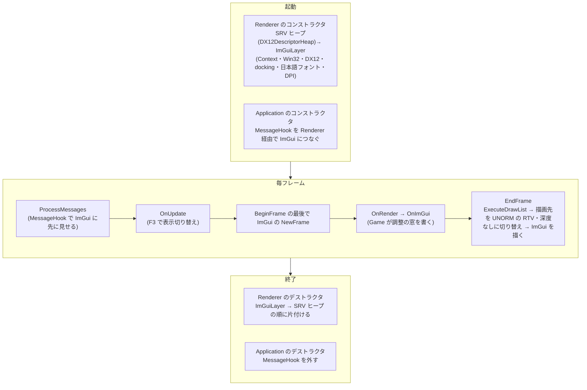

# ImGui(デバッグ用の画面)

自機の速度やカメラの数字を、動かしながら調整するための画面(Dear ImGui)を、エンジンに組み込む仕組み。

[← 資料の案内(Structure.md)に戻る](Structure.md)

**実装状況**:I-1〜I-7 済み。I-8(docs の整理)済み。ImGui の導入は完了

## 決めたこと

| 項目 | 決定 |
|---|---|
| バージョン | v1.92.9b の **docking 版**(窓をタブでまとめたり、端にくっつけたりできる。後で Unity のようなシーンビュー / ゲームビューを作りやすい。通常版に戻すのは CMake の URL を変えるだけ) |
| Window からのメッセージ | Window に「メッセージを先に見せるコールバック」を足し、Application が ImGui につなぐ(Window は ImGui を知らない) |
| Game からの使い方 | Game が `imgui.h` を直接 include して、`ImGui::Text` などを書く |
| UI の色 | ImGui 専用に、sRGB ではない RTV(見方)をもう1つ作る |
| 日本語 | Windows のフォントを読み込む |
| 確認用の窓 | FPS・自機の状態の表示 + 自機の数字をスライダーで調整 |
| 表示 | Debug と Release の両方に入れて、キーで表示を切り替える |

## 全体の流れ(完成後のイメージ)

```
ProcessMessages → OnUpdate → BeginFrame → [ImGui NewFrame] → OnRender → OnImGui(Game が窓を書く)
                → EndFrame:ExecuteDrawList → [ImGui の描画] → Barrier(表示用) → Execute → Present
```

---

## I-1. ImGui を取り込む

工場のたとえ:**外の工場から部品(ImGui)を仕入れて、自分の工場の部品棚に入れる**。まだ使わない。棚に入って、ビルドが通ることだけ確認する。

### 何をするか



| 追加するもの | 内容 |
|---|---|
| ダウンロード | DirectX-Headers と同じ `FetchContent`(zip の URL + `URL_HASH`)。ImGui は CMakeLists を持っていないので、取得だけする |
| `imgui` ライブラリ | ImGui の `.cpp`(本体 4 つ + `imgui_impl_win32.cpp` + `imgui_impl_dx12.cpp`)を集めた静的ライブラリを、自分で定義する |
| リンク | Engine に `PUBLIC` でつなぐ。`PUBLIC` なので、Game も `#include <imgui.h>` できる(決定事項 3) |

### どこに置くか、なぜそこか

| 処理 | 置く場所 | なぜそこか |
|---|---|---|
| ダウンロードとライブラリの定義 | Engine/CMakeLists.txt | DirectX-Headers(外の部品)と同じ場所・同じ書き方にそろえる。外の部品の取り込みは、この1か所に集める |
| `PUBLIC` でリンク | Engine の `target_link_libraries` | Game が `imgui.h` を直接使う(決定事項 3)ため。DX12 の部品は `PRIVATE` のままで、Game からは見えない |

**書いた内容**(Engine/CMakeLists.txt)

- `FetchContent_Declare(imgui …)`:`v1.92.9b-docking` の zip と、そのハッシュ(SHA256)。
- `add_library(imgui STATIC …)`:ImGui 本体の 4 ファイル + `imgui_impl_win32.cpp` + `imgui_impl_dx12.cpp`。`d3d12` と `dxgi` をリンクし、`/utf-8`(ImGui のソースが UTF-8 のため)と `/W0`(他人のコードの警告は出さない)でコンパイルする。
- `target_link_libraries(KREngine PUBLIC imgui)`。
- Visual Studio では、他の外部の部品と同じ `ThirdParty` フォルダーにまとめて表示する。

---

## I-2. シェーダーから見える SRV ヒープ

工場のたとえ:**GPU(シェーダー)が読む画像の札を、掛けておく札掛け**。今の工場には、描画先の札掛け(RTV)と、奥行きの札掛け(DSV)しかない。ImGui は、文字のフォント画像を、シェーダーで読んで画面に貼るので、「画像を読むための札」を掛ける札掛けが要る。

### 何をするか

| 追加するもの | 内容 |
|---|---|
| `DX12DescriptorHeap`(新しい部品) | ① 「シェーダーから見える」(shader-visible)札掛けを1つ作る(枠は 64 個)<br>② 枠を1つ借りる `Alloc`(CPU 用の場所と GPU 用の場所を返す)<br>③ 枠を返す `Free`<br>④ 使っていない枠の番号を覚えておく(返された枠は、次に借りるときに使い回す) |
| Renderer が持つ | `m_SrvHeap`。Device の後に作り、Device より先に捨てる(作った逆順) |

### 何の目的か

- ImGui の DX12 の部品は、「画像の札を掛ける枠の借り方・返し方」を、**アプリ(私たち)が用意して渡す**決まりになっている(`SrvDescriptorAllocFn` / `SrvDescriptorFreeFn`)。
- 枠を1つだけにしないのは、ImGui のフォントの画像が、途中で作り直される(文字を増やしたときなど)ことがあり、あとで自分の画像(シーンビューなど)を貼る可能性もあるため。
- 「シェーダーから見える」札掛けは、**1つの命令リストに1つしか設定できない**。そのため、これが唯一の SRV ヒープになる(ゲーム側の画像も、将来ここに置く)。

### どこに置くか、なぜそこか

| 処理 | 置く場所 | なぜそこか |
|---|---|---|
| 札掛けの作成と、枠の貸し借り | Engine/src/Graphics/DX12/DX12DescriptorHeap.h/.cpp(新規) | DX12 の部品(SwapChain・DepthBuffer・Buffer)と同じ場所・同じ形。DX12 の型は `src/` の中だけに閉じ込め、Game には見せない |
| 持ち主 | Renderer(`m_SrvHeap`) | Renderer が Device と描画の統括を持っている。ImGui の描画も Renderer の EndFrame の中で行う |
| 枠の数(64) | Renderer.cpp の先頭の定数(`SrvHeapSize`) | 使い方が増えたら、ここだけ直す |

**仕組み(DX12DescriptorHeap)**

- 枠の位置は「先頭の場所 + 枠の番号 × 枠1つ分の大きさ」で決まる。`Alloc` はその計算で、CPU 用と GPU 用の場所を返す。
- 空きの枠の番号は `m_FreeIndices` に入れておき、`Alloc` は末尾から1つ取り出す。`Free` は、渡された場所から枠の番号に戻して、末尾に足す(次の `Alloc` で、返された枠が使い回される)。
- 作る順番は、Device → Queue → SwapChain → DepthBuffer → CommandList → **SrvHeap**。捨てる順番は、その逆(`m_SrvHeap.reset()` は `m_CommandList.reset()` の前)。

---

## I-3. ImGuiLayer

工場のたとえ:仕入れた部品(ImGui)を**組み立てて、動かせる状態にする担当者**。「準備(初期化)」「毎フレームの始まり」「画面への描画」「片付け(終了)」を受け持つ。

### 何をするか



| 追加するもの | 内容 |
|---|---|
| `ImGuiLayer` クラス | ① コンストラクタで、`CreateContext` → `ImGui_ImplWin32_Init` → `ImGui_ImplDX12_Init` を行う<br>② デストラクタで、`ImGui_ImplDX12_Shutdown` → `ImGui_ImplWin32_Shutdown` → `DestroyContext` の順に片付ける<br>③ SRV の枠の借り方・返し方(`AllocFn` / `FreeFn`)を、`DX12DescriptorHeap` の `Alloc` / `Free` につなぐ小さい関数<br>④ docking を有効にする(`ImGuiConfigFlags_DockingEnable`) |
| Renderer が持つ | `m_ImGui`。SrvHeap の**後**に作り、SrvHeap より**先**に捨てる(ImGui が SrvHeap の枠を使っているため) |

**まだしないこと**:毎フレームの `NewFrame` と描画(I-5)、Window のメッセージをつなぐこと(I-4)。この手順では、「初期化と終了が、エラーなく通る」ことだけを確認する。

### どこに置くか、なぜそこか

| 処理 | 置く場所 | なぜそこか |
|---|---|---|
| ImGui の初期化・終了 | Engine/src/UI/ImGuiLayer.h/.cpp(新規) | ImGui の呼び出しを1つのクラスに集める。Renderer.cpp が、ImGui の細かい呼び出しでふくらむのを防ぐ。DX12 の型を含むので `src/` に置く(Game からは見えない) |
| 持ち主 | Renderer(`m_ImGui`) | 初期化に、Device・Queue・SrvHeap・描画先の形式が要る。それらを持っているのが Renderer |
| 枠の借り方・返し方の関数 | ImGuiLayer.cpp の中(名前なし namespace) | ImGui に渡すための、ImGuiLayer 専用の小さい関数。`InitInfo::UserData` に `DX12DescriptorHeap` を入れて、関数の中で取り出す |

**なぜ初期化と片付けを逆順にするか**:ImGui は SRV ヒープの枠を借りて使い、片付け(`ImGui_ImplDX12_Shutdown`)のときに、枠を返しに行く。先にヒープを捨てると、存在しないヒープに枠を返しに行って、クラッシュする。ビルの解体と同じで、後から作ったものから先に片付ける。

**注意点**

- 描画先の形式(RTV)は、今は既存の sRGB のものを渡す。UI の色のずれは、I-6 で、sRGB ではない RTV を足して直す(決定事項 4)。
- ImGui は、窓の位置などを `imgui.ini` というファイルに保存する(作業フォルダーに作られる)。Git には入れない(`.gitignore` に足す)。

---

## I-4/5. Window のメッセージをつなぎ、フレームに組み込む

I-4(メッセージのつなぎ)と I-5(フレームへの組み込み)は、まとめて1つの手順にした(I-4 だけでは画面に何も出ず、目で確認できないため)。

工場のたとえ:**玄関のボタンの係(Window)が、押された知らせを、ImGui の担当にも先に見せる**。そして毎フレーム、ImGui の担当に「今フレームの窓を書いて」「書いた窓を画面に貼って」と頼む。

### 何をするか



**毎フレームの流れ**

```
ProcessMessages → OnUpdate → BeginFrame(その最後で ImGui の NewFrame) → OnRender → OnImGui(Game が窓を書く)
                → EndFrame:ExecuteDrawList → ImGui の描画(SetDescriptorHeaps → RenderDrawData) → Barrier(表示用) → Present
```

| 追加するもの | 内容 |
|---|---|
| Window | `SetMessageHook`:メッセージを、Window 自身が処理する前に、コールバックに見せる。コールバックが `true`(処理した)を返したら、そこで終わる |
| Application | ① Renderer ができた後で、コールバックを登録する(Renderer 経由で ImGuiLayer の `HandleMessage` を呼ぶ)<br>② 毎フレーム、`OnRender()` の後に、新しい仮想関数 `OnImGui()` を呼ぶ |
| Renderer | ① `HandleWindowMessage`(ImGuiLayer へ渡すだけ)<br>② `BeginFrame` の最後で ImGui の `NewFrame`<br>③ `EndFrame` の `ExecuteDrawList` の後で、ImGui を描く |
| ImGuiLayer | `BeginFrame`(NewFrame 3つ)/ `Render`(`ImGui::Render` + SRV ヒープの設定 + `RenderDrawData`)/ `HandleMessage`(`ImGui_ImplWin32_WndProcHandler` を呼ぶ) |
| GameApp | `OnImGui()` で、確認用に `ImGui::ShowDemoWindow()`(ImGui の見本の窓)を出す |

### どこに置くか、なぜそこか

| 処理 | 置く場所 | なぜそこか |
|---|---|---|
| メッセージを先に見せる | Window(`SetMessageHook`) | Window は OS のメッセージを受ける場所。ここで「先に見せる」口を作れば、ImGui の名前を出さずに済む(決定事項 2) |
| コールバックの登録 | Application のコンストラクタ | Window と Renderer の両方を持っているのが Application。つなぎ役は Application(入力の状態表と同じ形) |
| NewFrame と描画 | Renderer(`BeginFrame` の最後 / `EndFrame` の中) | 描画先の設定(RTV・DSV・ビューポート)は BeginFrame、実際の描画の順番は EndFrame にあるため。Application と Game は ImGui の描画の順番を知らずに済む |
| `OnImGui()` | Application の仮想関数(`OnUpdate` / `OnRender` と同じ形) | Game が窓を書く場所。`OnRender` の後に呼べば、ゲームの絵より手前に UI が乗る |

**注意点**

- 最小化中は、`BeginFrame` から `EndFrame` までをまとめて飛ばす(今までどおり)ので、ImGui の NewFrame / 描画も一緒に飛ぶ。
- UI の色は、I-6 で直すまで、sRGB の RTV に描くため、少し白っぽく見える。

### 書いた内容と、確認で分かったこと

| ファイル | 内容 |
|---|---|
| [Window.h](../src/Platform/Windows/Window.h) / [.cpp](../src/Platform/Windows/Window.cpp) | `SetMessageHook`。`HandleMessage` の先頭で、窓口に先に見せる。処理済み(`true`)ならそこで終わる |
| [Application.cpp](../src/Core/Application.cpp) | ① Renderer を作った後で、窓口に `Renderer::HandleWindowMessage` をつなぐ<br>② `OnRender()` の後に `OnImGui()` を呼ぶ<br>③ デストラクタで窓口を外す(Renderer が先に破棄されるため、その後のメッセージを渡さないように) |
| [Application.h](../include/KR/Core/Application.h) | `virtual void OnImGui()` を追加 |
| [Renderer.h](../include/KR/Renderer/Renderer.h) / [.cpp](../src/Renderer/Renderer.cpp) | `HandleWindowMessage`(渡すだけ。公開ヘッダーに Windows.h の型を出さないよう、素の整数・ポインタで受ける)。`BeginFrame` の最後で NewFrame、`EndFrame` の `ExecuteDrawList` の後で ImGui を描く |
| [ImGuiLayer.h](../src/UI/ImGuiLayer.h) / [.cpp](../src/UI/ImGuiLayer.cpp) | `BeginFrame`(DX12 → Win32 → ImGui の順に NewFrame)/ `Render`(`ImGui::Render` → SRV ヒープを設定 → `RenderDrawData`)/ `HandleMessage`(`ImGui_ImplWin32_WndProcHandler`) |
| GameApp.cpp | `OnImGui()` で `ImGui::ShowDemoWindow()`(確認用。I-7 で置き換える) |
| [Engine/CMakeLists.txt](../CMakeLists.txt) | `imgui_demo.cpp` を追加(`ShowDemoWindow` の中身が入っているファイル) |

---

## I-6. 入力の取り合い・日本語・色

3つの小さい手順に分ける。

| 手順 | 内容 |
|---|---|
| I-6a | ImGui が文字入力を使っているときは、ゲームにキーを渡さない |
| I-6b | 日本語のフォントを読み込む |
| I-6c | UI の色のずれを直す(ImGui 専用の sRGB ではない RTV を足す) |

### I-6a. 入力の取り合い

**困っていること**:ImGui の文字入力欄に文字を打っている間も、W / A / S / D が自機に届いて、自機が動いてしまう。

工場のたとえ:玄関のボタンの係(Window)が受けたキーを、ゲームの担当(入力の状態表)と、ImGui の担当の**両方**に渡している。ImGui の担当が「今、私が文字を書いているので、キーは私だけに」と言ったら、ゲームの担当には渡さない。



| 追加するもの | 内容 |
|---|---|
| ImGuiLayer | `WantsKeyboard()`:ImGui が今、キーボードを使っているか(`io.WantCaptureKeyboard`) |
| Renderer | `ImGuiWantsKeyboard()`:ImGuiLayer に聞いて答えるだけ(Application は ImGui の型を知らない) |
| Application | `OnKeyDown` の最初で、ImGui がキーボードを使っていたら、入力の状態表に書かずに終わる |

**キーを離したとき(`OnKeyUp`)は、いつも状態表に伝える**:押している途中で ImGui が文字入力を始めたときに、離したことが伝わらず、押しっぱなしのまま固まらないようにするため。

### どこに置くか、なぜそこか

| 処理 | 置く場所 | なぜそこか |
|---|---|---|
| 「ImGui がキーを使っているか」の判定 | Application::OnKeyDown | キーを状態表に書く前の、入口。Game や Player は、ImGui を意識せずに済む |
| ImGui への問い合わせ | ImGuiLayer → Renderer → Application | 入力の状態表と同じ、Application が仲介する形。Application が ImGui の型を知らずに済む |

### I-6b. 日本語のフォント

**困っていること**:ImGui の標準のフォントは、日本語の文字を持っていない。日本語を書くと、「?」や空白になる。

工場のたとえ:ImGui の担当者が持っている**文字のスタンプ**には、日本語がない。Windows に入っている日本語のスタンプ(メイリオ)を、借りてきて、担当者に渡す。

| 追加するもの | 内容 |
|---|---|
| フォントの読み込み | ImGuiLayer のコンストラクタで、`C:\Windows\Fonts\meiryo.ttc` を `AddFontFromFileTTF` で読み込む。Windows のフォルダーの場所は、`GetWindowsDirectoryW` で調べる(`C:\Windows` と決め打ちしない)。ファイルがなければ、警告を出して、標準のフォントのまま進む(落とさない) |
| 画面の拡大率(DPI)への対応 | `ImGui_ImplWin32_GetDpiScaleForHwnd` で拡大率(100% → 1.0、150% → 1.5 など)を調べ、文字の大きさ(`style.FontScaleDpi`)と、余白などの大きさ(`style.ScaleAllSizes`)に反映する |
| 確認用の窓 | GameApp の `OnImGui()` に、日本語の文字を出す小さい窓を足す(I-7 で置き換える) |

**文字の範囲は指定しない**:今の ImGui(1.92)は、画面に出す文字を、必要になったときにフォントから読み込む。昔のように、「日本語の文字の範囲」を最初に指定する必要がない。

### どこに置くか、なぜそこか

| 処理 | 置く場所 | なぜそこか |
|---|---|---|
| フォントの読み込みと、DPI の反映 | ImGuiLayer のコンストラクタ | ImGui の準備(初期化)の一部。1か所にまとめて、Renderer や Game が ImGui の細かい設定を知らずに済む |
| フォントのファイルの場所 | ImGuiLayer.cpp の先頭の定数 | あとで別のフォントに変えたくなったとき、ここだけ直す |

**書いた内容**:ImGuiLayer.cpp の先頭に、フォントのファイル名(`meiryo.ttc`)と大きさ(18 画素)の定数。コンストラクタで、DPI の拡大率を `ScaleAllSizes`(余白など)と `FontScaleDpi`(文字)に反映 → `GetWindowsDirectoryW` で Windows のフォルダーを調べて、`AddFontFromFileTTF` で読み込む。ファイルがなければ警告を出して、標準のフォントのまま進む。

**なぜ DPI の拡大率を掛けるか**:拡大率が高い(たとえば 150%)モニターは、同じ大きさの画面に、より多くの画素が並んでいる。文字を「18 画素」のような固定の画素数で出すと、そのモニターの上では小さくなり、読みにくい。拡大率(1.5 など)を掛けて画素数を増やすと、見た目の大きさが、どのモニターでも同じになる。

### I-6c. UI の色のずれを直す

**困っていること**:今の ImGui の窓は、色が**白っぽく(明るく)**見える。

**原因**:このエンジンは、バックバッファを **sRGB の RTV** で描いている。sRGB の RTV は、シェーダーが出した色を、書き込むときに、モニター用の明るさ(ガンマ補正)へ**自動で変換**する。ゲームの絵は「物理的に正しい明るさ」で出しているので、変換して正しい。ところが ImGui の色は、**最初から、モニター用に調整された値**として作られている。それを、もう一度変換すると、明るくなりすぎる(二重に補正される)。

工場のたとえ:同じキャンバス(バックバッファ)に、2種類のペンで描く。**変換付きのペン**(ゲームの絵用)と、**変換なしのペン**(ImGui 用)。



| 追加するもの | 内容 |
|---|---|
| DX12Common.h | `LinearRenderTargetFormat`(= `DXGI_FORMAT_R8G8B8A8_UNORM`。sRGB ではない形式) |
| DX12SwapChain | ① RTV のヒープの枠を、`BackBufferCount` から、その **2倍**に増やす<br>② 同じバックバッファに対して、sRGB の RTV に加えて、UNORM の RTV も作る(リサイズのときも作り直す)<br>③ `GetCurrentLinearRenderTargetView()` |
| Renderer | ① ImGui を作るときに、`LinearRenderTargetFormat` と、`DXGI_FORMAT_UNKNOWN`(深度は使わない)を渡す<br>② `EndFrame` で、ImGui を描く前に、描画先を UNORM の RTV(深度なし)に切り替える |

**ポイント**:同じバックバッファ(画像1枚)を、**見方(RTV)を変えて**、2回描く。画像を増やすのではなく、「どう書き込むか」の見方だけを増やす。

### どこに置くか、なぜそこか

| 処理 | 置く場所 | なぜそこか |
|---|---|---|
| UNORM の RTV の作成 | DX12SwapChain | バックバッファと RTV のヒープを持っているのは SwapChain。リサイズで作り直すのも、ここ |
| 描画先の切り替え | Renderer::EndFrame(ImGui を描く直前) | 「ゲームの絵 → ImGui」の切り替わりの場所。ゲームの絵は、今までどおりの sRGB の RTV のまま |
| 深度なし(`DXGI_FORMAT_UNKNOWN`) | ImGui の初期化 | ImGui の窓は、奥行きに関係なく、常に手前に描く。深度バッファを使わない |

---

## I-7. FPS・自機の状態の表示と、数字の調整

自機・カメラの数字を、ImGui の窓で、動かしながら調整できるようにする。2つの手順に分ける。

| 手順 | 内容 | 画面の変化 |
|---|---|---|
| I-7a | 数字を「定数」から「変数(構造体にまとめたもの)」に変える | なし(動きは今までどおり) |
| I-7b | 調整の窓を作って、F3 キーで出したり隠したりする | 窓が出る |

**窓に出すもの**:FPS / 自機の速度・位置・横の速さ / 自機の数字(基準速度・加減速の幅・近づく速さ・最高横速度・横の近づく速さ・動ける範囲)/ カメラの数字(高さ・後ろの距離・見る先の高さ・前方の距離)/ 傾きの最大角度 / VSync の切り替え / 自機を最初の位置に戻すボタン / 見本の窓の表示切り替え。

### I-7a. 数字を変数にまとめる

**困っていること**:今の数字は、`constexpr`(定数)。定数は、プログラムが動いている間は変えられない。ImGui のスライダーで動かすには、変えられる**変数**にする必要がある。

工場のたとえ:**壁に固定された設定札**(定数)を、**取り外せる設定パネル**(変数)に変える。

| 変更するもの | 内容 |
|---|---|
| Player | 数字を、`PlayerParams`(構造体)にまとめる。初期値は、今の定数と同じ。`Player` が持ち、`GetParams()` で、外から読み書きできる。`UpdateSpeed` / `UpdateSteering` は、定数ではなく、この構造体の値を使う |
| GameApp | カメラの数字を `CameraSettings`(構造体)、傾きの最大角度をメンバー変数にまとめる。`OnUpdate` / `OnRender` で、それらを使う |
| 変えないもの | モデルの中心の補正・拡大・向き(`PlayerScale` など)は、調整する数字ではなく、モデル固有の値なので、定数のまま。確認用の目印(`Marker`)も定数のまま |

**なぜ構造体にまとめるか**:数字が 10 個以上ある。バラバラの変数にすると、ImGui の窓で1つずつ呼び出すとき、また、初期値に戻すときに、扱いにくい。構造体なら、「初期値に戻す」は、`params = PlayerParams{}` の1行で済む。

### どこに置くか、なぜそこか

| 処理 | 置く場所 | なぜそこか |
|---|---|---|
| `PlayerParams` | Player.h(Player の中の型) | 自機の動きの数字は、Player の仕事に属する。ImGui を知らずに、ただの数字の入れ物にしておく(調整の窓は GameApp が作る) |
| `CameraSettings` | GameApp.h | カメラを追従させるのは GameApp。カメラの数字も GameApp が持つ |
| 窓とのつなぎ | I-7b で、GameApp の `OnImGui()` に書く | Player / Camera の数字は、GameApp から見える形にしておくだけ。ImGui の関数は、GameApp にだけ出てくる |

### I-7b. 調整の窓と F3 の切り替え

工場のたとえ:**運転席の計器盤と調整つまみ**。速度計(FPS・自機の状態)と、設定パネルのつまみ(スライダー)を、1枚の窓にまとめる。F3 キーで、計器盤ごと出したり隠したりする。



| 追加するもの | 内容 |
|---|---|
| Input(エンジン) | `Key::F3` を追加(`Input.h` の一覧と、`Input.cpp` の Windows のキー番号 `VK_F3` の変換) |
| Player | `Reset()`(位置・速度を最初に戻す。数字はそのまま) |
| GameApp | ① `OnUpdate` で、F3 が押されたら `m_ShowDebugUi` を切り替える<br>② `OnImGui` で、表示中なら `DrawDebugWindow()` を呼ぶ<br>③ `DrawDebugWindow()`:FPS、VSync、自機の表示と調整、カメラの調整、傾き、ボタン、見本の窓の表示切り替え |

### どこに置くか、なぜそこか

| 処理 | 置く場所 | なぜそこか |
|---|---|---|
| `Key::F3` | Input.h / Input.cpp(エンジン) | `Key` の一覧は、エンジンの公開ヘッダー。Windows のキー番号(`VK_F3`)を Game に見せないため、変換は Input.cpp の中に閉じ込めてある。新しいキーは、エンジンに足す |
| F3 の切り替えと窓の中身 | GameApp | 「どの数字を調整するか」はこのゲームの話。エンジンには、汎用の窓の仕組み(`OnImGui`)だけがある |
| 「自機を最初の位置に戻す」 | Player::Reset() | 位置や速度を持っているのは Player。GameApp から Player の中身を直接書き換えない |

---

## 完成後の全体像



| 場所 | 役割 |
|---|---|
| [Engine/CMakeLists.txt](../CMakeLists.txt) | ImGui(docking 版 v1.92.9b)の取得と、静的ライブラリ `imgui`。Engine に `PUBLIC` でリンク(Game も `imgui.h` を使える) |
| [DX12DescriptorHeap](../src/Graphics/DX12/DX12DescriptorHeap.h) | シェーダーから見える札掛け(SRV ヒープ)と、枠の貸し借り |
| [ImGuiLayer](../src/UI/ImGuiLayer.h) | 準備・片付け・毎フレームの NewFrame と描画・メッセージの受け渡し・キーボードの取り合いの判定 |
| [DX12SwapChain](../src/Graphics/DX12/DX12SwapChain.h) | 同じバックバッファに、sRGB の RTV(ゲームの絵)と UNORM の RTV(ImGui)の2通りの見方 |
| [Window](../src/Platform/Windows/Window.h) | `MessageHook`(メッセージを先に見せる窓口) |
| [Application](../include/KR/Core/Application.h) | `OnImGui()`(Game が窓を書く場所)。窓口の登録と解除 |
| GameApp | `DrawDebugWindow()`:FPS・自機の状態の表示、自機・カメラ・傾きのスライダー、ボタン。F3 で表示切り替え |
| Player.h | `PlayerParams`(調整できる数字の入れ物。ImGui を知らない)と `Reset()` |

**押さえておく点**

| 点 | 内容 |
|---|---|
| 初期化と片付けは逆順 | ImGui は SRV ヒープの枠を借りている。先にヒープを捨てると、存在しないヒープに枠を返しに行って、クラッシュする |
| 枠の借り方は私たちが決める | 札掛けの持ち主は私たち。ImGui が自分で枠を選ぶと、他の画像と取り合いになる |
| 窓口を外す | Renderer が先に破棄され、Window が後に破棄される。その間に届くメッセージを、存在しない Renderer に渡さないため |
| 色は2通りの見方 | ゲームの絵は「物理的に正しい明るさ」で出すので sRGB の RTV(変換する)。ImGui の色は最初からモニター用の値なので、UNORM の RTV(変換しない) |
| 文字入力の取り合い | ImGui が文字入力中は、ゲームにキーを渡さない。離したときは、いつも伝える |
| 数字は「参照」で調整 | `GetParams()` が `PlayerParams&` を返す。スライダーが本物の変数を書き換えるので、次のフレームから反映される。調整した数字は、終了すると消える(気に入った数字は、`PlayerParams` の初期値に書く) |
