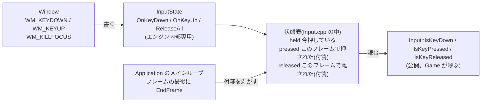
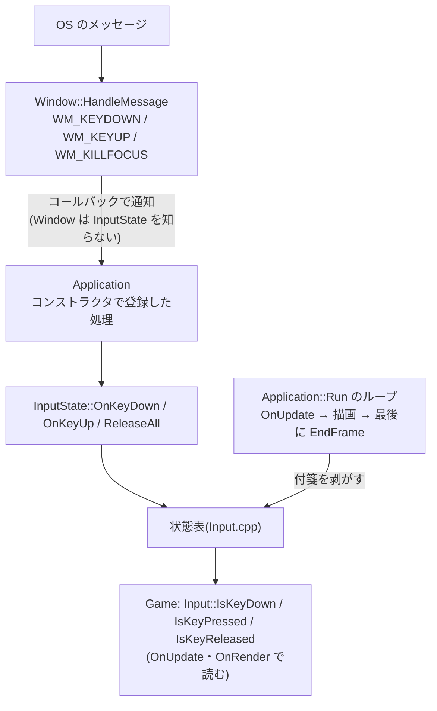

# 入力(キーボード)

キーの押している・押した・離したを Game が調べられるようにする仕組み(フェーズ3-7)。

[← 資料の案内(Structure.md)に戻る](Structure.md)

> 追加した処理ごとに「流れ」「どこに置いたか」「なぜそこか」をここに足していく。

**実装状況**:3-7-1(状態表と読む関数)済み / 3-7-2(Window とメインループにつなぐ)済み

### 状態表と読む関数(3-7-1)

工場のたとえ:**押しボタンの状態を掲示板に書いておく**。ボタンの係(Window)が書き換え、自機の担当(Game)は読むだけ。

| 処理 | 置いた場所 | なぜそこか |
|---|---|---|
| `Key` の一覧と `Input::IsKey…`(読むだけ) | [Input.h](../include/KR/Core/Input.h)(公開) | Game が使う入口なので `include/` に置く。Windows.h やキー番号を Game に漏らさないよう、`Key` という自前の一覧にした |
| 状態表と `Key` → Windows のキー番号の変換 | [Input.cpp](../src/Core/Input.cpp)(非公開) | `VK_LEFT` などの Windows の定義は Windows.h が必要。Game に見せないため `.cpp` の中に閉じ込めた |
| 書き込み口 `InputState::OnKeyDown` など | [InputState.h](../src/Core/InputState.h)(非公開) | 書き込みはエンジン内部(Window / Application)だけの仕事。公開ヘッダーに置くと Game が状態を書き換えられてしまうので、`src/` に置いた |

**3つの状態の考え方**

| 関数 | 意味 | 使い道 |
|---|---|---|
| `IsKeyDown` | 今押している(押した瞬間も含む) | 上昇・下降(S / ↓ で上昇、W / ↑ で下降)・左右移動(A / D、← / →) |
| `IsKeyPressed` | このフレームで押された。押しっぱなしでも最初の1フレームだけ true | 切り替えキー |
| `IsKeyReleased` | このフレームで離された | ボタンを離したとき |

- 「押した・離した」は、前のフレームとの比較ではなく**付箋**(押した瞬間に貼る、フレームの最後に剥がす)で管理する。1フレームの間に押して離した短い操作を見逃さないため。
- 押しっぱなしで同じ `WM_KEYDOWN` が繰り返し届いても、すでに押していれば付箋は貼らない(`OnKeyDown` の中で判定)。

### Window とメインループにつなぐ(3-7-2)

工場のたとえ:掲示板(状態表)はできたので、**ボタンの係(Window)が書き込みに来る道**と、**毎フレームの最後に付箋を剥がす係**をつなぐ。

| 追加する処理 | 置く場所 | なぜそこか |
|---|---|---|
| `SetKeyUpCallback` / `SetFocusLostCallback` と、`WM_KEYUP` / `WM_SYSKEYUP` / `WM_KILLFOCUS` の処理 | Window.h / Window.cpp | OS のメッセージを受けるのは Window の仕事。今の `SetResizeCallback` / `SetKeyDownCallback` と同じ形にして、読む人が迷わないようにする |
| コールバックの登録と、`InputState::OnKeyDown / OnKeyUp / ReleaseAll` の呼び出し | Application のコンストラクタ | Window が `InputState` を知らずに済み、状態表に触るのが Application だけになる(依存の向きがそろう) |
| `InputState::EndFrame()` の呼び出し | Application::Run のループの最後(`OnRender` の後) | 付箋は `OnUpdate` でも `OnRender` でも読めるようにしたいので、フレームの一番最後に剥がす。最小化中も剥がし忘れないよう、描画の有無に関係なく毎回呼ぶ |

---

## ImGui との入力の取り合い

ImGui の文字入力欄に打っている間は、ゲームにキーを渡さない(自機が動いてしまわないように)。

- 判定:`Application::OnKeyDown` の最初で、`Renderer::ImGuiWantsKeyboard()`(= ImGui の `io.WantCaptureKeyboard`)が true なら、入力の状態表に書かずに終わる。
- **離したとき(`OnKeyUp`)は、いつも状態表に伝える**。押している途中で ImGui が入力を使い始めても、「離した」が伝わらずに押しっぱなしのまま固まらないようにするため。
- F3(調整の窓の表示切り替え)のために、`Key::F3` を追加した(`Key` の一覧と `VK_F3` の変換は、エンジン側の Input.h / Input.cpp にある)。
- 詳しくは [ImGui.md](ImGui.md)。
