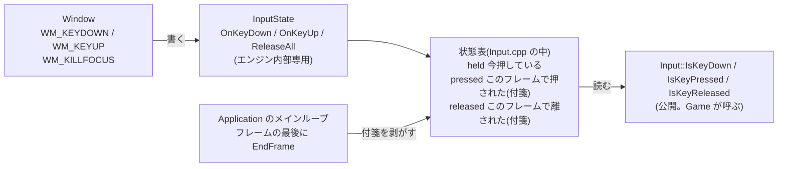
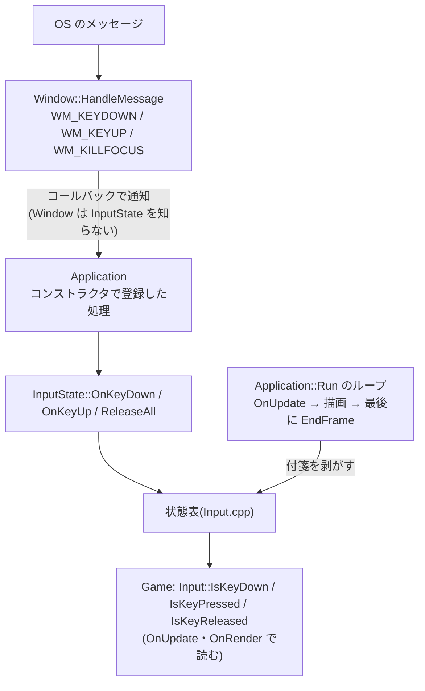
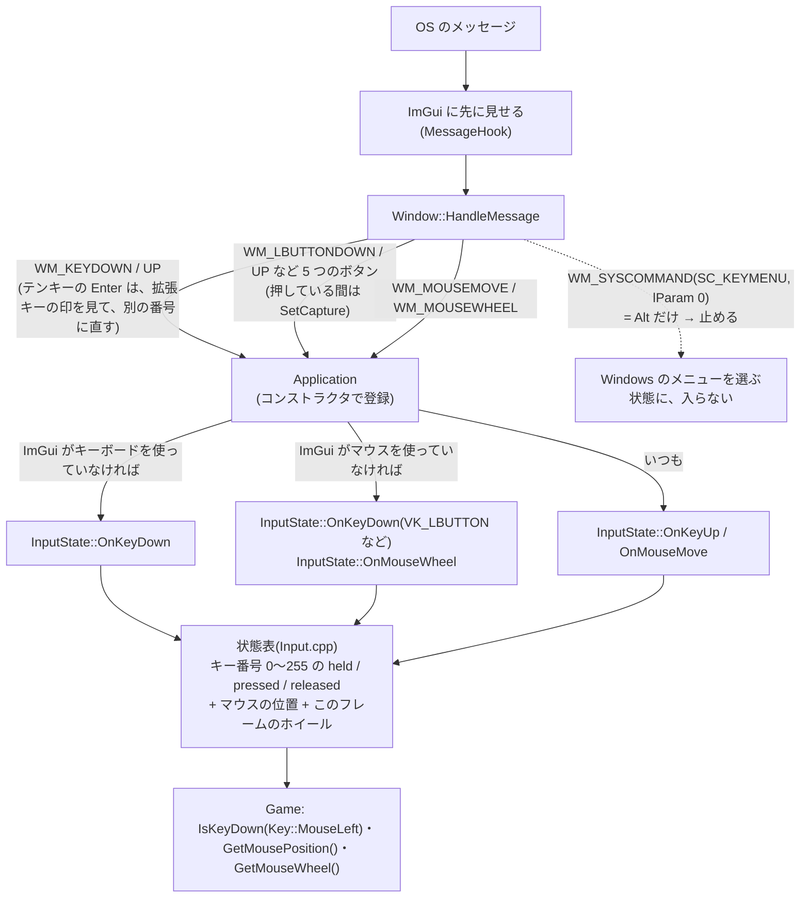

# 入力(キーボード・マウス)

キーとマウスのボタンの押している・押した・離したと、マウスの位置・ホイールを、Game が調べられるようにする仕組み(フェーズ3-7。2026-10-14 に、全部のキーとマウスを追加)。

[← 資料の案内(Structure.md)に戻る](Structure.md)

> 追加した処理ごとに「流れ」「どこに置いたか」「なぜそこか」をここに足していく。

**実装状況**:3-7-1(状態表と読む関数)済み / 3-7-2(Window とメインループにつなぐ)済み / 全部のキーとマウス(2026-10-14)済み → [下の「全部のキーとマウス」](#全部のキーとマウス2026-10-14)

### 状態表と読む関数(3-7-1)

工場のたとえ:**押しボタンの状態を掲示板に書いておく**。ボタンの係(Window)が書き換え、自機の担当(Game)は読むだけ。

| 処理 | 置いた場所 | なぜそこか |
|---|---|---|
| `Key` の一覧と `Input::IsKey…`(読むだけ) | [Input.h](../include/KR/Core/Input.h)(公開) | Game が使う入口なので `include/` に置く。Windows.h やキー番号を Game に漏らさないよう、`Key` という自前の一覧にした |
| 状態表と `Key` → Windows のキー番号の変換 | [Input.cpp](../src/Core/Input.cpp)(非公開) | `VK_LEFT` などの Windows の定義は Windows.h が必要。Game に見せないため `.cpp` の中に閉じ込めた |
| 書き込み口 `InputState::OnKeyDown` など | [InputState.h](../src/Core/InputState.h)(非公開) | 書き込みはエンジン内部(Window / Application)だけの仕事。公開ヘッダーに置くと Game が状態を書き換えられてしまうので、`src/` に置いた |

**3つの状態の考え方**

| 関数 | 意味 | 使い道 |
|---|---|---|
| `IsKeyDown` | 今押している(押した瞬間も含む) | 上昇・下降(S / ↓ で上昇、W / ↑ で下降)・左右移動(A / D、← / →) |
| `IsKeyPressed` | このフレームで押された。押しっぱなしでも最初の1フレームだけ true | 切り替えキー |
| `IsKeyReleased` | このフレームで離された | ボタンを離したとき |

- 「押した・離した」は、前のフレームとの比較ではなく**付箋**(押した瞬間に貼る、フレームの最後に剥がす)で管理する。1フレームの間に押して離した短い操作を見逃さないため。
- 押しっぱなしで同じ `WM_KEYDOWN` が繰り返し届いても、すでに押していれば付箋は貼らない(`OnKeyDown` の中で判定)。

### Window とメインループにつなぐ(3-7-2)

工場のたとえ:掲示板(状態表)はできたので、**ボタンの係(Window)が書き込みに来る道**と、**毎フレームの最後に付箋を剥がす係**をつなぐ。

| 追加する処理 | 置く場所 | なぜそこか |
|---|---|---|
| `SetKeyUpCallback` / `SetFocusLostCallback` と、`WM_KEYUP` / `WM_SYSKEYUP` / `WM_KILLFOCUS` の処理 | Window.h / Window.cpp | OS のメッセージを受けるのは Window の仕事。今の `SetResizeCallback` / `SetKeyDownCallback` と同じ形にして、読む人が迷わないようにする |
| コールバックの登録と、`InputState::OnKeyDown / OnKeyUp / ReleaseAll` の呼び出し | Application のコンストラクタ | Window が `InputState` を知らずに済み、状態表に触るのが Application だけになる(依存の向きがそろう) |
| `InputState::EndFrame()` の呼び出し | Application::Run のループの最後(`OnRender` の後) | 付箋は `OnUpdate` でも `OnRender` でも読めるようにしたいので、フレームの一番最後に剥がす。最小化中も剥がし忘れないよう、描画の有無に関係なく毎回呼ぶ |

---

## ImGui との入力の取り合い

ImGui の文字入力欄に打っている間は、ゲームにキーを渡さない(自機が動いてしまわないように)。

- 判定:`Application::OnKeyDown` の最初で、`Renderer::ImGuiWantsKeyboard()`(= ImGui の `io.WantCaptureKeyboard`)が true なら、入力の状態表に書かずに終わる。
- **離したとき(`OnKeyUp`)は、いつも状態表に伝える**。押している途中で ImGui が入力を使い始めても、「離した」が伝わらずに押しっぱなしのまま固まらないようにするため。
- F3(調整の窓の表示切り替え)のために、`Key::F3` を追加した(`Key` の一覧と `VK_F3` の変換は、エンジン側の Input.h / Input.cpp にある)。
- 詳しくは [ImGui.md](ImGui.md)。

---

## 全部のキーとマウス(2026-10-14)

それまでの `Key` は、ゲームが使う 14 個だけだった(足すたびに、エンジンを直していた)。キーボードの全部のキーと、マウス(ボタン・位置・ホイール)を、まとめて足した。
状態表は、もともと Windows のキー番号 0〜255 の全部を持っていたので、**表そのものは変えず、「`Key` → キー番号」の対応と、Window が書き込む道を増やした**。

### 流れ

### どこに何を置いたか

| 処理 | 置いた場所 | なぜそこか |
|---|---|---|
| `Key` の一覧(全部のキー + マウスのボタン + `Count`)・`MousePosition`・`GetKeyName` / `GetMousePosition` / `GetMouseWheel` | [Input.h](../include/KR/Core/Input.h)(公開) | Game が使う入口。Windows の型・番号は出さない(今までと同じ決まり) |
| 対応表 `KeyTable`(`Key` → Windows のキー番号・名前) | [Input.cpp](../src/Core/Input.cpp) | 今までは `switch` だったが、名前も持たせるため、1 行 1 キーの表にした。**並びが `Key` とずれると、ビルドが止まる**(`static_assert`) |
| テンキーの Enter の番号 `KeyCodes::NumpadEnter` | [KeyCodes.h](../src/Platform/Windows/KeyCodes.h)(新規・非公開) | Windows に番号が無いキーに、エンジンが付ける番号。付けるのは Window、読むのは Input.cpp。どちらも Windows に依存する場所なので、`Platform/Windows/` に置いた |
| マウスのメッセージ(5 つのボタン・位置・ホイール)・`SetCapture`・Alt のメニューの止め方 | [Window.cpp](../src/Platform/Windows/Window.cpp) | OS のメッセージを受けるのは Window の仕事。キーと同じく、コールバックで Application に知らせる(Window は InputState を知らない) |
| ImGui の窓の上なら、クリックとホイールを渡さない | [Application.cpp](../src/Core/Application.cpp) のコンストラクタ | キーボードの `OnKeyDown` と同じ場所・同じ形。判定は `Renderer::ImGuiWantsMouse()`(= `io.WantCaptureMouse`) |
| 見本 | [サンプル KRMinimal](../samples/Minimal/MinimalApp.cpp) | 全部のキーを `Key::Count` まで順に調べて、押した・離したをログに、押しているキー・マウスの位置・ホイールを ImGui の窓に出す |

### 決めたこと・理由・選ばなかった案

| 決めたこと | 理由 | 選ばなかった案 |
|---|---|---|
| **キーの範囲**:A〜Z・数字・F1〜F12・矢印・Enter Space Escape Tab Backspace・Shift Ctrl Alt・編集のキー・テンキー | ゲームで使うキーは、ほぼ、これで足りる | **記号のキー(; , . / @ [ ] など)も入れる**:日本語の配列と英語の配列で、同じ番号のキーの位置と刻印が違う(例:`VK_OEM_3` は、英語では `` ` ``、日本語では `@`)。名前を付けると、配列によって嘘になる |
| **Shift・Ctrl・Alt の左右は、区別しない** | Windows は、キーのメッセージで、左右どちらも `VK_SHIFT` などを送ってくる。そのまま使えて、簡単 | **左右を分ける**(`LeftShift`):`lParam` のスキャンコード・拡張キーの印から、Window で見分ける処理が要る。**両方用意する**:同じ押し方で 2 つのキーが true になり、表が複雑になる |
| **マウスのボタンは、`Key` に入れる**(`Key::MouseLeft` など) | `IsKeyDown` がそのまま使える。将来、キーの割り当てを変える設定(例:「攻撃 = O または左クリック」)を作るとき、キーとボタンを同じ型で持てる。Windows も、ボタンにキー番号(`VK_LBUTTON` = 1 など)を持っているので、**状態表を増やさずに済む** | **別の列挙 `MouseButton` と `IsMouseDown` などを作る**:キーとボタンが混ざらず、型で区別できる。ただし、割り当ての設定では、2 つの型を両方扱う必要がある |
| **位置とホイールも入れる** | クリックした場所を調べるには位置が要る(`Camera::ScreenPointToRay` に、そのまま渡せる)。ホイールは、カメラの寄り・引きで使う | ボタンだけにする |
| 位置は `float` の組 `MousePosition` | `ScreenPointToRay` が `float` を受け取るので、変換せずに渡せる | `int` の組(ピクセルは整数だが、毎回 `float` に直すことになる)・DirectXMath の `XMFLOAT2`(公開ヘッダーで DirectXMath を前提にしたくない) |
| ホイールは「**このフレームの量**」(フレームの最後に 0) | 「押した」の付箋と同じ考え方。1 フレームに 2 目盛り回したら 2 になる(足していく) | 起動からの合計を返す(ゲームが前のフレームとの差を取る必要があり、面倒) |
| **ImGui の窓の上では、クリックとホイールを渡さない**。「離した」と位置は、いつも渡す | 窓のボタンを押したつもりが、ゲームで攻撃してしまう、を防ぐ。「離した」をいつも渡すのは、押している途中で窓の上に移っても、押しっぱなしで固まらないようにするため(キーボードと同じ) | いつもゲームにも渡す |
| テンキーの Enter は、`Enter` とは別のキー(`NumpadEnter`) | 「テンキー」として足すなら、別に読めるべき。Windows は両方を `VK_RETURN` で送るので、`lParam` の bit24(拡張キーの印)で見分けて、Windows で使われていない番号 `0x0E` を付けた | 同じ `Enter` として扱う(`NumpadEnter` を作らない) |
| 押している間は `SetCapture`(全部離したら `ReleaseCapture`) | ボタンを押したまま、ウィンドウの外で離しても、「離した」が届く(届かないと、押しっぱなしのまま固まる)。ImGui も同じことをしているが、ImGui に頼らずに、エンジンでも行う | 何もしない(ウィンドウの外で離すと、押しっぱなしになる) |
| **Alt だけを押して離したとき、Windows のメニューの状態に入らない**(`WM_SYSCOMMAND` の `SC_KEYMENU` で、`lParam` が 0 のときだけ止める) | Alt をゲームのキーにしたため。止めないと、Windows が「ウィンドウのメニューを選ぶ状態」に入り、メインループが止まり、次のキーが Windows に取られる(F10 も同じ理由で、もともと止めていた)。`lParam` に文字が入る Alt+Space(ウィンドウのメニューを開く)は、止めない | `WM_SYSKEYUP` の Alt を、既定の処理に渡さない(Alt+F4 などへの影響が読みにくい) |
| 対応表に、キーの**名前**を持たせた(`GetKeyName`) | ログ・ImGui の表示・将来のキーの設定のファイルで、数値ではなく名前で扱える | 名前を持たない(表示のたびに、ゲーム側で表を作ることになる) |

### 確認したこと(2026-10-14)

- ビルド(Debug):エラー・警告なし(全部のターゲット)
- サンプル KRMinimal に、**ウィンドウへ直接メッセージを送る**(PostMessage)方法で入力を送り、ログで確かめた:A・1・F5・Shift・Ctrl・Alt・Escape・Delete・Enter・NumpadEnter・Numpad5・NumpadAdd・F12・Z の押した/離した、マウスの 5 つのボタンの押した/離した、クリックの位置、ホイール(+1・+1・-1)
- Alt だけを押して離したあとも、メインループが止まらず、次のキー(Q)が届いた。ウィンドウのタイトルが取れて、エラーのダイアログなし。終了時、DX12 の解放漏れなし
- **ImGui の窓の上のクリックが、ゲームに届かないこと**は、自動では確かめられなかった(ウィンドウへ直接送る方法では、本物のカーソルが窓の上に無いため、ImGui が「マウスは外にある」と判断する。本物の入力を送る方法(SendInput)は、ほかの窓に入力が取られて、結果が安定しなかった)。手で確かめる:KRMinimal を起動して、左上の「Minimal」の窓の上をクリックしても、ログに「押した: MouseLeft」が出ないこと

### 既知の制限

- テンキーは、**NumLock が ON のとき**だけ `Numpad0` などになる。OFF のときは、Windows が `Insert`・`End`・矢印などとして送ってくるので、そのキーとして読める
- 横スクロール(`WM_MOUSEHWHEEL`)は、扱っていない
- マウスの位置は、最後に届いた位置。カーソルがウィンドウの外にあるとき(ボタンを押していないとき)は、外へ出る直前の位置のまま
- 記号のキーは無い(上の表を参照)
