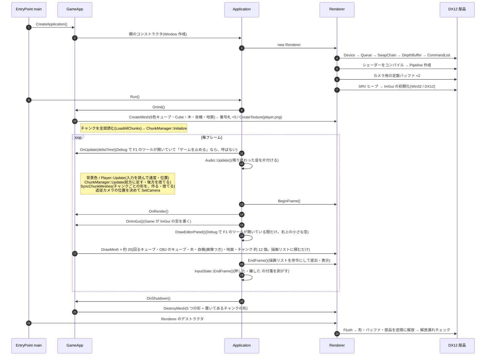
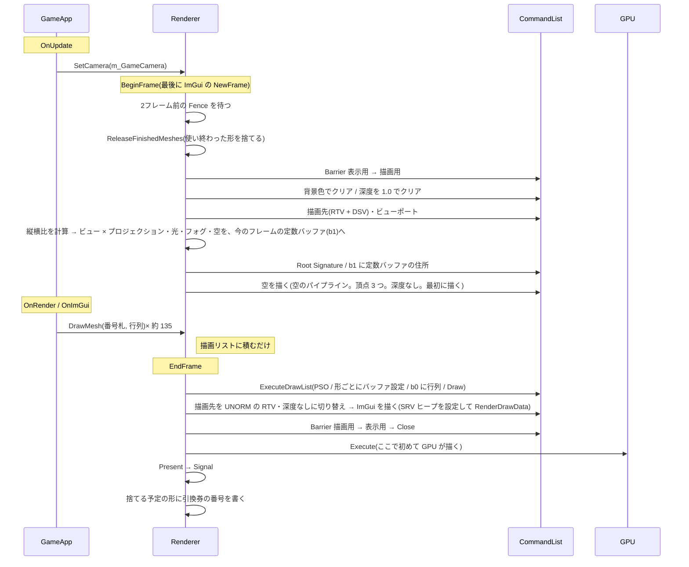

# 起動から終了・1フレーム

アプリの起動 → メインループ → 終了の流れと、1フレームの中で CPU / GPU がどう動くか。

[← 資料の案内(Structure.md)に戻る](Structure.md)

## 起動から終了まで



| 処理 | 場所 |
|---|---|
| Renderer のコンストラクタ | [Renderer.cpp:60](../src/Renderer/Renderer.cpp#L60) |
| メインループ | [Application.cpp:27](../src/Core/Application.cpp#L27) |
| 入力の付箋を剥がす(フレームの最後) | [Application.cpp:52](../src/Core/Application.cpp#L52) |
| F1 でツールを開く・一時停止(Debug) | [Application.cpp](../src/Core/Application.cpp)(`OpenBehaviorEditor`・`Run`)。詳しくは [BehaviorEditor.md](BehaviorEditor.md) の「ゲームから F1 で開く」 |
| Game の初期化(形を作る) | GameApp.cpp:33 |
| Game の更新(自機の動き・追従カメラ) | GameApp.cpp:50 |
| Game の描画(DrawMesh) | GameApp.cpp:92 |
| Game の終了(DestroyMesh) | GameApp.cpp:127 |
| Renderer のデストラクタ | [Renderer.cpp:93](../src/Renderer/Renderer.cpp#L93) |


---

## 1フレームの流れ



| 処理 | 場所 |
|---|---|
| BeginFrame | [Renderer.cpp:171](../src/Renderer/Renderer.cpp#L171) |
| 深度バッファのクリア | [Renderer.cpp:193](../src/Renderer/Renderer.cpp#L193) |
| カメラの行列を定数バッファへ | [Renderer.cpp:211](../src/Renderer/Renderer.cpp#L211) |
| 描画リストの実行 | [Renderer.cpp:285](../src/Renderer/Renderer.cpp#L285) |
| EndFrame | [Renderer.cpp:337](../src/Renderer/Renderer.cpp#L337) |


---

## フレームインフライト2 のタイムライン

```
時間 →
frameIndex:  0            1            0            1
CPU:     [F1 を記録]  [F2 を記録]  [F3 を記録]  [F4 を記録]
          Allocator0   Allocator1   Allocator0   Allocator1
          定数バッファ0  定数バッファ1  定数バッファ0  定数バッファ1
                                     ↑ F1 が GPU で終わったか(Fence)確認してから再利用
GPU:              [F1 を実行]  [F2 を実行]  [F3 を実行]
```

**フレームごとに2つずつ持つもの**:Allocator、カメラの定数バッファ(GPU が読んでいる最中に書き換えないため)

