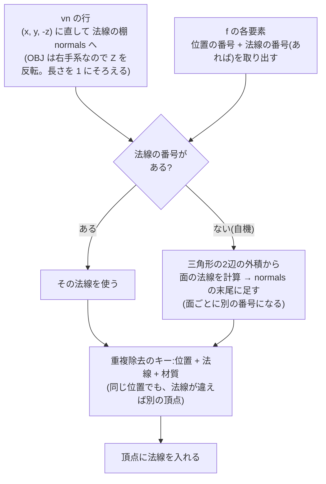
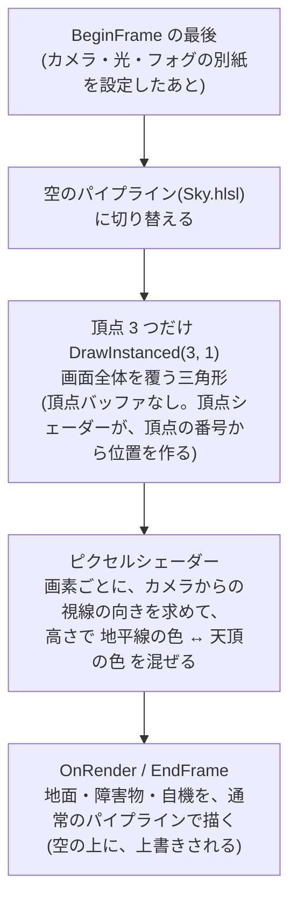
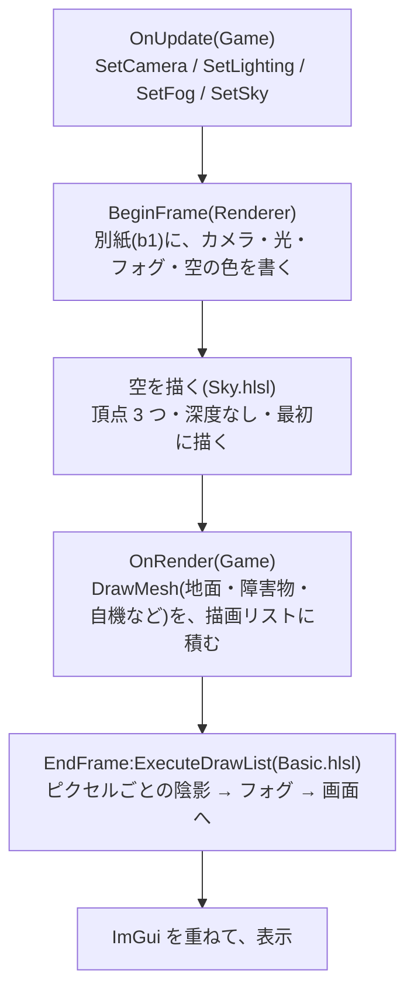

# 光・フォグ・地面・障害物・空(フェーズ4)

陰影(ライティング)、遠くが霞むフォグ、地面、障害物、空を足して、見た目の土台を作る(フェーズ4)。

[← 資料の案内(Structure.md)に戻る](Structure.md)

**実装状況**:4-1〜4-9 済み(フェーズ4 完了)

## 決めたこと

| 項目 | 決定 |
|---|---|
| ライティング | 平行な光(太陽)+ 環境光を、**ピクセルごと**に計算する。将来、シャドウマップなどのシェーダーを足せるように、ピクセルの世界での位置(ワールド座標)も、ピクセルシェーダーに渡す。光の情報は、まとまった構造体にして b1 に入れる |
| 自機の法線 | `vn` が無いので、三角形ごと(面ごと)の法線を計算で作る(カクカクした陰影) |
| フォグ | 距離に応じて指数的に濃くなる。フォグの色は、地平線の空の色に自動で合わせる |
| 地面 | 市松模様の板を、自機の位置に合わせて動かす(無限に続いて見える) |
| 障害物 | フェーズ4 では、仮置きとして、乱数(固定の種)で並べる。手作りの配置表(1チャンク分の位置のリスト)を、チャンクごとに用意して乱数で選ぶのは、フェーズ5(理不尽な配置にならないように、人間がコースを作る) |
| ImGui | 光・フォグ・地面・空の数字を、調整の窓に足す |
| 空 | 地平線側が明るいグラデーション(専用のシェーダーで描く) |

**フェーズ4 に含めないもの**:影(シャドウ)、SSAO などの後処理、当たり判定、自機のテクスチャ、シーン用カメラ、チャンク生成(フェーズ5)。

## 手順

| 手順 | 内容 | 画面の変化 |
|---|---|---|
| 4-1 | `Vertex` に法線を追加(構造体・入力レイアウト・シェーダーの3か所)。キューブに面の法線 | なし |
| 4-2 | LoadObj で `vn` を読む。無いときは、三角形から計算 | なし |
| 4-3 | ライティング(b1 の拡張、Root Signature の可視範囲を ALL に、陰影) | 立体感が出る |
| 4-4 | フォグ | 遠くが霞む |
| 4-5 | 地面 | 地面が出る |
| 4-6 | 障害物 | 障害物が並ぶ |
| 4-7 | グラデーションの空 | 空が変わる |
| 4-8 | ImGui の窓に数字を足す | 調整できる |
| 4-9 | docs・仕上げ | — |

---

## 4-1. `Vertex` に法線を追加する

**法線**:面が向いている方向を表す、長さ 1 の矢印。陰影の計算(4-3)で使う。

工場のたとえ:部品(頂点)に、「どちらを向いているか」の**向き札**を付ける。

### 同時に直す3か所

`Vertex` の形は、**3か所で別々に書いてある**。1か所でも食い違うと、GPU が頂点データの区切りを間違えて読み、形が崩れる(`R16_UINT` の話と同じ種類の問題)。

```
C++ の Vertex(40 バイト):   [position 12][normal 12][color 16]
入力レイアウト:              POSITION=0 / NORMAL=12 / COLOR=24(offsetof で自動)
HLSL の VSInput:             POSITION / NORMAL / COLOR
```

| 変更 | 場所 |
|---|---|
| `Vertex` に `normal` を、位置と色の間に足す(28 → 40 バイト) | [Mesh.h](../include/KR/Renderer/Mesh.h) |
| 入力レイアウトに `NORMAL` を足す | [Renderer.cpp:41](../src/Renderer/Renderer.cpp#L41) |
| `VSInput` に `float3 normal : NORMAL` を足す | [Basic.hlsl](../shaders/Basic.hlsl) |
| キューブの頂点に、面ごとの法線を入れる(前 `(0,0,-1)`、後 `(0,0,1)`、右 `(1,0,0)`、左 `(-1,0,0)`、上 `(0,1,0)`、下 `(0,-1,0)`) | [Mesh.cpp](../src/Renderer/Mesh.cpp) |
| LoadObj の頂点の作り方を直す(法線は、まだ仮の `(0,0,0)`。4-2 で本物にする) | [ModelLoader.cpp](../src/Renderer/ModelLoader.cpp) |

### どこに置くか、なぜそこか

| 処理 | 置く場所 | なぜそこか |
|---|---|---|
| `Vertex` の定義 | Mesh.h(公開ヘッダー) | 頂点の形の定義は1か所に置いて、入力レイアウトとシェーダーは、これに合わせる |
| キューブの法線 | Mesh.cpp(`CubeNormals`) | キューブの形を作っているのが Mesh.cpp。面ごとに頂点を並べているので、面ごとの法線を足しやすい |

**この手順では、画面の見た目は変わらない**(法線は、まだ使わない)。

---

## 4-2. LoadObj で法線を読む

**困っていること**:LoadObj は、頂点の法線を、まだ仮の `(0,0,0)` にしている。陰影(4-3)には、本物の法線が要る。

OBJ の法線は、2通りある。

| 場合 | 例 | やること |
|---|---|---|
| ファイルに `vn` がある | Cube.obj、木 | `vn` を読んで、面の要素(`5//1` の最後の `1`)で指された法線を使う |
| ファイルに `vn` が無い | 自機(cat.obj) | 三角形の形から、**面ごとの法線を計算**して作る(決定事項:カクカクした陰影) |

### 何をするか



| 変更するもの | 内容 |
|---|---|
| `vn` の行 | 3つの数字を読み、Z を反転し、長さ 1 にそろえて、法線の棚 `normals` に並べる(位置の `v` と同じ扱い) |
| 面の要素の読み取り | `ParseFacePositionIndex` を `ParseFaceElement` に広げる。`位置/UV/法線` の、位置と法線の番号を返す(法線が無ければ「無い」) |
| 法線の計算 | 面に法線の無い要素があるとき、面の最初の3頂点から、法線を計算して `normals` の末尾に足す。その番号を、その面の要素に使う |
| 重複除去のキー | 「位置 + 材質」から、「位置 + **法線** + 材質」に変える |
| 頂点の作成 | 仮の `(0,0,0)` をやめて、`normals[法線の番号]` を入れる |

**なぜ、法線の無い面は、面ごとに頂点を分けるのか**:頂点には、法線が1つしか入らない。1つの角を、3枚の面が共有していたら、3枚で法線が違う。法線が違う面は、頂点を共有できないので、**面ごとに別の頂点**にする(「位置 + 法線 + 材質」が同じ頂点だけ使い回す)。そのため、頂点の数は増える(自機は、約 6,000 頂点になる見込み)。

**法線の計算**:三角形の2辺の外積(2辺に垂直な矢印)を、長さ 1 にそろえる。

```
法線 = normalize( cross( p2 - p0, p1 - p0 ) )     (p0, p1, p2 は、面の最初の3頂点。Z 反転後の位置)
```

向きは、「時計回りが表」の規則に合わせる(外向きの法線になる)。計算できない(面積が 0 の)三角形は、上向き `(0,1,0)` の仮の法線にする。

### どこに置くか、なぜそこか

| 処理 | 置く場所 | なぜそこか |
|---|---|---|
| `vn` の読み取り・法線の計算・Z の反転 | ModelLoader.cpp(LoadObj の中) | OBJ という形式の事情(右手系、`vn` が無いことがある)は、読む側(インポーター)が吸収する。描画側は、「法線の入った頂点」だけを見る |
| 面の要素の読み取り | ModelLoader.cpp の名前なし namespace の関数 | LoadObj の内部だけで使うので、公開しない |

### 動作確認

画面の見た目は、**変わりません**(法線は、まだ使わない)。確認用のログに、次を出す。

| ファイル | 期待するログ |
|---|---|
| Cube.obj | 頂点 **24**(今までは 12。法線が面ごとに違うので、頂点を共有しなくなる)、法線はファイルから 6 個 |
| 木 | 頂点が 281 より増える。法線はファイルから |
| 自機 | 頂点 約 6,000(三角形 2,082 枚 × 3 に近い数)、法線は計算で作った |

**確認で分かったこと**:Cube は頂点 24(法線が面ごとに違うので共有しなくなった)、木は 1,124、自機は 6,246(= 三角形 2,082 × 3。法線の無い自機は、面ごとに頂点が分かれた)。

---

## 4-3. ライティング(陰影)

**目的**:光の当たる面を明るく、反対側を暗くして、立体感を出す。

工場のたとえ:**太陽が1つあって、物の面ごとに「どれだけ光を受けるか」を決める**。面が太陽のほうを向いていれば明るく、横を向けば暗く、反対を向けば光が当たらない(環境光だけ)。

### 陰影の計算(Lambert の拡散反射)

```
明るさ = 環境光 + 光の色 × saturate( dot(法線 N, 光が来る向き L) )
色     = 頂点の色 × 明るさ
```

| 言葉 | 意味 |
|---|---|
| 法線 N | 面が向いている方向(長さ 1)。4-1・4-2 で頂点に入れた |
| 光が来る向き L | 物から太陽へ向かう向き(長さ 1)。平行な光なので、世界のどこでも同じ |
| `dot(N, L)`(内積) | 2つの矢印が同じ向きなら 1、直角なら 0、反対なら −1 |
| `saturate(…)` | 値を 0〜1 の間に切る。反対向き(マイナス)は 0 にする(光が当たらない) |
| 環境光 | 光が当たらない面も、真っ黒にならないための、最低限の明るさ(空からの照り返しのようなもの) |

### 何をするか

| 追加・変更するもの | 内容 |
|---|---|
| `Lighting`(構造体。新規ヘッダー) | 光の向き(`toLight`)、光の色、環境光。`Renderer::SetLighting` で毎フレーム渡す(`SetCamera` と同じ形) |
| b1 の別紙(`FrameConstants`) | `viewProjection` に加えて、光の向き・光の色・環境光を足す(C++ と HLSL の両方) |
| Root Signature | b1 を、頂点シェーダー**だけ**から、**ピクセルシェーダーにも見える**(`ALL`)に変える(陰影はピクセルシェーダーで計算するため) |
| 頂点シェーダー | 法線を、ワールド行列で、世界の向きに直して(`mul(float4(normal, 0), world)`)渡す。ピクセルの**世界での位置**も渡す(将来、シャドウマップやフォグで使う) |
| ピクセルシェーダー | 上の式で、色に陰影をかける |
| GameApp | 太陽の向きを、「方位」と「高さ」の2つの角度で持ち、光の向きの矢印に直して `SetLighting` で渡す。ImGui の調整の窓に、「光」の項目(方位・高さ・光の色・環境光)を足す(動かして確認するため) |

**ポイント**
- 法線は、**ワールド行列の「回転と拡大」の部分だけ**を使って回す(位置の移動は、向きに効かないので、4つ目の成分を 0 にする)。
- 自機・木・障害物は、均一な拡大か、軸に沿った拡大なので、この単純な方法で足りる(回転しながら非均一に拡大する物が出てきたら、法線専用の行列が要る。既知の制限として記録)。

### どこに置くか、なぜそこか

| 処理 | 置く場所 | なぜそこか |
|---|---|---|
| `Lighting`(光の入れ物) | Engine の公開ヘッダー(`Renderer/Lighting.h`) | Game が光を決めて、Renderer に渡す。`SetCamera` と同じ「Game が持ち、毎フレーム渡す」形 |
| 陰影の計算 | Basic.hlsl(ピクセルシェーダー) | 画素ごとの明るさを決める仕事は、シェーダーの仕事。将来、シャドウマップなどを足すときも、ここに足す |
| 光の別紙への書き込み | Renderer::BeginFrame(カメラの行列と同じ場所) | 「フレームごとに1回、まとめて別紙に書く」仕組みが、すでにある |
| 太陽の方位・高さ | GameApp(Game 側の値) | 見た目の演出の話。Renderer は、渡された光の矢印を使うだけ |

### 動作確認

| 確認すること | 期待する結果 |
|---|---|
| 光の当たる面 | 明るい(キューブの上面・光に近い側の面) |
| 反対側の面 | 暗い(でも、真っ黒ではない = 環境光) |
| 自機 | 白一色の影絵から、**カクカクした陰影のある立体**になる |
| ImGui の「光」 | 方位・高さを動かすと、陰影の向きが、すぐに変わる |
| 6色のキューブ | 色の違いに、陰影が重なって見える |
| F10(シェーダー再読み込み) | エラーが出ない |

### 書いた内容

| ファイル | 内容 |
|---|---|
| [Lighting.h](../include/KR/Renderer/Lighting.h)(新規) | `Lighting`:光の向き(`toLight`)・光の色・環境光 |
| [Renderer.h](../include/KR/Renderer/Renderer.h) / [.cpp](../src/Renderer/Renderer.cpp) | `SetLighting`。`FrameConstants` に `toLight` / `lightColor` / `ambientColor` を足し(`float4` にそろえる)、`BeginFrame` で、向きを長さ 1 にそろえて書く |
| [DX12Pipeline.cpp](../src/Graphics/DX12/DX12Pipeline.cpp) | b1 の可視範囲を `VERTEX` から `ALL` に変更 |
| [Basic.hlsl](../shaders/Basic.hlsl) | b1 に光を追加。頂点シェーダーが、世界の位置と世界の法線(`w = 0` で回転と拡大だけ)をピクセルシェーダーに渡す。ピクセルシェーダーが、法線を長さ 1 にそろえ直し、`saturate(dot(N, L))` で陰影をかける |
| GameApp.cpp | 太陽の方位・高さ(2つの角度)から、光の向きを作って `SetLighting`。ImGui に「光」の項目 |

**`saturate` で 0 に切る理由**:反対を向いた面は、「光が当たらない」だけで、「環境光より暗くなる」わけではない。マイナスをそのまま使うと、環境光から引き算してしまい、反対側が環境光より暗く(色がマイナスに)なって不自然になる。

**FrameConstants を `float4` にそろえる理由**:HLSL の定数バッファは、16 バイトの区切りで並ぶ。`float3` を並べると、C++ の並びと、HLSL の並びが、ずれることがある。`float4` にそろえれば、ずれない。

**位置と向きの違い(w の値)**:ワールド行列を掛けるとき、4つ目の数字(w)が、移動を効かせるスイッチになる。位置(場所)は w = 1(移動も効く)、法線(向き)は w = 0(回転と拡大だけ効く)。物を右へ 10 メートル動かしても、法線は変わらない。

---

## 4-4. フォグ(遠くが霞む)

**目的**:遠い物ほど、空の色に溶けて見えるようにして、奥行き(遠近感)とスピード感を出す。将来のチャンク生成で、遠くに急に物が現れる(ポップイン)のを、隠すためにも使う。

工場のたとえ:**霧の中を走る**。近くはくっきり見えて、遠くは、霧の色(空の色)に溶けていく。

### 計算(指数的なフォグ)

```
距離 = カメラ から ピクセルの世界での位置 までの長さ
見える割合 = exp( -濃さ × 距離 )          ← 1 = くっきり、0 = 完全に霧の色
色 = 霧の色 と 陰影をかけた色 を、「見える割合」で混ぜる
```

濃さ 0.02 のときの例:

| 距離 | 見える割合 |
|---|---|
| 0 m | 100% |
| 25 m | 約 61% |
| 50 m | 約 37% |
| 100 m | 約 14% |
| 150 m | 約 5% |
| 200 m | 約 2% |

- 近くはほとんど霞まず、遠くへ向かって、自然に濃くなる。**完全には霧の色にならない**が、200 m 先で 2% なので、ほぼ消える。
- 数字は**濃さ1つ**。大きいほど、近くから霞む。0 にすれば、フォグなし。

### 霧の色は、背景(空)の色に自動で合わせる

遠くの物が、霧の色に近づくので、霧の色が空の色と同じなら、**遠くが空に溶ける**(地平線で、物と空の境目が消える)。空の色(背景色)は、夕方と昼の間で変わるが、Renderer が持っている背景色を、そのまま霧の色にするので、自動で追従する。

### 何をするか

| 追加・変更するもの | 内容 |
|---|---|
| `Fog`(構造体。`Lighting.h` に追加) | フォグのオン / オフと、濃さ。`Renderer::SetFog` で毎フレーム渡す |
| b1 の別紙 | カメラの位置、霧の色(背景色)、フォグの濃さを足す(C++ と HLSL の両方) |
| ピクセルシェーダー | 陰影をかけた色を、上の式で霧の色と混ぜる |
| GameApp | `Fog` を持ち、毎フレーム渡す。ImGui の調整の窓に、「フォグ」の項目(オン / オフ・濃さ)を足す |

### どこに置くか、なぜそこか

| 処理 | 置く場所 | なぜそこか |
|---|---|---|
| `Fog`(フォグの入れ物) | Lighting.h(光と同じヘッダー) | 「Game が持ち、毎フレーム渡す」形が、光と同じ。光とフォグは、どちらも「環境の設定」 |
| 霧の色を背景色にする | Renderer(`m_ClearColor` を使う) | 背景色を持っているのは Renderer。Game は、濃さだけ決めればよい |
| 距離の計算とフォグ | Basic.hlsl(ピクセルシェーダー) | 画素ごとの色を決める仕事。ピクセルの世界での位置は、4-3 で渡してある |

### 動作確認

| 確認すること | 期待する結果 |
|---|---|
| 遠くの障害物 | 空の色に溶けて、見えにくくなる |
| 背景色が変わっても | 霧の色が追従して、遠くが空に溶けたまま |
| ImGui の「フォグ」 | 濃さを上げると、近くから霞む。0 またはオフで、フォグなし |
| 自機 | ほとんど霞まない(カメラのすぐ近くのため) |

### 書いた内容

| ファイル | 内容 |
|---|---|
| [Lighting.h](../include/KR/Renderer/Lighting.h) | `Fog`:オン / オフ、濃さ(初期値 0.02) |
| [Renderer.h](../include/KR/Renderer/Renderer.h) / [.cpp](../src/Renderer/Renderer.cpp) | `SetFog`。`FrameConstants` に `cameraPosition` / `fogColor`(= 背景色)/ `fogParams`(濃さ。オフのときは 0)を足して、`BeginFrame` で書く |
| [Basic.hlsl](../shaders/Basic.hlsl) | ピクセルシェーダーで、陰影をかけた色と霧の色を、`exp(-濃さ × 距離)` の割合で混ぜる |
| GameApp.cpp | `Fog` を持って毎フレーム渡す。ImGui に「フォグ」の項目 |

**霧の色を背景色に合わせる理由**:遠くの物は、霧の色に近づく。霧の色が空と違う色(たとえば真っ白)だと、空との境目に、はっきりした輪郭が出て、白い壁のように見える。空と同じ色なら、遠くが空に自然に溶ける。

**フォグなしの扱い**:濃さを 0 にする(`exp(0) = 1` なので、見える割合が常に 1 = 霞まない)。シェーダーに「オン / オフ」の分岐を作らずに済む。

**確認で分かったこと**:濃さ 0 のとき `exp(0) = 1`。見える割合が 1 なので、`lerp` は陰影をかけた色をそのまま返し、霧の色は混ざらない。シェーダーに「オン / オフ」の分岐を作らずに済む。

---

## 4-5. 地面

**目的**:自機の足元に地面を作る。市松模様が後ろへ流れることで、走る速さが分かるようにする。

工場のたとえ:**ベルトコンベアの床**。床は、世界に対して、模様が固定されている。自機が前へ進むと、模様が後ろへ流れて見える。床は、自機の近くにだけ置いて、自機が進むのに合わせて、少しずつ、前へずらしていく(無限に続いて見える)。

### 何をするか

```
地面の板:幅 96 m(X が -48 〜 +48)× 長さ 256 m(自機の 16 m 後ろから、240 m 先まで)
        2 m 四方のタイルを、白(明るい色)と灰(暗い色)で交互に並べた市松模様

毎フレーム:板の位置を「自機の Z を、4 m(タイル2枚分)の倍数に切り捨てた位置」に置く
        → 4 m ずつ、ぽんぽんと前へずれる。模様は 4 m ごとに同じなので、ずれても、見た目は変わらない
          = 模様が世界に固定されているように見える(無限の地面)
```

| 追加するもの | 内容 |
|---|---|
| `CreateCheckerPlaneMeshData`(Mesh.h / Mesh.cpp。新規) | 市松模様の板の形のデータを作る。タイルの数・大きさ・位置・2色を、引数で決める。頂点の法線は、すべて上向き `(0,1,0)` |
| GameApp | ① `OnInit` で、板の形を作って `CreateMesh`<br>② `OnRender` で、自機の位置に合わせた位置に `DrawMesh`<br>③ `OnShutdown` で `DestroyMesh` |

**なぜ 4 m ずつずらすのか**:タイルは 2 m 四方で、白と灰が交互なので、模様は **4 m(2 枚分)ごとに**同じ形に戻る。自機の位置に毎フレームぴったり合わせて動かすと、模様が自機にくっついて、**模様が流れなくなる**(速さが分からない)。4 m の倍数だけずらせば、模様が世界に固定される。

**地面の高さ**:自機の足(Y = 0)と同じ高さだと、足と地面が重なって、ちらつく(Z ファイティング)。地面を 2 cm 下げて(Y = −0.02)、これを避ける。

### どこに置くか、なぜそこか

| 処理 | 置く場所 | なぜそこか |
|---|---|---|
| 板の形を作る | Engine(Mesh.cpp) | キューブと同じ「基本の形を作る関数」。フェーズ5 のチャンクでも、同じ関数で地面を作れる |
| 板を置く位置の計算 | GameApp::OnRender | どこに置くかは、ゲームの話。Engine は、形を作るだけ |
| タイルの大きさ・数・色 | GameApp.cpp の先頭の定数 | 動かしながら調整する |

### 動作確認

| 確認すること | 期待する結果 |
|---|---|
| 地面 | 自機の足元から、奥へ向かって、市松模様が広がる |
| 走ると | 模様が、後ろへ流れる(W で速く、S で遅く) |
| 地面の端 | 遠くはフォグで空に溶けて、端が見えない。左右の端も、目立たない |
| 陰影 | 地面にも陰影がつく(太陽の高さを変えると、地面の明るさが変わる) |
| どこまで走っても | 地面が途切れない |

### 書いた内容

| ファイル | 内容 |
|---|---|
| [Mesh.h](../include/KR/Renderer/Mesh.h) / [Mesh.cpp](../src/Renderer/Mesh.cpp) | `CreateCheckerPlaneMeshData`:タイルごとに頂点 4 つ(隣と共有しない。色が違うため)・三角形 2 つ。真上から見て時計回りが表(キューブの上の面と同じ順)。法線は上向き |
| GameApp.cpp | 先頭に地面の定数(タイル 2 m・48 × 128 枚・自機の 16 m 後ろから・Y = −0.02・2 色)。`OnInit` で `CreateMesh`、`OnRender` で「自機の Z を 4 m の倍数に切り捨てた位置」に `DrawMesh`、`OnShutdown` で `DestroyMesh` |

**4 m ずつずらす理由**:地面の板を毎フレーム自機の位置にぴったり合わせると、模様が自機にくっついて、床が動いているように見えない(速さが分からない)。模様は 4 m ごとに同じ形に戻るので、4 m の倍数だけずらせば、模様が世界に固定されて見える。

### 確認で分かったこと(物が地面に埋まる問題と、位置を動かす窓)

地面を置いたら、確認用の物(回るキューブ・OBJ のキューブ・木・目印)が、地面に埋まって見えた。原因は、物の原点が、地面と同じ高さ(Y = 0)にあるため。キューブは中心が原点なので、半分(0.5 m)が埋まる。木は、根元が原点より少し下にある。

対処として、ImGui の調整の窓に、「**物の位置(Translate)**」の項目を足した。

| 項目 | 内容 | 初期値 |
|---|---|---|
| 回るキューブ / OBJ のキューブ / 木 | X・Y・Z をまとめて動かす(`DragFloat3`) | キューブは Y = 1.0 / 0.5(地面に乗る高さ)、木は Y = 0.1 |
| 地面の高さ | Y | −0.02 |
| 目印の高さ | Y | 0.5(1 m のキューブが地面に乗る高さ) |
| 自機の高さの補正 | Y | 0 |

- 位置は、`SceneObjectPositions`(GameApp.h)にまとめた。`DrawMesh` の行列(Translate)に使う。
- **置き場所の理由**:「どこに置くか」は、ゲームの話なので、GameApp が持つ。Engine には、位置の概念は無く、`DrawMesh` に渡された行列を使うだけ。

---

## 4-6. 障害物

> **フェーズ5 で、置き換えた**:ここに書いてある、乱数で並べる仮置き(`GenerateObstacles` / `Course.cpp`)は、フェーズ5 で、Tiled で作ったチャンクを並べる仕組みに置き換えて、削除した(Chunks.md)。`Obstacle` だけが、`Course.h` に残っている。以下は、フェーズ4 当時の記録。

**目的**:確認用の目印(コース左右のキューブ)を、**コース上の障害物**に置き換える。色・大きさ・位置の違うキューブが、走る先に並ぶようにする。

決定事項:フェーズ4 では、**仮置き**として、固定の乱数の種で並べる。フェーズ5 で、手作りのチャンクに置き換える(理不尽な配置にならないように、人間がコースを作る)。

工場のたとえ:**同じ設計図(乱数の種)から、毎回同じ配置の障害物を作る**。

### 何をするか

```
障害物のデータ(1つ分):位置(コースのどこ)・大きさ(幅・高さ・奥行き)・色の番号
  → 乱数の種 を決めて、一定の範囲(Z = 40 m 〜 2000 m)に、リストとして作る(約 130 個)

  1つずつ:前の障害物から 10 〜 18 m 先に置く
          X:コースの幅の中(-5.5 〜 +5.5 m)
          大きさ:幅 1〜2 m / 高さ 0.6〜3 m / 奥行き 1〜2 m
          色:4色の中から1色

描画:リストの障害物を、1つずつ、キューブの形を「拡大 × 移動」の行列で DrawMesh する(同じ形を、行列だけ変えて何回でも描ける)
```

| 追加・変更するもの | 内容 |
|---|---|
| `Course.h / .cpp`(Game。新規) | `Obstacle`(位置・大きさ・色の番号)と、`GenerateObstacles(種, 開始Z, 終了Z, コースの幅)`。形のデータ(リスト)を作るだけで、描画はしない |
| GameApp | ① 4色のキューブの形を作る(色ごとに `CreateMesh`)<br>② 障害物のリストを持つ<br>③ `OnRender` でリストを描く<br>④ 確認用の目印(`Marker`)と、「目印の高さ」を消す |
| ImGui | 「障害物」の項目:数の表示、乱数の種の入力、「作り直す」ボタン |

### なぜ、同じ乱数の種で、毎回同じ配置になるのか

乱数は、本当にランダムなのではなく、「**種**」から、決まった計算で、数字の列を作ります。同じ種なら、同じ計算になり、**同じ数字の列**が出ます。だから、配置が毎回同じになり、「ここに障害物がある」を、確認しながら調整できます。種を変えれば、別の配置になります。

### 非均一な拡大でも、陰影が狂わない理由

障害物は、幅・高さ・奥行きが違うので、**非均一な拡大**をします。法線は、4-3 のとおり、ワールド行列の 3x3 部分で回しますが、**回転しない箱**(軸に沿った箱)なら、面の法線は、拡大しても、同じ向きのままです(長さだけが変わり、シェーダーで 1 にそろえ直す)。障害物を**回転**させると、この単純な方法では、法線が狂う(法線専用の行列が要る)。今回は回転しないので、問題ない(既知の制限)。

### どこに置くか、なぜそこか

| 処理 | 置く場所 | なぜそこか |
|---|---|---|
| 障害物のデータと、並べるルール | Game/src/Course/Course.h / .cpp | 「どんなコースか」はゲームの話。描画(GameApp)から切り離して、**データを作るだけ**の関数にする。フェーズ5 で、チャンクのデータ(障害物のリスト)の原型になる |
| 描画 | GameApp::OnRender | 描画は GameApp の仕事(Player と同じ。動き・配置は、描画と分ける) |
| 4色のキューブ | GameApp | `CreateMesh` を持っているのは GameApp(番号札を持つ) |

### 動作確認

| 確認すること | 期待する結果 |
|---|---|
| 障害物 | コースの先に、色・大きさの違う障害物が、並んでいる。地面に乗っている(埋まらない・浮かない) |
| 走ると | 障害物が、次々に近づいて、後ろへ過ぎる(当たり判定は無いので、すり抜ける) |
| 遠くの障害物 | フォグで、空に溶けて見える |
| 陰影 | 障害物の面ごとに、明るさが違う |
| ImGui | 乱数の種を変えて、「作り直す」と、配置が変わる。同じ種に戻すと、同じ配置になる |

### 書いた内容

| ファイル | 内容 |
|---|---|
| Course.h / Course.cpp(新規) | `Obstacle`(位置・大きさ・色の番号)と、`GenerateObstacles`:乱数の種・範囲(Z = 40 〜 2000 m)・コースの幅から、10〜18 m おきに 1 つずつ置いたリストを作る。**データを作るだけ**で、描画しない。引数の評価の順番は決まっていないので、`width` `height` `depth` は、1 つずつ別の行で引く(順番が変わると、同じ種でも配置が変わるため) |
| GameApp.cpp | 色ごとの 1 m のキューブ(4色)を作り、リストを持つ。`OnRender` で、各障害物を「大きさに拡大 → 底が地面に乗る位置へ移動」して描く。確認用の目印(`Marker`)と「目印の高さ」を消した。ImGui に「障害物」(数・乱数の種・作り直すボタン) |
| GameApp.h | `m_ObstacleMeshes`(色ごとの番号札)・`m_Obstacles`・`m_ObstacleSeed` |

**フェーズ5 への橋渡し**:`Obstacle` のリストは、チャンク(コースの1区画)のデータの原型。フェーズ5 では、手作りのチャンクごとに、このリストを持つ。

**確認で分かったこと**:同じキューブの形(番号札)を、行列(拡大 × 移動)だけ変えて何回でも描ける。形は色ごとに 4 つで足りる。

---

## 4-7. グラデーションの空

**目的**:今の空(背景色 1 色)を、**地平線が明るく、真上が暗い**グラデーションにする。フォグの色を地平線の色と同じにして、遠くの物が地平線に溶けるようにする。

### 空を描く仕組み

```
画面の 1 画素ごとに:
  ① その画素を通る、カメラからの「視線の向き」を求める
  ② 視線の高さ(上向きか、水平か)で色を決める
       水平(地平線)→ 地平線の色 / 真上 → 天頂の色 / その間は、混ぜる
```

| 部品 | 内容 |
|---|---|
| 画面全体を覆う三角形 | 3 つの頂点で、画面全体を覆う(頂点バッファは要らない。頂点シェーダーが、頂点の番号から位置を作る) |
| 空専用のシェーダー(Sky.hlsl) | 上の ①② を計算する |
| 空専用のパイプライン | 深度テスト・深度書き込みをしない(最初に描いて、あとから地面・物が上書きする) |
| フォグの色 | 地平線の色と同じにする(遠くが、地平線の空に溶ける) |

### 手順

| 手順 | 内容 | 画面の変化 |
|---|---|---|
| 4-7a | シェーダーの共通部分を別ファイル(`Common.hlsli`)に分ける。`#include` の検索場所を、コンパイラに教える | なし |
| 4-7b | 空を描く(`Sky` の設定・`Sky.hlsl`・パイプライン・フォグの色を地平線の色に) | 空がグラデーションになる |
| 4-7c | ImGui の調整の窓に、空の項目を足す | 調整できる |

### 4-7a. シェーダーの共通部分を分ける

これから、シェーダーが 2 つになる(物を描く Basic.hlsl、空を描く Sky.hlsl)。**どちらも、同じ別紙(b1)の中身を読む**。

- 別紙の宣言を、2 つのファイルに別々に書くと、片方だけ直し忘れて食い違う危険がある(`Vertex` の 3 か所の話と同じ種類の問題)。
- そこで、別紙の宣言を、共通のファイル(`Common.hlsli`)に **1 つだけ**書き、2 つのシェーダーから `#include` で取り込む。

| 変更 | 場所 |
|---|---|
| b1 の `FrameConstants` の宣言を、共通のファイルに移す(新規) | [Common.hlsli](../shaders/Common.hlsli) |
| b1 の宣言を消して、`#include "Common.hlsli"` に置き換える(物の描画は、今までと同じ) | [Basic.hlsl](../shaders/Basic.hlsl) |
| `#include` の検索場所(シェーダーのフォルダー)を、`-I` で教える | [DX12ShaderCompiler.cpp](../src/Graphics/DX12/DX12ShaderCompiler.cpp) |
| 新しいファイルを、IDE に表示するリストに足す(自動コンパイルされない設定) | [Engine/CMakeLists.txt](../CMakeLists.txt) |

| 処理 | 置く場所 | なぜそこか |
|---|---|---|
| b1 の宣言(共通) | Assets/Shaders/Common.hlsli | C++ の `FrameConstants` と対応する宣言を **1 か所だけ**にするため。食い違いようがない。将来、シャドウマップなどのシェーダーが増えても、同じファイルを取り込めばよい |
| `#include` の検索場所の指定 | DX12ShaderCompiler | シェーダーのコンパイルは、ここが担当。ファイルのあるフォルダーを、コンパイラに教える |

**動作確認**:画面の見た目は変わらない。シェーダーのエラーが出ない。F10(再読み込み)も、エラーが出ない。

**確認で分かったこと**:シェーダーは、ファイルを開いて、中身の文字だけをコンパイラに渡している(ファイルの場所は渡していない)。そのため、`#include` の探す場所(`-I`)を、教える必要がある。

---

### 4-7b. 空を描く

工場のたとえ:**背景に、空の絵を、画面いっぱいに描いてから、その上に、地面や物を描く**。



### 視線の向きの求め方

画素の位置(画面の座標 = NDC の x, y)と、一番奥(NDC の z = 1)の点を、**カメラの行列の逆**で、世界の座標に戻す。その点と、カメラの位置を結ぶ向きが、視線の向き。

```
奥の点(世界)  = 画素の (x, y, 1, 1) に、viewProjection の逆行列を掛けて、w で割ったもの
視線の向き    = normalize( 奥の点 - カメラの位置 )
高さ t        = saturate( 視線の向きの Y )        ← 水平なら 0、真上なら 1(下向きは 0)
空の色        = lerp( 地平線の色, 天頂の色, pow( t, 傾き ) )
```

「傾き」は、グラデーションの形を決める数字。小さいほど、地平線の近くで、すぐ天頂の色になる(地平線の光が細い)。大きいほど、地平線の色が、広く残る。

### 追加・変更するもの

| 追加・変更するもの | 内容 |
|---|---|
| `Sky`(構造体。Lighting.h に追加) | 地平線の色・天頂の色・傾き。`Renderer::SetSky` で毎フレーム渡す |
| b1 の別紙(C++ の `FrameConstants` と Common.hlsli の両方) | `inverseViewProjection`(視線の向きを求めるための逆行列)、`skyHorizon`、`skyZenith`(w に傾き)を足す |
| フォグの色 | 背景色(`SetClearColor`)ではなく、**地平線の色**にする(遠くが、地平線の空に溶ける) |
| Sky.hlsl(新規) | 頂点シェーダー:頂点の番号から、画面全体を覆う三角形の位置を作る。ピクセルシェーダー:上の式で、空の色を決める |
| DX12Pipeline | 空用に、「深度テスト・深度書き込みなし」「カリングなし」「入力レイアウトなし」を選べるようにする。Root Signature は、物のパイプラインと**同じ物を共有**する(命令リストに設定した Root Signature と、PSO の Root Signature が、同じ物である必要があるため) |
| Renderer | 空のパイプラインを持つ。`LoadShaders` で、Sky.hlsl もコンパイルして作る(F10 の再読み込みでも、両方作り直す)。`BeginFrame` の最後で、空を描く |
| GameApp | 地平線の色・天頂の色を持って、毎フレーム渡す。**固定の色**(夕方と昼の間で変える処理は、作らない。ImGui で調整できる) |

### どこに置くか、なぜそこか

| 処理 | 置く場所 | なぜそこか |
|---|---|---|
| 空の色の計算 | Sky.hlsl(ピクセルシェーダー) | 画素ごとの色を決める仕事は、シェーダーの仕事。将来、太陽の円盤・雲・星を足すときも、ここに足す |
| 空を描く順番 | Renderer::BeginFrame の最後(物を描く前) | 空は、一番奥なので、最初に描く。あとから描く地面・物が、上書きする |
| 空の色の設定 | GameApp(`Sky` を持って、毎フレーム渡す) | 光やフォグと同じ「Game が決めて、毎フレーム渡す」形 |
| 深度テストなし | 空のパイプライン | 空は、一番奥に、画面全体を塗るだけ。深度に関係なく、最初に描く |

### 背景色の変化を、なしにした

以前の確認用に作った、背景色が夕方と昼の間で、約 12 秒周期で変わる処理(`OnUpdate` の中)を、**消した**。背景色は、固定の色(`m_BackgroundColor`。初期値は、変化の中間くらい)にして、ImGui の「背景(空)」で、動かして調整できる。フォグの色は、今までどおり、背景色に合わせる。4-7b の空(地平線の色・天頂の色)も、時間で変えず、固定の色にする。

### 書いた内容(4-7b。ImGui の空の項目も、ここに含めた。4-7c は、これで済み)

| ファイル | 内容 |
|---|---|
| [Lighting.h](../include/KR/Renderer/Lighting.h) | `Sky`:地平線の色・天頂の色・傾き(初期値は、夕方のような色) |
| [Renderer.h](../include/KR/Renderer/Renderer.h) / [.cpp](../src/Renderer/Renderer.cpp) | `SetSky`。別紙に `inverseViewProjection`・`skyHorizon`・`skyZenith`(w = 傾き)を足す。フォグの色を、地平線の色に変更。`LoadShaders` で Sky.hlsl もコンパイルして、空のパイプラインを作る(F10 の再読み込みでも、物と空を同時に作り直す)。`BeginFrame` の最後で、頂点 3 つの `DrawInstanced` で空を描く |
| [DX12Pipeline.h](../src/Graphics/DX12/DX12Pipeline.h) / [.cpp](../src/Graphics/DX12/DX12Pipeline.cpp) | 空用に、`sharedRootSignature`(Root Signature の共有)・`depthEnabled`(深度なし)・`cullBackFaces`(カリングなし)を選べるように。Root Signature の作成を、関数(`CreateRootSignature`)に分けた |
| [Sky.hlsl](../shaders/Sky.hlsl)(新規) | 頂点シェーダー:頂点の番号から、画面全体を覆う三角形を作る。ピクセルシェーダー:`inverseViewProjection` で視線の向きを求めて、高さで 地平線の色 ↔ 天頂の色 を混ぜる |
| [Common.hlsli](../shaders/Common.hlsli) | b1 に、`inverseViewProjection`・`skyHorizon`・`skyZenith` を足した(C++ の `FrameConstants` と同じ並び) |
| GameApp.cpp | 背景色の代わりに、`Sky` を毎フレーム渡す。ImGui に「空」の項目(地平線の色・天頂の色・傾き・初期値に戻す) |

**空を最初に描いて、深度テストをしない理由**:空は、深度バッファに何も書かないので、深度バッファは「一番奥(1.0)」のまま。あとから描く地面や物は、深度が 1.0 より手前なので、深度テストに必ず合格して、空の画素を上書きする。空が残るのは、何も描かれなかった場所だけ。

**Root Signature を共有する理由**:命令リストに設定した Root Signature と、PSO の Root Signature は、同じ物である必要がある。空だけ別の Root Signature を作ると、物を描いた後に、設定し直しが要る。空と物で共有すれば、BeginFrame で1回設定するだけで済む。

---

## 4-8. 地面の色を ImGui で調整する

**目的**:ImGui の調整の窓で、地面の 2 色(市松模様の明るい方・暗い方)を、動かしながら決められるようにする。光・フォグ・空・物の位置・障害物は、すでに ImGui で調整できる(4-3〜4-7)。残りの、地面の色を足す。

### 困っていること(なぜ、すぐには動かせないのか)

地面の色は、**頂点の色**として、形(メッシュ)の中に**焼き込まれて**いる(タイルごとに、4 つの頂点に、色が入っている)。光やフォグの数字は、毎フレーム別紙で渡しているので、すぐに変えられるが、**頂点の色は、GPU のバッファの中に、作ったときの値で入っている**。色を変えるには、**形を作り直す**必要がある。

### 何をするか

| 追加・変更するもの | 内容 |
|---|---|
| GameApp | ① 地面の 2 色を、メンバー変数(`m_GroundColorA` / `m_GroundColorB`)にする<br>② 地面の形を作る処理を、関数(`RebuildGroundMesh`)にまとめる:古い形を `DestroyMesh` して、新しい形を `CreateMesh` する(`OnInit` でも、この関数で作る)<br>③ ImGui に「地面」の項目:2 色のカラーピッカー。**色を選び終えたとき**(ピッカーを閉じたとき、またはスライダーを離したとき)に、作り直す |

**なぜ、選び終えたときに作り直すのか**:色を動かしている間、毎フレーム作り直すと、毎フレーム、約 24,000 頂点(約 1 MB)の GPU のバッファを作ることになり、重い。選び終えたときに 1 回だけ作り直せば、十分。

**作り直しても安全な理由**:`DestroyMesh` は、**遅延削除**(GPU が使い終わってから、本当に捨てる)。そのため、GPU がまだ古い形を描いている最中に、新しい形に切り替えても、問題ない。

### どこに置くか、なぜそこか

| 処理 | 置く場所 | なぜそこか |
|---|---|---|
| 地面の形の作り直し | GameApp(`RebuildGroundMesh`) | 地面の形の持ち主は GameApp(`m_GroundMesh`)。形を作る関数(`CreateCheckerPlaneMeshData`)は Engine にあるが、いつ作り直すかは、ゲームの話 |
| 地面の色 | GameApp(メンバー変数) | 光・フォグ・空と同じ、「Game が持つ見た目の設定」 |

### 書いた内容(4-8)

| ファイル | 内容 |
|---|---|
| GameApp.h / .cpp | 地面の 2 色を、メンバー変数(`m_GroundColorA` / `m_GroundColorB`。初期値は `DefaultGroundColorA/B`)にした。地面の形を作る処理を、`RebuildGroundMesh`(あれば古い形を `DestroyMesh` して、今の色で `CreateMesh`)にまとめた。ImGui に「地面」の項目(2 色のカラーピッカー・初期値に戻すボタン) |

**作り直しのタイミング**:色を選び終えたとき(`IsItemDeactivatedAfterEdit`)に、フラグ(`m_RebuildGround`)を立てる。実際の作り直しは、**次の `OnUpdate` の最初**にする。`OnImGui` は、`OnRender` の後(= 古い形の番号札を、描画リストに積んだ後)に呼ばれる。そこで `DestroyMesh` すると、番号札がすぐ無効になり、積んだ描画が「無効な番号札」になるため。

---

## 4-7 の追加:空の地平線の折れ目をなくす(なめらかな計算)

**確認で分かったこと**:空の地平線に、はっきりした線が見えた。原因は、今までの `pow(高さ, 傾き)` が、地平線のすぐ上で、グラフが垂直に立ち上がる形(傾きが 1 より小さいとき)で、地平線より下の「平らな部分」と、折れ目のように接していたため。

**決定**:地面の端(フォグが薄いと、地面と空の境目が見える)は、何もしない(濃さを上げれば見えなくなる)。空の折れ目は、なめらかな計算にする。

```
視線の高さ s(水平 = 0、真上 = 1、真下 = -1)
光の強さ w = exp( -(s ÷ 幅)² )           ← 地平線(s = 0)で 1、離れるほど 0 に近づく釣り鐘型。地平線で、グラフが水平(傾き 0)
遠い所の色 = s が 0 以上なら 天頂の色、0 未満なら 下の色
空の色     = lerp( 遠い所の色, 地平線の色, w )
```

| 変更 | 内容 |
|---|---|
| `Sky`([Lighting.h](../include/KR/Renderer/Lighting.h)) | `gradientPower`(傾き)をやめて、`nadirColor`(下の色)と `horizonWidth`(地平線の光の幅。初期値 0.45)に置き換えた |
| b1 の別紙([Common.hlsli](../shaders/Common.hlsli) と [Renderer.cpp](../src/Renderer/Renderer.cpp)) | `skyNadir` を足し、`skyZenith.w` を「光の幅」にした(別紙は 272 バイトになり、256 バイトを超えるので、確保は 512 バイト単位になる) |
| [Sky.hlsl](../shaders/Sky.hlsl) | 上の計算に置き換えた |
| ImGui の「空」 | 「下の色」と「地平線の光の幅」を足した(傾きを削除) |

**なぜ折れ目が出ないか**:釣り鐘型 `exp(-(s/幅)²)` は、地平線(s = 0)で、グラフが**水平**(傾き 0)で、**上下対称**。地平線の上でも下でも、色が、同じなめらかさで、地平線の色に近づくので、地平線をまたいでも、色の変わり方が途切れず、線に見えない。

---

## フェーズ4 のまとめ

### 画面を作る流れ(1 フレーム)



### 構成と、置き場所の考え方

| 部品 | 置き場所 | なぜそこか |
|---|---|---|
| 頂点の形(位置・法線・色)、基本の形(キューブ・市松の板) | Engine(Mesh.h / Mesh.cpp) | 形のデータの作り方は、エンジンの基本機能 |
| OBJ の法線(`vn` の読み込み・無いときの計算・Z の反転) | Engine(ModelLoader.cpp) | OBJ という形式の事情は、読む側(インポーター)が吸収する |
| 光・フォグ・空の入れ物(`Lighting` / `Fog` / `Sky`) | Engine の公開ヘッダー(Lighting.h) | Game が決めて、Renderer に毎フレーム渡す(`SetCamera` と同じ形) |
| 陰影・フォグ・空の計算 | シェーダー(Basic.hlsl / Sky.hlsl)。共通の b1 の宣言は Common.hlsli | 画素ごとの色を決めるのはシェーダーの仕事。宣言を 1 か所にして、食い違いを防ぐ |
| 空の描画の順番 | Renderer::BeginFrame | 空は一番奥。最初に描いて、あとから描く物が上書きする |
| 地面の位置・障害物の配置・太陽の向き・各種の数字 | Game(GameApp / Course) | 見た目の設定やコースは、ゲームの話 |

### 既知の制限(あとで見直す)

| 内容 | 状態 |
|---|---|
| 法線を世界の向きに直すとき、ワールド行列の 3x3 をそのまま使う | 回転しながら非均一に拡大する物が出たら、法線専用の行列(逆行列の転置)が要る。今は、回転する物は均一な拡大、障害物は回転しないので、問題ない |
| 地面の端が、フォグの濃さが薄いと、見える | 地面は自機の約 256 m 先まで。フォグの濃さを、約 0.02 以上にすれば、端が見えない。フェーズ5 で、幅は、コースの幅(自機が動ける所)だけに、した(Chunks.md 5-2c) |
| (フェーズ4 当時)障害物の乱数は、同じ種でも、環境(コンパイラ)によって、配置が変わることがある | フェーズ5 で、手作りのチャンク(Tiled)に置き換えて、解消。チャンクを選ぶ乱数は、`std::mt19937` を、直接使っている |
| 影(シャドウ)・自機のテクスチャ・当たり判定 | フェーズ4 に含めない(未定) |

### 数字の調整

光・フォグ・空・地面の色・物の位置などは、ImGui の調整の窓(F3)で、動かしながら調整できる。**調整した値は、「設定の保存」の「保存」で、`Assets/Settings/settings.json` に、残せる**(起動時に、自動で読む。Settings.md)。コードの初期値(`Lighting` / `Fog` / `Sky` / `GameSettings` など)に、書き写す必要は、なくなった。

---

## 4-7c. 空のちらつきを直す(地平線の幅を狭めたとき)

**症状**:「地平線の光の幅」を狭める(0.05 など)と、地平線の付近が、ちらつく。自機が、遠くへ進むほど、強くなる。

**原因**:空は、画面の座標(一番奥 z = 1)を、`inverseViewProjection` で、世界の座標に戻して、カメラの位置を引き、視線の向きを求めていた。

| 問題 | 内容 |
|---|---|
| 桁落ち | カメラは、手前 0.1 m〜奥 1000 m。z = 1 の点を戻すとき、`1 − 1.0001` のような、ほぼ同じ数どうしの引き算になり、`farPoint.w` に、約 0.06% の誤差が出る |
| 位置を足し引き | 世界の座標に戻してから、カメラの位置を引くので、誤差が、カメラの位置(自機の Z)に比例して、視線の向きに乗る(Z = 1000 m で、視線の高さ s に、約 0.0006) |

幅が広いと、色の変わり方が、ゆるやかで、誤差は、見えない。狭いと、同じ誤差が、色の数段階の差になって、見える。

**直し方**:ビュー行列の、移動の成分を 0 にして(カメラの向きだけにして)、逆行列を作る。カメラの位置が無ければ、誤差は、xyz と w で、同じ割合になり、`normalize` で、約分されて、消える。シェーダーは、カメラの位置を引かない。

| ファイル | 内容 |
|---|---|
| [Renderer.cpp](../src/Renderer/Renderer.cpp) | 空用の `inverseViewProjection` を、`viewRotationOnly`(`r[3]` = (0, 0, 0, 1))から作る |
| [Sky.hlsl](../shaders/Sky.hlsl) | `normalize(farPoint.xyz / farPoint.w)`(`- cameraPosition` をやめた) |
| [Common.hlsli](../shaders/Common.hlsli) | `inverseViewProjection` のコメントを、「カメラの位置は含まない」に |

**学んだこと**:大きな数(自機の位置)を足してから、引くと、誤差が出る。位置が要らない計算(向きだけ)は、位置を、最初から、入れない。

## 0.16.0:点光源・スポットライト・ハイライト(2026-10-21。ブランチ feature/lighting)
計画・決めたこと・タスクは [LightingPlan.md](LightingPlan.md)。ここは、**できた仕組み**。使い方は [Reference/Lighting.md](Reference/Lighting.md)・[Reference/Material.md](Reference/Material.md)。

### 仕組み
- **光の受け渡し**:`Lighting::pointLights`(最大 16)・`spotLights`(最大 8)→ `Renderer::BeginFrame` が、検査して(上限・負の色・距離 0 以下・向き 0・角度)、`FrameConstants`(b1)の配列に書く。配列は、**使う分だけ**が有効(個数 `lightCounts` を見て、ピクセルシェーダーが回す)。向きは長さ 1 に・角度は cos にして渡す(シェーダーで、毎画素、計算しない)。
- **`FrameConstants` の並び**:`Renderer.cpp` の `struct FrameConstants` と `shaders/Common.hlsli` の `cbuffer FrameConstants` は、**完全に同じ並び**。`static_assert` で、先頭の位置(272 バイト)と全体の大きさを確かめる。光の配列は、すべて `float4`(HLSL の 16 バイトの区切りで、ずれない)。
- **材質**:物ごとのデータは、**ルートシグネチャの `b3`(ピクセル専用・root constants 12 個)**で渡す(`MaterialRootIndex`)。1 つの物ごとに、`SetGraphicsRoot32BitConstants` で書く。`Material`(公開)→ `MaterialConstants`(`Renderer.cpp`。float4 × 3)に写す。空・線のシェーダーは `b3` を読まない。
- **ピクセルシェーダー(`Basic.hlsl` の `PSMain`)**:拡散 = 環境光 + 太陽 + Σ 点光源 + Σ スポット。**ハイライトは、光ごとに `BlinnPhong` を求めて足す**(物の色には掛けず、`材質の specularColor × specularStrength` を掛ける)。`specularStrength` が 0 なら、足すのは 0 = **今までの見た目**(基準画像との差を数えると、0 か、丸めだけの差 3 画素・最大差 1)。
- **距離の弱まり**:`Attenuation(d, range) = window² / (d² + 0.01)`、`window = saturate(1 − (d/range)⁴)`。距離の 2 乗に反比例(現実の光と同じ)× `range` で滑らかに 0。分母の 0.01 は、距離 0 の割り算を防ぐ。
- **スポットの円錐**:`SpotFactor` = `cos` の差を、内側と外側の間で、`smoothstep`。内側 = 外側のときは、段差になる(0 除算は、小さい数で防ぐ)。

### 決めたこと(理由)・選ばなかった案
- **ハイライトは、物の色に掛けない**:現実の、つやのある物の反射は、光の色になる(プラスチック)。金属のように色を付けたいときは、`specularColor` で。
- **材質は、root constants(`b3`)**:物ごとに変わる小さいデータなので、`b0`(ワールド行列)と同じ方法。選ばなかった案:定数バッファに、物の数ぶん並べる(管理が増える)/ `Vertex` に入れる(頂点の形式の変更が、ローダー・スキニングに及ぶ)。
- **光は、`FrameConstants` の配列**:1 フレームに 1 回書けば済む。選ばなかった案:構造化バッファ(上限を、増やせる。が、16 + 8 で足りるうちは、定数バッファのほうが単純)・クラスタ化(光が数百個のとき。今は要らない)。
- **影・法線マップ・トゥーンは、今回はしない**(`LightingPlan.md` の「次の段階」)。

### 確認したこと
- 基準画像(固定カメラの場面:板・キューブ・球 3・骨つきの人)との**違う画素の数**を数えた(`材質なし・光なし` = 0 か、最大差 1 の 3 画素)。
- 点光源 3・16 個 / スポット 2・8 個の画面。17 個で警告 1 回・16 個では出ない。使えない光(負の色・距離 0・位置が NaN・向き 0・内側 > 外側・角度 0)で、画面が壊れない・警告は 1 回。
- 点光源 16 + スポット 8 + ハイライトで、Debug ビルドが 59 FPS(垂直同期の上限)。
- **見つけた不具合**:球の三角形の向きが逆で、内側が見えていた(ハイライトが出ないことで、気づいた。**球が暗いのは、光の計算ではなく、向きを疑う**)。

### 既知の制限
- 影が無い(光は、物を通り抜ける)・法線マップが無い・反射(まわりの景色が映る)が無い。
- 光の数の上限は、点光源 16・スポット 8(シェーダーの配列の大きさ。増やすときは、`Common.hlsli`・`Renderer.cpp`・`Lighting.h` の 3 か所)。
- ピクセルごとに、全部の光を計算する(光が多く、画面が広いと、重くなる)。

## 0.17.0:トゥーン(2026-10-22。ブランチ feature/toon)
**したこと**:`Material::toonSteps`(帯の数)・`toonSoftness`(境目のなめらかさ)。シェーダーの `Toon(x, steps, softness)` と `ToonSpecular(h, steps, softness)`(`Common.hlsli`)。材質の `b3` の `params`(y = 帯の数・z = なめらかさ)で渡す(大きさは、変わらない)。
**仕組み**:`Toon` は、当たり具合 x(0〜1)を、等間隔の `steps` 個の値に切る(最低の帯 = 0・x = 1 で 1)。帯の下の縁で、1 つ下の帯から、`smoothstep` でつなぐ(`softness` = 帯 1 つの幅に対する割合)。太陽・点光源・スポットの**光ごとに**、`saturate(dot(N, L))` を `Toon` に通してから、光の色を掛ける(距離の弱まり・円錐は、なめらかなまま)。ハイライトは、`BlinnPhong` の値を、しきい値 0.5 で、はっきりした点にする。`steps` が 2 未満なら、`Toon`・`ToonSpecular` は、入力をそのまま返す = **今までの見た目**。
**決めたこと(理由)**:光ごとに帯に切る(合計を切ると、複数の光が重なったとき、帯が混ざって汚くなる)。輪郭線は今回しない(裏返した拡大の描き直し・後処理は、描き方が別で大きい)。組み込みの 1 つの機能にした(ゲームが書く、自由なシェーダーは、次の段階)。
**確認**:材質なし・トゥーンなし = 基準画像との差 0。3 段階 + ハイライトの画面(球・キューブ・骨つきの人)・点光源 3 + スポット 2 + 境目くっきり(`softness` 0)の画面。
**既知の制限**:輪郭線なし・影なし・環境光は、帯にならない。
