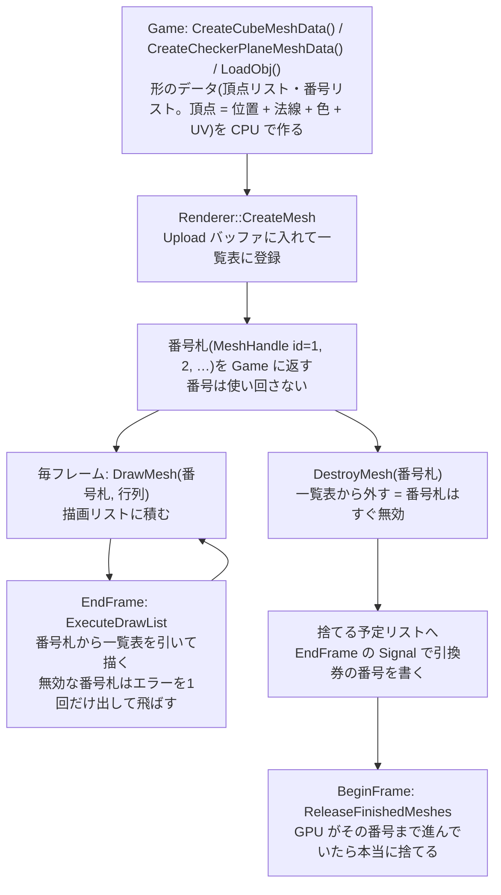
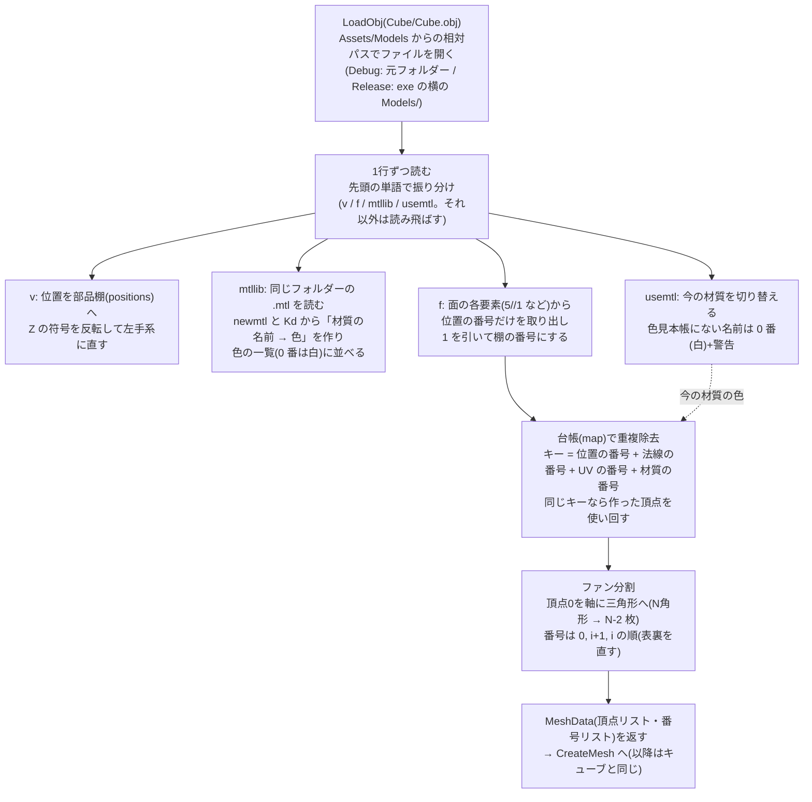

# メッシュ(形のデータ)

形(メッシュ)の作り方・番号札・削除の流れと、OBJ ファイルから読み込む流れ。

[← 資料の案内(Structure.md)に戻る](Structure.md)

## メッシュの一生(番号札の流れ)

| 処理 | 場所 |
|---|---|
| キューブの形を作る | [Mesh.cpp:46](../src/Renderer/Mesh.cpp#L46) |
| CreateMesh | [Renderer.cpp:223](../src/Renderer/Renderer.cpp#L223) |
| DestroyMesh | [Renderer.cpp:253](../src/Renderer/Renderer.cpp#L253) |
| 捨てる予定の形を捨てる | [Renderer.cpp:267](../src/Renderer/Renderer.cpp#L267) |
| DrawMesh | [Renderer.cpp:276](../src/Renderer/Renderer.cpp#L276) |
| 引換券の番号を書く | [Renderer.cpp:364](../src/Renderer/Renderer.cpp#L364) |

**遅延削除の理由**:CPU は GPU より1フレーム先を走っているので、DestroyMesh の時点で GPU がまだその形を描いているかもしれない。すぐに捨てると GPU が捨てたメモリを読んでしまう。フェーズ5のチャンク生成(走りながら作る・捨てるを繰り返す)でも止まらないように、Flush せずに後で捨てる(実際に、チャンクごとの形を、`SyncChunkMeshes` が、毎フレーム、作る・捨てている)。

**番号(indices)は uint32_t**:OBJ のモデルは頂点が 65536 個を超えることがあるため。型を変えるときは、`MeshData`・CreateMesh のバイト数計算・`IndexBufferView` の形式(`R32_UINT`)を必ず同時に直す。食い違うと、エラーは出ずに形だけが崩れる。

---

## OBJ 読み込みの流れ(LoadObj)

工場のたとえ:**設計図(.obj)を1行ずつ読んで、部品棚から製品を組み立てる**。

| 処理 | 場所 |
|---|---|
| モデルフォルダーの決定 | [ModelLoader.cpp:24](../src/Renderer/ModelLoader.cpp#L24) |
| .mtl を読む(LoadMtl) | [ModelLoader.cpp:40](../src/Renderer/ModelLoader.cpp#L40) |
| 面の要素から位置の番号を取り出す | [ModelLoader.cpp:80](../src/Renderer/ModelLoader.cpp#L80) |
| LoadObj 本体 | [ModelLoader.cpp:111](../src/Renderer/ModelLoader.cpp#L111) |
| v(Z の反転) | [ModelLoader.cpp:139](../src/Renderer/ModelLoader.cpp#L139) |
| f(重複除去・ファン分割) | [ModelLoader.cpp:153](../src/Renderer/ModelLoader.cpp#L153) |
| mtllib / usemtl | [ModelLoader.cpp:199](../src/Renderer/ModelLoader.cpp#L199) |

**押さえておく点**

| 点 | 内容 |
|---|---|
| 座標系 | OBJ は右手系(手前が +Z)、このエンジンは左手系(奥が +Z)。位置の Z を反転する。これは鏡に映すのと同じなので、三角形の表裏が入れ替わる → 三角形の番号の順を逆にして直す。他のエンジン(Unity など)も、インポートの時点で自分の座標系に変換する |
| 番号のずれ | OBJ は 1 から数え、C++ の配列は 0 から数える → 1 を引く。負の数は「棚の最後から数える」 |
| 重複除去 | 同じ位置でも、法線や材質が違えば別の頂点にする(頂点には法線も色も1つしか入らないため)。Cube は、法線が面ごとに違うので、頂点 24 個(位置 8 個を、面ごとに分ける) |
| 法線(vn) | `vn` を読む(位置と同じ理由で Z を反転し、長さ 1 にそろえる)。**`vn` が無いモデル(自機)は、面ごとに、2辺の外積から法線を計算して作る**(面ごとにカクカクした陰影になる。法線の違う面は、頂点を共有できないので、頂点が増える。自機は 2,082 三角形 → 6,246 頂点)。UV(`vt`)は、フェーズ6 で読むようになった(v は `1 − v`。OBJ は下が 0、D3D は上が 0)。`.mtl` の `map_Kd`(画像)は、`MeshData::diffuseTexturePath` に入る([Textures.md](Textures.md)) |
| 失敗したとき | ファイルが開けない → エラーログ + 空の MeshData(CreateMesh が弾いて無効な番号札になり、描かれないだけ)。壊れた行 → 警告 + その行を飛ばす。.mtl が開けない → 警告 + 全部白 |
| 大きさ | OBJ の単位はモデルによって違う(サンプルの木は約 28 メートル)。大きさは Game 側の `DrawMesh` の行列(拡大)で合わせる |

---

## 基本の形を作る関数(Engine の Mesh.cpp)

| 関数 | 形 | 使い道 |
|---|---|---|
| `CreateCubeMeshData` | 1 辺 1 m のキューブ(面ごとに頂点 4 つ・面ごとの法線) | 回るキューブ・障害物(フェーズ5 では、`BuildChunkMeshData` が、障害物ごとに、頂点を拡大・移動して、チャンク 1 つぶんの形にまとめる。Chunks.md) |
| `CreateCheckerPlaneMeshData` | 市松模様の平らな板(タイルごとに頂点 4 つ・法線は上向き) | 地面(自機に合わせて 4 m ずつずらして、無限に続いて見せる) |

頂点の形は `Vertex { position, normal, color, uv }`(48 バイト)。C++ の `Vertex`、入力レイアウト、シェーダーの `VSInput` の 3 か所は、同じ形でそろえる(1 か所でも食い違うと、形が崩れる)。詳しくは [Lighting.md](Lighting.md)。
