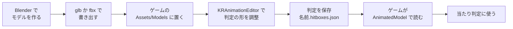
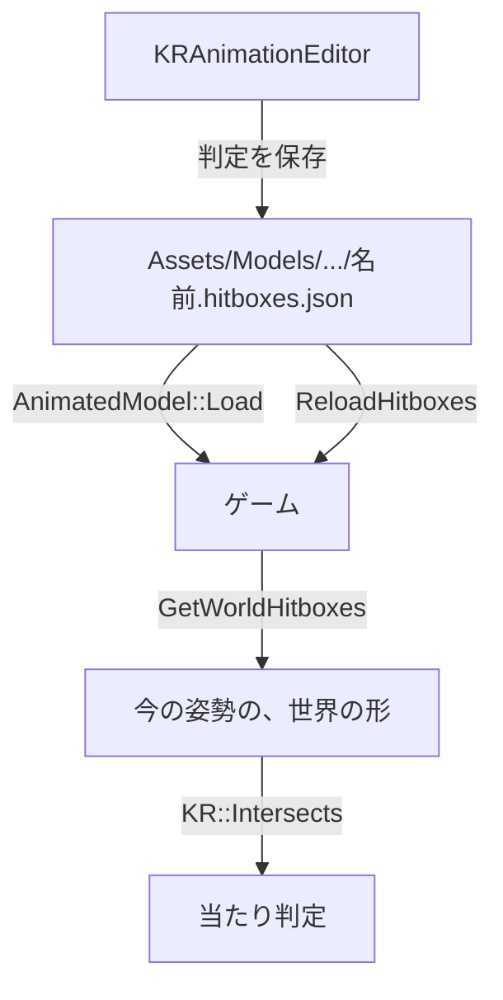

# AnimationEditorGuide

<!-- 画像の置き場所:docs/Reference/images/。撮ったら、該当の節に、他のページと同じ書き方(感嘆符・角括弧の説明・丸括弧の images/ファイル名)で、足す。AnimEd_01_start.png=起動直後 / AnimEd_02_hitboxes.png=判定の形だけ / AnimEd_03_select.png=形を選んだ / AnimEd_04_panel_hitbox.png=当たり判定のパネル / AnimEd_05_scale.png=大きさのギズモ / AnimEd_06_hit_test.png=テストの箱に当たって赤 / AnimEd_07_mirror.png=左右反転 / AnimEd_08_unsaved.png=未保存の印 -->

## 概要
**KRAnimationEditor** は、動くモデル(骨つきの 3D モデル)の**当たり判定の形**を、画面を見ながら調整するツールです。数字を打たなくても、3D の絵の上で、形を**クリックで選んで、ドラッグで動かして、大きさを変えられます**。

### 先に、言葉の説明
| 言葉 | 意味 |
|---|---|
| **骨**(ボーン) | モデルの中にある、関節のようなもの。腕・足・頭など。骨が動くと、そこに付いた体が動く |
| **動き**(アニメーション) | 「歩く」「攻撃する」のような、骨の動きの、ひとまとまり。モデルのファイルの中に、入っている |
| **判定の形** | 当たり判定に使う、**箱か球**。骨にくっついていて、骨が動くと、一緒に動く。見た目の形とは、別に、持つ |
| **アセット** | ゲームのデータ(モデル・音・設定など)。ゲームの `Assets` フォルダーに置く |

### なぜ、判定の形を、別に持つのか
モデルの見た目は、細かい形です。それを、そのまま当たり判定に使うと、計算が重くなります。そこで、**体のおおまかな部分を、箱や球で囲んで**、その箱や球で当たりを調べます。この箱や球を、画面を見ながら、**体に合うように調整する**のが、このツールの仕事です。

### 全体の流れ

**ツールで調整して、保存する。ゲームは、読むだけ**です。ゲームのコードで、判定の形を、直す必要はありません。

## 準備

### 1. エンジンをビルドする
エンジンのフォルダー(`KREngine`)で、次を実行します。ツールは、エンジンと一緒に、ビルドされます。
```powershell
cmake --preset vs2026
cmake --build build --config Debug
```
できあがる実行ファイル:`build\tools\AnimationEditor\Debug\KRAnimationEditor.exe`

Visual Studio を使うなら、エンジンの `build\KREngine.slnx` を開くと、**KRAnimationEditor が、最初から、起動する対象**になっています。F5 で、ビルドして、起動できます。

### 2. モデルを用意する
Blender で作ったモデルを、`.glb`(glTF)か `.fbx` で書き出して、ゲームの `Assets\Models\<モデルの名前>\` に置きます。書き出し方の注意(座標・骨・動き)は、`docs/Usage.md` の 7-1 に、書いてあります。

このページの手順では、エンジンに入っている見本のモデル(人型・骨が 212 本)を使います。
```text
KREngine\samples\Assets\Models\Test\HumanModel\HumanModel.glb
```

## 起動
4 つの方法があります。

### ① Visual Studio から
`KRAnimationEditor` を起動する対象にして、F5 を押します。最初は、エンジンの `samples\Assets` が、開きます。2 回目からは、前回の続きです(`KRAnimationEditor.txt` に、覚えています)。

### ② コマンドで、ゲームのフォルダーを、最初から開く
```powershell
KRAnimationEditor.exe --assets "ゲームのAssetsフォルダー" --model Test/HumanModel/HumanModel.glb
```
| 引数 | 意味 |
|---|---|
| `--assets` | ゲームの `Assets` フォルダー(中に `Models` フォルダーが、あるフォルダー) |
| `--model` | `Models` の下からの場所(`Models\` は、書かない)。省略すると、一覧の最初のモデル |

### ③ 画面の中で、フォルダーを選ぶ
ツールを起動してから、左上の「プロジェクト」の「アセット」の欄で、フォルダーを書いて Enter、または「参照...」ボタンで選びます。「最近...」ボタンで、最近使ったフォルダーに、切り替えられます。

### ④ プログラマー以外の人に、渡す
ツールの実行ファイルだけを、`dist\` フォルダーに取り出します。
```powershell
powershell -NoProfile -ExecutionPolicy Bypass -File tools\Publish-Tools.ps1
```
できた `dist\` を、渡して、受け取った人は、`KRAnimationEditor.exe` を起動して、③ でゲームのフォルダーを選びます(ビルドの道具は、要りません)。

## 画面の見方
画面の左に、**操作のパネル**があり、残りが、**3D の絵**(ビューポート)です。パネルは、上から、次の区画に分かれています。

| 区画 | 項目 | 役割 |
|---|---|---|
| **プロジェクト** | アセット | 開くゲームの `Assets` フォルダー。「最近...」と「参照...」で、選べる |
| | モデル | `Assets\Models` の下の、`.glb` `.gltf` `.fbx` の一覧。選ぶと、開く |
| **表示** | 骨 / 骨を手前に表示 / メッシュ | 骨の線・骨をモデルの手前に描くか・モデルの見た目(メッシュ)を、表示するか |
| | モデルを回す | モデルを、自動で回す |
| | カメラをリセット | カメラを、最初の位置に戻す |
| | **骨の選択** | 骨を、名前の一覧から選ぶ。選んだ骨が、橙色になる。下の、判定の形の調整の対象になる |
| **再生** | 動き | 動きを、名前の一覧から選ぶ |
| | 一時停止 / ループ / 速さ / 時刻 | 止める・繰り返す・速さ・今の時刻(止めて、時刻を動かすと、その姿勢を確かめられる) |
| | 基準姿勢(アニメーションなし) | オンにすると、動きを止めて、基準の姿勢にする |
| **当たり判定** | 判定の形を表示 | 判定の形を、緑の線で表示する。選んだ形は黄色、テストの箱に触れた形は赤 |
| | テストの箱の位置 | 水色の「テストの箱」の位置。判定の形に、ぶつけて、当たりを確かめる |
| | 形の種類 / 中心(骨の中) / 半分の大きさ・半径 | 選んだ形の、種類(箱か球)・中心の位置・大きさ |
| | この骨に判定の形を追加 / この形を削除 | 形を、足す・消す |
| | コピー / 貼り付け / 左右反転して貼り付け | 形の、複製 |
| | **判定を保存** / 判定を読み直す | 保存・ファイルから読み直す |

## 操作

### マウス
| 操作 | 何が起きるか |
|---|---|
| 左ドラッグ | カメラを回す |
| 中ボタンのドラッグ | カメラを、平行に動かす |
| ホイール | 近づく・離れる |
| **左クリック** | 判定の形・骨を、選ぶ(動かさずに、押して離す)。パネルの上では、選ばない |

### 3D の絵の上で、形を直接、直す
| やりたいこと | 操作 |
|---|---|
| 形を選ぶ | 緑の線の形を、左クリック。重なっているときは、**一番手前**の形が選ばれる |
| 骨を選ぶ | 形に当たらない所で、骨の線の近くを、左クリック。形と骨が重なるときは、形が先に選ばれる |
| 形を動かす | 選んだ形に出る、**移動のギズモ**(赤 = X、緑 = Y、青 = Z の矢印)を、ドラッグ |
| 大きさを変える | **S キー**(または、パネルの「大きさ (S)」)で、**大きさのギズモ**に切り替えて、ドラッグ |
| 移動に戻す | **T キー**(またはパネルの「移動 (T)」) |
| コピー・貼り付け | **Ctrl + C**・**Ctrl + V**(またはボタン) |
| 左右反転して貼り付け | コピーした形を、**左右の鏡映し**にして、対の骨に貼る。対の骨は、名前から自動で決まる(下) |

大きさの最小は 0.01 です。ギズモの上にマウスがあるとき・ドラッグ中は、カメラを回さず、クリックでも選びません。文字を入力している間は、キー(T・S など)が、ツールに届きません。

### 「左右反転して貼り付け」で、対になる骨
骨の名前から、自動で、決まります。次の順に調べます。

1. 名前の終わりが `.L` と `.R`(または `_L` と `_R`。小文字も)。例:`arm.L` と `arm.R`
2. `Left` と `Right` を含む(大文字・小文字は、問いません)。例:`LeftHand` と `RightHand`
3. `左` と `右` を含む。例:`左腕` と `右腕`

どれにも、当てはまらないとき(体の真ん中の骨など)は、「反転先の骨」の一覧から、自分で選びます。

### 保存していないときの印
形を、動かす・大きさを変える・貼り付けると、**「* 判定の形が、保存されていません」**が出ます。保存しないまま、別のモデルやフォルダーに切り替えようとすると、確認の窓が出ます(保存して続ける・捨てて続ける・やめる)。ツールの窓の「×」で閉じるときは、確認が出ない場合があるので、**閉じる前に、保存**してください。

## 通しのチュートリアル:判定を直して、ゲームで当たりを確かめる
ここでは、**新しいゲームを作って、人型のモデルを表示して、調整した判定に、弾(球)を当てる**ところまで、通して作ります。

### 手順 1　新しいゲームを作る
フォルダー `HitboxTutorial` を作って、次の構成にします。
```text
HitboxTutorial/
├─ CMakeLists.txt
├─ External/KREngine/        ← エンジン(Git のサブモジュール)
├─ Assets/
│   └─ Models/Test/HumanModel/HumanModel.glb    ← 手順 2 で置く
└─ src/
    └─ GameApp.cpp                              ← 手順 5 で書く
```
`CMakeLists.txt` は、**4 行**です(最初の 2 行は、決まり文句。エンジンの取り込み方は、`docs/Usage.md` の 2-1)。
```cmake
cmake_minimum_required(VERSION 3.28)
project(HitboxTutorial LANGUAGES CXX)
add_subdirectory(External/KREngine)
kr_add_game(HitboxTutorial)
```
`kr_add_game` が、`src\` の下の `.cpp` を、自動で集めて、実行ファイルを作ります。CMake の、ほかの設定は、要りません。

### 手順 2　モデルを置く
エンジンの `samples\Assets\Models\Test\HumanModel\` の中の `HumanModel.glb` を、ゲームの `Assets\Models\Test\HumanModel\` に、コピーします。

### 手順 3　ツールで開いて、判定を直す
```powershell
KRAnimationEditor.exe --assets "HitboxTutorial\Assets" --model Test/HumanModel/HumanModel.glb
```
1. 画面の上で、モデルが歩いています(「動き」が `Walk`)。**「骨」のチェックを外す**と、判定の形(緑の線)が、見やすくなります。
2. 体の部分の緑の形を、**左クリック**して、選びます。選んだ形が黄色になり、**移動のギズモ**が出ます。
3. ギズモの矢印を、ドラッグして、形を、体に合う位置に動かします。
4. **S キー**を押して、**大きさのギズモ**に切り替えて、ドラッグして、体の大きさに合わせます。**T キー**で、移動に戻ります。
5. **当たりの確認**:「当たり判定」の「テストの箱の位置」の一番左の数字を、ドラッグして、水色のテストの箱を、モデルに近づけます。**箱に触れた形は、赤くなり**、パネルに、当たった形の名前が出ます。
6. 気に入ったら、**「判定を保存」**を押します。

### 手順 4　保存されるもの
モデルの隣に、`HumanModel.hitboxes.json` ができます。
```text
HitboxTutorial/Assets/Models/Test/HumanModel/
├─ HumanModel.glb
└─ HumanModel.hitboxes.json      ← 保存で、できる
```
中身は、判定の形の一覧です(人が読める、JSON の文字のファイル)。
```json
{
  "version": 1,
  "hitboxes": [
    {
      "name": "root",
      "joint": "root",
      "jointIndex": 0,
      "shape": "sphere",
      "center": [0.0, 0.0, 0.0],
      "rotation": [0.0, 0.0, 0.0, 1.0],
      "halfSize": [0.5, 0.5, 0.5],
      "radius": 0.58
    }
  ]
}
```
| 項目 | 意味 |
|---|---|
| `joint` | くっつけた骨の**名前**。ゲームは、名前で骨を探す(骨の並びが変わっても、壊れない) |
| `shape` | `box`(箱)か `sphere`(球) |
| `center` | 骨の中での、位置。**骨が動いても、この数字は変わらない** |
| `halfSize` / `radius` | 箱の半分の大きさ / 球の半径(メートル) |

ファイルが無いモデルは、ゲームが、骨ごとの、とりあえずの形を作ります。

### 手順 5　ゲームのコードを書く
`src\GameApp.cpp` に、次を書きます。モデルを読んで、判定の形を線で見せて、A キーと D キーで動かせる弾(球)が、当たると、**当たった形の名前**を出します。
```cpp
#include <KR/KR.h>
#include <imgui.h>
#include <memory>
#include <string>

using namespace DirectX;

class GameApp : public KR::Application
{
public:
    GameApp() : Application(KR::ApplicationDesc{ .title = "判定のチュートリアル" }) {}

protected:
    void OnInit() override
    {
        // ① モデルを読む。判定の形は、同じ場所の HumanModel.hitboxes.json があれば、それを読む
        if (!m_Model.Load(GetRenderer(), "Test/HumanModel/HumanModel.glb"))
        {
            KR_LOG_ERROR("モデルを読めませんでした");
            return;
        }
        m_Model.Play("Walk");                                  // ② 動きを選ぶ(最初の動きは、もう再生している)

        // モデルの大きさに合わせて、弾とカメラの位置を決める
        const KR::AnimatedModel::Bounds& bounds = m_Model.GetBounds();
        m_Center = bounds.Center();
        m_Radius = bounds.Radius();
        m_BulletX = m_Center.x + m_Radius * 1.5f;
    }

    void OnUpdate(float deltaTime) override
    {
        m_Model.Update(deltaTime);                             // ③ 時刻を進めて、姿勢を求める

        // A キー・D キーで、弾を左右に動かす
        const float speed = m_Radius * 0.8f;
        if (KR::Input::IsKeyDown(KR::Key::A)) { m_BulletX -= speed * deltaTime; }
        if (KR::Input::IsKeyDown(KR::Key::D)) { m_BulletX += speed * deltaTime; }

        // ④ 当たり判定:今の姿勢の、世界の形を取って、弾の球と、1 つずつ調べる
        m_Bullet = KR::Sphere{ XMFLOAT3{ m_BulletX, m_Center.y, m_Center.z }, m_Radius * 0.08f };
        KR::WorldHitbox bullet;
        bullet.shape = KR::HitShape::Sphere;
        bullet.sphere = m_Bullet;

        m_HitName.clear();
        m_WorldHitboxes = m_Model.GetWorldHitboxes(XMMatrixIdentity());   // Draw に渡す行列と、同じ物
        const std::vector<KR::Hitbox>& definitions = m_Model.GetHitboxes();
        for (size_t i = 0; i < m_WorldHitboxes.size(); ++i)
        {
            if (KR::Intersects(m_WorldHitboxes[i], bullet)) { m_HitName = definitions[i].name; break; }
        }

        KR::Camera camera;
        camera.SetPosition({ m_Center.x, m_Center.y + m_Radius * 0.3f, m_Center.z - m_Radius * 3.0f });
        camera.LookAt(m_Center);
        GetRenderer().SetCamera(camera);
    }

    void OnRender() override
    {
        m_Model.Draw(GetRenderer(), XMMatrixIdentity());       // ⑤ 描く

        // 判定の形を、線で見せる(確認用)
        for (const KR::WorldHitbox& hit : m_WorldHitboxes)
        {
            if (hit.shape == KR::HitShape::Box) { GetRenderer().DrawWireBox(hit.box, { 0.2f, 1.0f, 0.3f, 1.0f }); }
            else { GetRenderer().DrawWireSphere(hit.sphere, { 0.2f, 1.0f, 0.3f, 1.0f }); }
        }
        // 弾:当たっていたら赤、当たっていなければ白
        const XMFLOAT4 color = m_HitName.empty() ? XMFLOAT4{ 1.0f, 1.0f, 1.0f, 1.0f } : XMFLOAT4{ 1.0f, 0.2f, 0.2f, 1.0f };
        GetRenderer().DrawWireSphere(m_Bullet, color);
    }

    void OnImGui() override
    {
        ImGui::Begin("判定");
        ImGui::Text("A / D キーで、弾を動かす");
        if (m_HitName.empty()) { ImGui::Text("当たっていない"); }
        else { ImGui::Text("当たった形: %s", m_HitName.c_str()); }
        // ツールで保存し直したら、このボタンで、ゲームを再起動せずに、読み直せる
        if (ImGui::Button("判定を読み直す")) { m_Model.ReloadHitboxes(); }
        ImGui::End();
    }

    void OnShutdown() override { m_Model.Unload(GetRenderer()); }   // ⑥ 片づける

private:
    KR::AnimatedModel m_Model;
    std::vector<KR::WorldHitbox> m_WorldHitboxes;
    KR::Sphere m_Bullet;
    XMFLOAT3 m_Center = { 0.0f, 0.0f, 0.0f };
    float m_Radius = 1.0f;
    float m_BulletX = 0.0f;
    std::string m_HitName;
};

std::unique_ptr<KR::Application> KR::CreateApplication() { return std::make_unique<GameApp>(); }
```
**コードの読み方**:

| 番号 | やっていること | 使っている関数 |
|---|---|---|
| ① | モデルと、判定の形のファイルを、読む | `AnimatedModel::Load()` |
| ② | 動きを選ぶ | `AnimatedModel::Play()` |
| ③ | 毎フレーム、時刻を進めて、姿勢を求める | `AnimatedModel::Update()` |
| ④ | 今の姿勢での、判定の形(世界の座標)を取って、弾と重なるかを調べる | `GetWorldHitboxes()`・`KR::Intersects()` |
| ⑤ | モデルを描く。判定の形を、線で見せる | `AnimatedModel::Draw()`・`DrawWireBox()`・`DrawWireSphere()` |
| ⑥ | 終わるときに、返す | `AnimatedModel::Unload()` |

`GetWorldHitboxes()` と `Draw()` に、**同じ行列**(ここでは、`XMMatrixIdentity()`)を渡すのが、決まりです。違う行列を渡すと、見た目と判定が、ずれます。

### 手順 6　ビルドして、動かす
```powershell
cd HitboxTutorial
cmake --preset vs2026
cmake --build build --config Debug
build\Debug\HitboxTutorial.exe
```
`CMakePresets.json` が無いときは、`cmake -S . -B build -G "Visual Studio 18 2026" -A x64` に、してください。

動かすと、モデルが歩いて、緑の線の判定が、体に付いてきます。**A キーと D キーで、弾を動かして、モデルに当てる**と、弾が赤くなり、「判定」の窓に、当たった形の名前が出ます。

**見本のモデルについて**:この人型のモデルは、骨が 212 本あり、判定の形(既定)が、たくさん重なって、緑の線が多く見えます。ふだんの、骨が少ないモデルなら、もっとすっきり見えます。起動したときに、コンソールに、警告「スキンが 2 個あります。最初の 1 つだけ読みます」が出ますが、モデルに、スキン(骨の組)が 2 つあるためで、動きに、問題はありません。

**判定を、直したくなったら**:ゲームを動かしたまま、ツールで、形を直して「判定を保存」。ゲームの「判定」の窓の**「判定を読み直す」**ボタンを押すと、再起動なしで、直した形に変わります。

## 保存と読み込みの仕組み

- **ツールとゲームは、ファイルでつながる**だけです。ツールは、開いたゲームの `Assets` フォルダーに、書き込みます。
- 保存先は、**モデルの隣**です。`.glb` と `.fbx`(拡張子だけが、違う)は、同じ `名前.hitboxes.json` を、共有します。
- 骨は、**名前**で探します。Blender で、骨の名前を変えたら、ツールで開き直して、保存し直してください。

## うまくいかないとき
| 症状 | 原因と直し方 |
|---|---|
| ツールを開いたまま、ビルドすると、リンクエラー(LNK1168)が出る | `KRAnimationEditor.exe` が、起動中。ツールを閉じてから、ビルドする |
| ツールで開いても、モデルの一覧が、空 | 選んだフォルダーに、`Models` フォルダーが、無い。**Assets フォルダー**(`Models` の、1 つ上)を選ぶ |
| 保存したのに、ゲームに反映されない | ゲームを、**再起動**する。または、ゲームから `ReloadHitboxes()` を呼ぶ(上の「判定を読み直す」ボタン)。別のゲームの `Assets` を、開いていないかも、確認する |
| 判定の形が、モデルから、大きく離れた所に出る | FBX の、骨とメッシュが、離れている。ツールを起動したときのログに、警告「骨とメッシュが離れています」が出る。Blender で、両方を原点にそろえて、書き出し直す |
| 日本語のフォルダーに、置いたら、開けない | 開けるはずです(エンジンは、日本語のフォルダーに対応済み)。起動したときのログ(コンソール)に、理由が出ていないか、確認する |
| 骨の名前を変えたら、判定の形が、消えた | 骨は、名前で探すので、名前が変わると、見つからない(ログに警告)。ツールで、形を付け直して、保存する |
| 「形式の版が違います」とログに出る | 古いエンジンで保存したファイル、または、新しいエンジンのファイル。ツールと、ゲームの、エンジンの版を、そろえる |
| 起動したときの警告「スキンが 2 個あります。最初の 1 つだけ読みます」 | モデルに、スキン(骨の組)が、2 つ以上ある。最初の 1 つだけ使う。見本の人型のモデルでも出るが、動く |
| T キーや S キーが、効かない | 文字を入力している欄に、カーソルがある。パネルの外を、クリックしてから、押す |

## なぜ、こうなっているか
- **ツールとゲームを、ファイルでつなぐ**:ツールで直した結果を、ゲームのコードに、書き写さなくて済む。ゲームは、読むだけ。形を直しても、**ゲームの再ビルドは、要らない**。
- **判定の形は、骨の中の座標で持つ**:骨が動いても、数字が変わらない。ゲームは、骨の今の位置を掛けて、世界の座標にする(`GetWorldHitboxes`)。
- **骨は、名前で探す**:骨の並び(番号)は、モデルを書き出し直すと、変わることがある。名前なら、壊れにくい。
- **ギズモ(矢印をドラッグする仕組み)は、外部ライブラリ ImGuizmo**:自分で作ると、矢印・つまみ・ドラッグの計算が、全部、要る。ツールだけが使い、ゲームには、入らない。
- 詳しい記録(選ばなかった案・確認したこと)は、`docs/AnimationEditor.md` と `docs/Animation.md`。

## 関連
- 関数の説明:[AnimatedModel](AnimatedModel.md)・[Hitbox](Hitbox.md)・[Collision](Collision.md)
- 敵の行動を、ノードで作るツール:[BehaviorEditorGuide](BehaviorEditorGuide.md)
