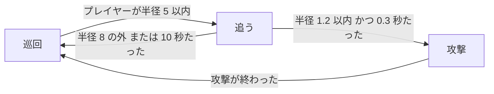
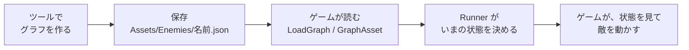
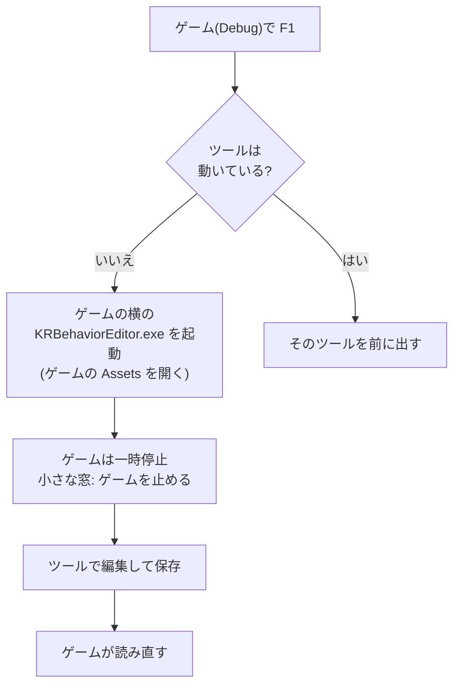

# BehaviorEditorGuide

<!-- 画像の置き場所:docs/Reference/images/。撮ったら、該当の節に、他のページと同じ書き方(感嘆符・角括弧の説明・丸括弧の images/ファイル名)で、足す。BehEd_01_start.png=起動直後 / BehEd_02_zoom.png=拡大 / BehEd_03_menu.png=右クリックのメニュー / BehEd_04_node_menu.png=ノードのメニュー / BehEd_05_connect.png=線を引く途中 / BehEd_06_rows.png=遷移の行のボタン / BehEd_07_warning.png=警告 / BehEd_08_unsaved.png=保存していない印 / BehEd_09_save.png=保存 / F1_01_game.png=ゲーム / F1_02_editor_open.png=F1 でツールが開いた -->

## 概要
**KRBehaviorEditor** は、敵の行動(巡回する・プレイヤーを追う・攻撃する)を、**ノードと線**で作るツールです。プログラムで、`if` を、何重にも書かなくても、**図を描くように**、行動を決められます。作った行動は、**JSON ファイル**に保存されて、ゲームは、それを読んで動かします。

### 先に、言葉の説明
| 言葉 | 意味 | 画面での色 |
|---|---|---|
| **状態** | 敵が、いま、していること。「待機」「巡回」「プレイヤーへ移動」「攻撃」 | 青 |
| **条件** | 「成り立つか」(はい / いいえ)を調べる部品。「プレイヤーが半径 3 以内」「1 秒たった」 | 緑 |
| **論理** | 条件を組み合わせる部品。「かつ」「または」「でない」 | 紫 |
| **遷移の行** | 状態のノードの中に並ぶ、「もし [条件] なら → [次の状態]」の 1 行。上の行から、順に調べる | 状態の中の行 |
| **ピン** | ノードの端にある丸。ここから、ここへ、線をつなぐ | 丸 |
| **グラフ** | ノードと線の全体。1 種類の敵が、1 つのグラフ(1 つのファイル)を持つ | |

### どんな行動が作れるか
たとえば、次のような行動です。

**エンジンがするのは、「いま、どの状態か」を決めることだけ**です。実際に歩く・攻撃する・ぶつかる処理(物理や当たり判定)は、**ゲームが書きます**。

### 全体の流れ


## 準備

### 1. エンジンをビルドする
エンジンのフォルダー(`KREngine`)で、次を実行します。ツールは、エンジンと一緒に、ビルドされます。
```powershell
cmake --preset vs2026
cmake --build build --config Debug
```
できあがる実行ファイル:`build\tools\BehaviorEditor\Debug\KRBehaviorEditor.exe`

### 2. ゲームの `Assets` フォルダーを決める
ツールは、ゲームの `Assets\Enemies\` フォルダーに、グラフ(`.json`)を、保存します。`Enemies` フォルダーが、まだ無くても、**保存したときに、作られます**。

## 起動
4 つの方法があります。

### ① Visual Studio から
`KRBehaviorEditor` を、スタートアップ プロジェクトに設定して、F5 を押します(エンジンの、最初のスタートアップは、`KRAnimationEditor` です。変えるときは、ソリューション エクスプローラーで、`KRBehaviorEditor` を、右クリック →「スタートアップ プロジェクトに設定」)。

### ② コマンドで、ゲームのフォルダーを、最初から開く
```powershell
KRBehaviorEditor.exe --assets "ゲームのAssetsフォルダー" --graph Walker
```
| 引数 | 意味 |
|---|---|
| `--assets` | ゲームの `Assets` フォルダー |
| `--graph` | 開くグラフの名前(`Walker` でも `Walker.json` でもよい) |

引数が無いときは、**前回の続き**(`KRBehaviorEditor.txt` に、覚えています。`.exe` の隣)。

### ③ ゲームから F1 キーで開く(いちばん便利)
**Debug のゲーム**を動かしている途中で、**F1 キー**を押すと、ツールが開きます。ゲームのフォルダーの `Assets` が、**自動で、開かれます**。使うには、ゲームの CMake に、1 行が要ります(下の「F1 で開く」)。

### ④ プログラマー以外の人に、渡す
```powershell
powershell -NoProfile -ExecutionPolicy Bypass -File tools\Publish-Tools.ps1
```
`dist\` に、ツールの実行ファイルだけが、取り出されます。受け取った人は、`KRBehaviorEditor.exe` を起動して、「参照...」で、ゲームの `Assets` フォルダーを選びます。

## 画面の見方
画面いっぱいの 1 枚の窓です。**左**が、フォルダー・一覧のパネル(幅は一定)で、**右**が、警告の一覧と、グラフです。

| 場所 | 項目 | 役割 |
|---|---|---|
| 左・上 | アセットのフォルダー(文字欄・「参照...」・「最近...」) | 開くゲームの `Assets` フォルダー。文字欄に入れて Enter、または、ボタンで選ぶ |
| 左・中 | 一覧 | `Assets\Enemies\*.json` の名前の一覧。押すと、そのグラフが開く。「一覧を更新」で、読み直す |
| 左・下 | このグラフ | 名前の文字欄・「保存」・「新規」・「読み直し」 |
| 左・最下 | 「● 保存していない変更があります」(橙) | グラフを直したのに、まだ、保存していないときに出る |
| 右・上 | 警告の一覧 | つなぎ忘れなどを、日本語で知らせる(下の「警告」) |
| 右 | グラフ | ノードと線。青 = 状態、緑 = 条件、紫 = 論理。橙の太い枠 = 最初に始まる状態(題に「[開始]」) |

## 操作

### グラフの上での操作
| やりたいこと | 操作 |
|---|---|
| 拡大・縮小 | マウスの**ホイール** |
| 画面を動かす | **右ボタンを押したまま**ドラッグ |
| ノードを動かす | ノードの題を、**左ボタンで**ドラッグ |
| ノードを選ぶ | 左クリック(まとめて選ぶときは、何もない所から、ドラッグで囲む) |
| **ノードを足す** | **何もない所**で、右クリック(押して離すだけ)→ メニューから選ぶ |
| 開始の状態を決める | **状態のノードの上**で、右クリック →「ここから始める」 |
| 遷移の行を足す | 状態のノードの中の「＋ 遷移の行を足す」(または、ノードの右クリックの「遷移の行を足す」) |
| 遷移の行の、順番を変える | 行の中央の「▲」(1 つ上へ)・「▼」(1 つ下へ)。上の行から、順に調べる |
| 遷移の行を消す | 行の「×」 |
| 論理の入力を足す・消す | 「かつ」「または」のノードの「＋ 入力を足す」・入力の行の「×」(2 つまで減らせる。16 まで足せる) |
| **線をつなぐ** | ピンから、つなぎたいピンへ、**左ボタンで**ドラッグ。離したときに、つながる |
| 線を消す | 線を選んで **Delete**、または、線を、ピンから引き離す |
| ノードを消す | ノードを選んで **Delete**(つながる線も、一緒に消える) |
| 値を直す | ノードの中の、数字の欄(ドラッグ・打ち込み)・チェック・文字の欄 |
| 保存 | 「保存」ボタン、または **Ctrl + S** |

### 右クリックのメニュー
| 場所 | メニューの項目 |
|---|---|
| **何もない所** | 「ノードを足す」:**状態**(待機・巡回・プレイヤーへ移動・攻撃)/ **条件(状況を調べる)**(プレイヤーが半径以内・プレイヤーが半径の外・秒たった・攻撃が終わった)/ **論理**(かつ・または・でない) |
| **状態のノードの上** | 「ここから始める」・「遷移の行を足す」・「このノードを消す」 |
| **論理のノードの上** | 「入力を足す」・「このノードを消す」 |

### 線のつなぎ方の決まり
つなげるのは、次の 3 通りだけです。

| つなぎ方 | 意味 | 例 |
|---|---|---|
| 条件の**出口**(右の丸)→ 遷移の行の**入口**(左の丸) | その行が、成り立つ条件 | 「プレイヤーが半径以内」→ 行 |
| 遷移の行の**出口**(右の丸)→ 状態の**入口**(題の左の丸) | 成り立ったとき、移る先 | 行 → 「追う」 |
| 条件の**出口** → 論理の**入力**(左の丸) | 条件を、組み合わせる | 「半径以内」→「かつ」の入力 1 |

- **規則に合わない相手の上では、線が、赤くなって**断られます(離しても、つながりません)。
- **循環**(自分自身に戻るつなぎ)は、作れません。
- 状態の出口(行)は、いくつ作っても構いません(分岐)。**行は、上から調べて、最初に成り立った行の先へ、移ります**(1 回の更新で、移るのは 1 回まで)。

### 値の意味(よく使う物)
| ノード | 値 | 意味 |
|---|---|---|
| 巡回 | `speed` | 歩く速さ(1 秒に何メートルか) |
| プレイヤーへ移動 | `speed` | 追う速さ |
| 攻撃 | `windupSeconds`・`activeSeconds`・`recoverySeconds` | 溜め・攻撃が出ている・硬直の、秒 |
| 攻撃 | `boxWidth`・`boxHeight`・`damage` | 攻撃の箱の大きさ・ダメージ |
| プレイヤーが半径以内 | `radius` | 半径(メートル)。**ちょうど半径は、内側** |
| プレイヤーが半径以内 | `key`(既定 `distanceToPlayerX`) | **ゲームが、`Context` に入れる、距離の名前**。ゲームと、そろえる |
| 秒たった | `seconds` | 状態に入ってから、何秒か(エンジンが、数える) |
| 攻撃が終わった | `key`(既定 `attackFinished`) | ゲームが、攻撃が終わったときに、真にする名前 |

### 警告
つなぎ忘れなどが、右上の一覧に、出ます。**警告があっても、グラフは、動きます**(作っている途中は、つなぎ忘れが、いつもあるため)。

| 警告 | 意味 |
|---|---|
| 開始なし | 最初の状態が、決まっていない(最初の状態から、始まる) |
| 遷移の行が未完成 | 行の、条件の入口、または、次の状態の出口が、つながっていない(その行は、使われない) |
| 行き止まり | 状態から、出る行が、無い(その状態の、ままになる。終わりの状態として、わざと作ってもよい) |
| 論理の入力不足 | 「かつ」「または」「でない」に、条件が、つながっていない |
| 使われていない条件 | 条件が、どの行にも、つながっていない |
| 循環 | 条件が、自分自身に戻っている(作れない。古いファイルにあれば、警告) |
| たどり着けない状態 | 開始から、線をたどって、行けない状態 |

### 保存のときの決まり
- 保存先は、`<Assets>\Enemies\<名前>.json` です。名前の `.json` は、書かなくて構いません。
- 名前に、**使えない文字**:空・前後の空白や「.」・`\ / : * ? " < > |`・制御文字。
- **今開いている名前と、違う名前**で、同じ名前のファイルが、既にあるとき:「上書きしますか?」と聞かれます。
- **保存していない変更**があるときに、フォルダーを変える・別のグラフを開く・「新規」・「読み直し」を押すと、確認の窓が出ます(保存して続ける・捨てて続ける・やめる)。
- ツールの窓の「×」で閉じるときは、確認が出ません。**閉じる前に、保存**してください。

## 通しのチュートリアル:敵を、巡回・追跡・攻撃させる
**新しいゲームを作って、敵のグラフを読み込んで、巡回する敵を動かして、ツールで直すと、動いているゲームに、すぐ反映される**ところまで、通して作ります。

### 手順 1　新しいゲームを作る
フォルダー `EnemyTutorial` を作って、次の構成にします。
```text
EnemyTutorial/
├─ CMakeLists.txt
├─ External/KREngine/        ← エンジン(Git のサブモジュール)
├─ Assets/
│   └─ Enemies/
│       └─ Walker.json       ← 手順 2 で置く
└─ src/
    └─ GameApp.cpp           ← 手順 4 で書く
```
`CMakeLists.txt` は、**5 行**です(最初の 2 行は、決まり文句)。3 行目の `set(KR_BUILD_TOOLS ...)` が、**F1 でツールを開く**ための 1 行です(要らなければ、消してください)。
```cmake
cmake_minimum_required(VERSION 3.28)
project(EnemyTutorial LANGUAGES CXX)
set(KR_BUILD_TOOLS ON CACHE BOOL "" FORCE)
add_subdirectory(External/KREngine)
kr_add_game(EnemyTutorial)
```
`set(KR_BUILD_TOOLS ...)` は、**エンジンを取り込む前**に書きます。あると、ゲームをビルドするときに、ツールも一緒にビルドされて、**Debug のときだけ**、ゲームの実行ファイルの横に、`KRBehaviorEditor.exe` が、コピーされます。

### 手順 2　グラフを用意する
**いちばん早い方法**:エンジンの `samples\Assets\Enemies\Walker.json` を、ゲームの `Assets\Enemies\` に、コピーします。巡回して、プレイヤーに気づくと追って、近づくと攻撃する敵です。
```text
KREngine\samples\Assets\Enemies\Walker.json  →  EnemyTutorial\Assets\Enemies\Walker.json
```

**自分で作る方法**(「待機 → プレイヤーが近づく → 攻撃 → 待機」の、小さな行動):
1. ツールを起動します:`KRBehaviorEditor.exe --assets "EnemyTutorial\Assets"`。「新規」を押すと、**待機の状態が 1 つだけ**のグラフになります。
2. 何もない所で、**右クリック**して、「状態」の「攻撃」を選びます。攻撃のノードが、置かれます。
3. もう一度、右クリックして、「条件(状況を調べる)」の「プレイヤーが半径以内」を選びます。条件のノードが、置かれます。もう 1 つ、「攻撃が終わった」も、足します。
4. **待機**のノードの中の「**＋ 遷移の行を足す**」を押して、行を 1 つ作ります。**攻撃**のノードにも、行を 1 つ作ります。
5. 線をつなぎます。
   - 「プレイヤーが半径以内」の**出口** → 待機の**行の入口**。
   - 待機の**行の出口** → **攻撃**の入口(題の左の丸)。
   - 「攻撃が終わった」の**出口** → 攻撃の**行の入口**。
   - 攻撃の**行の出口** → **待機**の入口。
6. 警告の一覧が、空になったか、確認します。「開始なし」と出たら、待機のノードを右クリックして、「ここから始める」を選びます。
7. 名前の欄に `Walker` と入れて、**「保存」**を押します。`Assets\Enemies\Walker.json` ができます。

### 手順 3　ゲームのコードで使う、4 つの名前
ゲームと、ツールで作ったグラフは、**名前**で、つながります。コードを書く前に、次を、確認します。

| 何の名前か | 名前 | どこで決まるか |
|---|---|---|
| 状態の種類 | `Patrol` `MoveToPlayer` `Attack` `Wait` | ツールの、状態のノードの種類 |
| 状態の値 | `speed` `windupSeconds` ほか | ツールの、ノードの中の値の欄 |
| **状況の名前**(距離) | `distanceToPlayerX` | ツールの、条件の `key`。**ゲームが、同じ名前で、`Context` に入れる** |
| 状況の名前(攻撃の終わり) | `attackFinished` | ツールの、条件の `key`。同じ |

**ツールの `key` と、ゲームが `Context` に入れる名前が、ずれると**、条件が、いつも「成り立たない」になり、ログに警告が 1 回出ます。

### 手順 4　ゲームのコードを書く
`src\GameApp.cpp` に、次を書きます。プレイヤー(青い箱)を A キーと D キーで動かして、敵(赤い箱)が、グラフのとおりに、動きます。
```cpp
#include <KR/KR.h>
#include <imgui.h>
#include <cmath>
#include <memory>

using namespace DirectX;

class GameApp : public KR::Application
{
public:
    GameApp() : Application(KR::ApplicationDesc{ .title = "敵の行動のチュートリアル" }) {}

protected:
    void OnInit() override
    {
        m_PlayerMesh = GetRenderer().CreateMesh(KR::CreateCubeMeshData({ 0.2f, 0.5f, 1.0f, 1.0f }));
        m_EnemyMesh = GetRenderer().CreateMesh(KR::CreateCubeMeshData({ 0.9f, 0.2f, 0.2f, 1.0f }));
        m_AttackMesh = GetRenderer().CreateMesh(KR::CreateCubeMeshData({ 1.0f, 0.9f, 0.2f, 1.0f }));
        m_FloorMesh = GetRenderer().CreateMesh(KR::CreateCheckerPlaneMeshData(
            20, 4, 1.0f, { -10.0f, 0.0f, -2.0f }, { 0.75f, 0.75f, 0.78f, 1.0f }, { 0.35f, 0.35f, 0.42f, 1.0f }));

        // ① グラフを読む(Assets/Enemies/Walker.json)。読めなかったときは、エラーが出て、待機だけのグラフになる
        m_Asset.Load(KR::GetAssetDirectory("Enemies") / "Walker.json");
        m_Runner.SetGraph(m_Asset.GetGraph());
        m_GraphVersion = m_Asset.GetVersion();
    }

    void OnUpdate(float deltaTime) override
    {
        // プレイヤーを、A キー・D キーで動かす
        if (KR::Input::IsKeyDown(KR::Key::A)) { m_PlayerX -= 4.0f * deltaTime; }
        if (KR::Input::IsKeyDown(KR::Key::D)) { m_PlayerX += 4.0f * deltaTime; }
        m_PlayerX = std::fmax(-WorldHalfWidth, std::fmin(WorldHalfWidth, m_PlayerX));

        // ② グラフのファイルが書き換わっていたら、読み直して、Runner に渡す(ツールで保存すると、約 0.5 秒で反映される)
        m_Asset.ReloadIfChanged(deltaTime);
        if (m_Asset.GetVersion() != m_GraphVersion)
        {
            m_Runner.SetGraph(m_Asset.GetGraph());                 // 今の状態を、引き継ぐ
            m_GraphVersion = m_Asset.GetVersion();
        }

        // ③ 今の状況を、Context に入れる。名前は、ツールの条件の key と、そろえる
        KR::Behavior::Context context;
        context.SetFloat("distanceToPlayerX", std::abs(m_PlayerX - m_EnemyX));
        context.SetBool("attackFinished", m_AttackFinished);

        // ④ Runner に、1 フレーム進めてもらう(「いま、どの状態か」が決まる)
        m_Runner.Update(deltaTime, context);

        // ⑤ いまの状態を見て、ゲームが、敵を動かす(エンジンは、動かさない)
        const KR::Behavior::StateView state = m_Runner.GetCurrentState();
        m_Attacking = false;
        if (state.GetType() == "Patrol")
        {
            m_EnemyX += m_Direction * state.GetFloat("speed") * deltaTime;
            if (m_EnemyX > WorldHalfWidth) { m_Direction = -1.0f; }
            else if (m_EnemyX < -WorldHalfWidth) { m_Direction = 1.0f; }
        }
        else if (state.GetType() == "MoveToPlayer")
        {
            const float direction = (m_PlayerX > m_EnemyX) ? 1.0f : -1.0f;
            m_EnemyX += direction * state.GetFloat("speed") * deltaTime;
        }
        else if (state.GetType() == "Attack")
        {
            if (state.EnteredThisFrame()) { m_AttackTime = 0.0f; }   // 入った最初のフレームだけ true
            m_AttackTime += deltaTime;
            m_Attacking = true;
            // 溜め → 出ている → 硬直の秒を、全部数え終わったら、「攻撃が終わった」
            m_AttackFinished = m_AttackTime >= state.GetFloat("windupSeconds")
                                             + state.GetFloat("activeSeconds")
                                             + state.GetFloat("recoverySeconds");
        }
        if (state.GetType() != "Attack") { m_AttackFinished = false; }
        m_EnemyX = std::fmax(-WorldHalfWidth, std::fmin(WorldHalfWidth, m_EnemyX));

        // ⑥ 見てほしい敵を、ツールへ知らせる(Debug だけ。F1 で開いたツールの、グラフの上で、いまの状態が光る)
        KR::Behavior::ObserveRunner(m_Runner, m_Asset);

        KR::Camera camera;
        camera.SetPosition({ 0.0f, 4.0f, -12.0f });
        camera.LookAt({ 0.0f, 0.5f, 0.0f });
        GetRenderer().SetCamera(camera);
    }

    void OnRender() override
    {
        GetRenderer().DrawMesh(m_FloorMesh, XMMatrixIdentity());
        GetRenderer().DrawMesh(m_PlayerMesh, XMMatrixTranslation(m_PlayerX, 0.5f, 0.0f));
        // 攻撃しているときは、黄色
        GetRenderer().DrawMesh(m_Attacking ? m_AttackMesh : m_EnemyMesh, XMMatrixTranslation(m_EnemyX, 0.5f, 0.0f));
    }

    void OnImGui() override
    {
        ImGui::SetNextWindowPos(ImVec2(10.0f, 10.0f), ImGuiCond_FirstUseEver);      // 最初の位置・大きさ(あとは、動かした位置を覚える)
        ImGui::SetNextWindowSize(ImVec2(560.0f, 380.0f), ImGuiCond_FirstUseEver);
        ImGui::Begin("敵のグラフ");
        ImGui::Text("A / D:プレイヤーを動かす   F1:ツールを開く(Debug)");
        ImGui::Text("いまの状態: %s", m_Runner.GetCurrentState().GetType().c_str());
        KR::Behavior::DrawGraphDebug(m_Runner);                    // グラフを描いて、いまの状態を、橙で光らせる
        ImGui::End();
    }

    void OnShutdown() override
    {
        GetRenderer().DestroyMesh(m_FloorMesh);
        GetRenderer().DestroyMesh(m_AttackMesh);
        GetRenderer().DestroyMesh(m_EnemyMesh);
        GetRenderer().DestroyMesh(m_PlayerMesh);
    }

private:
    static constexpr float WorldHalfWidth = 7.0f;

    KR::Behavior::GraphAsset m_Asset;                              // グラフのファイルを持つ。書き換わったら、読み直す
    KR::Behavior::Runner m_Runner{ m_Asset.GetGraph() };           // 敵 1 体ぶんの、「いまの状態」
    uint32_t m_GraphVersion = 0;

    KR::MeshHandle m_PlayerMesh, m_EnemyMesh, m_AttackMesh, m_FloorMesh;
    float m_PlayerX = -4.0f;
    float m_EnemyX = 3.0f;
    float m_Direction = -1.0f;
    float m_AttackTime = 0.0f;
    bool m_AttackFinished = false;
    bool m_Attacking = false;
};

std::unique_ptr<KR::Application> KR::CreateApplication() { return std::make_unique<GameApp>(); }
```
**コードの読み方**:

| 番号 | やっていること | 使っている関数 |
|---|---|---|
| ① | グラフのファイルを読む | `GraphAsset::Load()` |
| ② | ファイルが書き換わったら、読み直して、`Runner` に渡す | `GraphAsset::ReloadIfChanged()`・`GetVersion()`・`Runner::SetGraph()` |
| ③ | 今の状況を、名前をつけて、入れる | `Context::SetFloat()`・`SetBool()` |
| ④ | いまの状態を、決めてもらう | `Runner::Update()` |
| ⑤ | 状態の種類と値を読んで、ゲームが動かす | `Runner::GetCurrentState()`・`StateView::GetType()`・`GetFloat()`・`EnteredThisFrame()` |
| ⑥ | ツールへ、見てほしい敵を、知らせる | `ObserveRunner()` |
| 窓の中 | グラフを描いて、いまの状態を光らせる | `DrawGraphDebug()` |

### 手順 5　ビルドして、動かす
```powershell
cd EnemyTutorial
cmake --preset vs2026
cmake --build build --config Debug
build\Debug\EnemyTutorial.exe
```
`CMakePresets.json` が無いときは、`cmake -S . -B build -G "Visual Studio 18 2026" -A x64` にしてください。

動かすと、**赤い箱(敵)が、左右に巡回**します。**A キーと D キーで、青い箱(プレイヤー)を、敵に近づける**と、敵が追ってきて、近づくと、**黄色くなって攻撃**します。「敵のグラフ」の窓には、グラフが描かれて、**いまの状態のノードが、橙色に光ります**。

### 手順 6　ツールで直して、動いているゲームに、すぐ反映する
**F1 キー**を押します。**ツールが開いて**、ゲームの `Assets` が、自動で、開かれます(ゲームは、一時停止します)。ツールの画面には、まず、見本のグラフ(または、前回のグラフ)が出ます。**グラフの上の「ゲームで見ている敵は Walker」の横の、「Walker を開く」ボタン**を押すと、ゲームが使っているグラフが、開きます。

1. 「Walker を開く」を押して、グラフを開いてから、たとえば、「巡回」の `speed` を、**1.5 から 4 に**直します。
2. **「保存」**(または Ctrl + S)を押します。
3. ツールを閉じる(または、ゲームの右上の小さな窓の「ゲームを止める」のチェックを外す)と、ゲームが、再開します。
4. **約 0.5 秒で、グラフが、読み直されて**、敵の巡回が、速くなります。**ゲームの再起動も、再ビルドも、要りません。**

**止めずに、直したい**とき:ゲームの右上の小さな窓「エディター(F1)」の「**ゲームを止める**」の、チェックを外します。ゲームが動いたまま、ツールで直すと、**約 0.2〜0.7 秒で、動いている敵に反映**されます(保存する前から)。

**いまの状態を、ツールの上で見る**:F1 で開いたツールの、グラフの上でも、**いまの状態のノードが、橙色に光ります**(コードの ⑥ の `ObserveRunner()` を、呼んでいるため)。

## F1 で開く仕組み

- **Debug のゲームだけ**です。Release のゲームでは、F1 は、効きません(配るゲームに、ツールを、入れないため)。
- ゲームの CMake に、`set(KR_BUILD_TOOLS ON CACHE BOOL "" FORCE)` が、無いと、ツールが、コピーされず、F1 を押しても、ログに警告「ツールがありません」が出るだけです。
- ゲームのコードは、**何も書かなくても**、F1 は、使えます。ただ、「いまの状態を、ツールの上で光らせる」には、コードで `ObserveRunner()` を、毎フレーム呼びます(手順 4 の ⑥)。

## 保存と読み込みの仕組み
- **ツールとゲームは、ファイルでつながる**だけです。ツールは、`Assets\Enemies\<名前>.json` を書き、ゲームは、読みます。
- **版**:ファイルには、版があります(今は `"version": 2`)。**版 1 の古いファイルは、読むときに、自動で、版 2 に変換**されます(動きは、変わりません)。**版 2 で保存したファイルは、古いエンジン(0.12.0 まで)では、読めません**。ツールで、保存し直したら、ゲームのエンジンも、新しい版にしてください。
- **壊れたファイル**(書きかけ・手で直して間違えた)でも、ゲームは、**落ちません**。エラーがログに出て、**前のグラフのまま**、動き続けます(または、待機だけのグラフ)。
- グラフは、**複数の敵で、共有**できます。同じ種類の敵は、1 つの `GraphAsset` を、共有して、敵ごとに、`Runner` を 1 つ持ちます(`Runner` が、その敵の「いまの状態」を、持つため)。

## うまくいかないとき
| 症状 | 原因と直し方 |
|---|---|
| 敵が、ずっと待機のまま、動かない | グラフが読めていない(ログに、エラーか警告が出る)。`Assets\Enemies\Walker.json` が、ゲームの、`Assets` の中に、あるか。ファイル名が、コードの名前と、同じか |
| 敵が、プレイヤーに、気づかない | ツールの条件の `key`(`distanceToPlayerX`)と、コードが `Context` に入れる名前が、同じか。ずれると、条件が、いつも偽になり、ログに警告が 1 回出る |
| 攻撃が、終わらない・すぐ終わる | コードで、`attackFinished` を、真にするタイミングを、確認する(溜め・攻撃・硬直の秒を、全部数え終わったとき)。攻撃を出る行が、あるか |
| 保存したのに、ゲームに、反映されない | ゲームが、`GraphAsset::ReloadIfChanged()` を、毎フレーム呼んでいるか(手順 4 の ②)。別の `Assets` フォルダーを、ツールで、開いていないか |
| F1 を押しても、ツールが、開かない | Release ではないか(Debug だけ)。ゲームの CMake に `set(KR_BUILD_TOOLS ON ...)` があるか(**エンジンを取り込む前**に)。ゲームの横に、`KRBehaviorEditor.exe` が、コピーされているか |
| ツールを開いたまま、ビルドすると、リンクエラー(LNK1168) | `KRBehaviorEditor.exe` が、起動中。ツールを閉じてから、ビルドする |
| 「版が違う」とログに出て、待機だけになる | 新しいエンジンのツールで保存した(版 2)ファイルを、古いエンジンで読んでいる。ゲームのエンジンの版を、進める |
| グラフに、「遷移の行が未完成」の警告が出る | 行の、条件の入口か、次の状態の出口が、つながっていない。つなぐか、行を「×」で消す |
| 線が、つながらない(赤くなる) | つなぎ方の決まり(上の表)に、合っていない。条件の出口 → 行の入口、行の出口 → 状態の入口、のように、**向き**を確認する |
| 日本語を含むフォルダーに、置いたら、開けない | 開けるはずです(対応ずみ)。コンソールのログに、理由が出ていないか、確認する |
| `Enemies` フォルダーを、初めて作ったあと、ゲームに、グラフが、届かない | ビルドしてください。`Assets` の下の、新しいフォルダーは、**次のビルドで、自動で設定し直されて、その次のビルドで、コピー**されます(Release の配布物のとき) |

## なぜ、こうなっているか
- **ノードで作る**:敵の行動を、`if` の入れ子で書くと、条件が増えるほど、読めなくなる。図にすると、**どの状態から、どこへ、どういう条件で移るか**が、一目で分かる。プログラマー以外の人も、直せる。
- **エンジンは、物理・移動・当たり判定を持たない**:歩く速さ・壁・ジャンプは、ゲームごとに違う。エンジンが決めるのは、「いま、どの状態か」だけ。だから、2D のゲームにも、3D のゲームにも、使える。
- **状況を、名前で渡す**(`Context`):エンジンは、ゲームの、自機や敵の型を、知らない。数字や真偽に、名前をつけて、渡す。ゲーム固有の型を、エンジンに、入れずに済む。
- **遷移の行を、状態の中に並べる**(UE5 のブランチの形):分岐ごとに、別のピンになり、線が、からまない。**上の行から、順に調べる**ので、優先順位も、一目で分かる。
- **ファイルが書き換わったら、自動で読み直す**:直して、ビルドして、起動して、確かめる、を繰り返すと、遅い。保存するだけで、動いているゲームが、変わる。
- 詳しい記録(選ばなかった案・確認したこと)は、`docs/BehaviorEditor.md` と `docs/Behavior.md`。

## 関連
- 関数の説明:[BehaviorRunner](BehaviorRunner.md)・[BehaviorGraph](BehaviorGraph.md)・[BehaviorDebug](BehaviorDebug.md)
- 動くモデルの判定を、調整するツール:[AnimationEditorGuide](AnimationEditorGuide.md)
