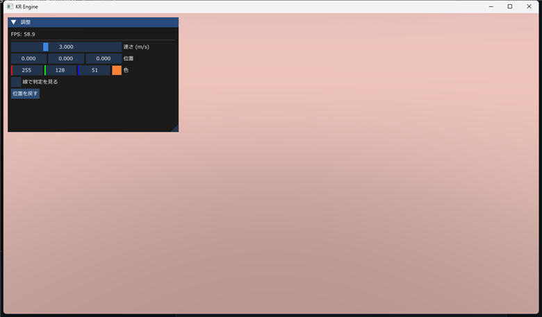

# ImGui

## 概要
ゲームを動かしながら、**数字を直したり、状態を見たりする窓**を作る仕組み(Dear ImGui)。スライダー・ボタン・チェックボックス・文字の表示などを、**数行**で書ける。自機の速さ・重力・カメラの位置を、再起動なしで調整するのに使う。

エンジンが、ImGui の準備(ウィンドウ・DirectX 12 とのつなぎ・フォント)を、すべてしてある。ゲームは、**OnImGui() の中で ImGui:: の関数を呼ぶだけ**。

- **使い方**:`#include <imgui.h>` を書いて、`Application::OnImGui()` の中で、`ImGui::Begin("名前")` から `ImGui::End()` の間に、部品を並べる。`OnRender` の後に呼ばれて、**ゲームの絵より手前**に乗る。
- **毎フレーム書き直す**:ImGui は「即時モード」。毎フレーム、`OnImGui` が、窓と部品を**もう一度書く**。`if (ImGui::Button("..."))` は、押された**そのフレームだけ** `true` になる。
- **版**:v1.92.9b の **docking 版**(窓を、タブでまとめたり、画面の端にくっつけたりできる)。
- **日本語**:Windows のメイリオ(`meiryo.ttc`)を読み込む。画面の拡大率(DPI)に合わせて、大きさが変わる。フォントが無い PC では、警告を出して、日本語が出ない。
- **入力**:ImGui が、文字入力などでキーボードを使っている間は、ゲームにキーが届かない。マウスが窓の上にある間は、「押した」とホイールが、ゲームに届かない(`Input` の仕様)。
- **窓の位置の記憶**:ImGui が、窓の位置・大きさを `imgui.ini`(実行したフォルダー)に保存する。毎回、同じ位置に出る。
- **見本の窓**:`ImGui::ShowDemoWindow()` を呼ぶと、**全部の部品の見本**が出る(使い方を探すときに、これを見る)。
- ImGui 本体の全部の関数は、`imgui.h`(読みやすい説明つき)と、見本の窓が、いちばん詳しい。この文書は、**よく使う物**だけをまとめた。

ヘッダー:`imgui.h`(エンジンが、`PUBLIC` でリンクしているので、ゲームから、そのまま include できる)

## サンプルコード
自機の速さと重力を調整する窓。

```cpp
#include <KR/KR.h>
#include <imgui.h>

class MyGame : public KR::Application
{
protected:
    void OnImGui() override
    {
        ImGui::SetNextWindowPos(ImVec2(10.0f, 10.0f), ImGuiCond_FirstUseEver);   // 最初の 1 回だけ、位置を決める

        ImGui::Begin("調整");                                                      // 窓を開く(戻り値は、窓が見えているか)

        ImGui::Text("FPS: %.1f", ImGui::GetIO().Framerate);                        // 文字(printf と同じ書き方)
        ImGui::Separator();

        ImGui::SliderFloat("速さ (m/s)", &m_Speed, 0.0f, 10.0f);                   // スライダー:値を直接、書き換える
        ImGui::DragFloat3("位置", m_Position, 0.05f);                              // ドラッグで動かす(x, y, z)
        ImGui::ColorEdit3("色", m_Color);                                          // 色を選ぶ
        ImGui::Checkbox("線で判定を見る", &m_ShowHitbox);                          // チェックボックス

        if (ImGui::Button("位置を戻す"))                                           // 押された、そのフレームだけ true
        {
            m_Position[0] = m_Position[1] = m_Position[2] = 0.0f;
        }

        ImGui::End();                                                              // 窓を閉じる(Begin の戻り値に関係なく、必ず呼ぶ)
    }

private:
    float m_Speed = 3.0f;
    float m_Position[3] = { 0.0f, 0.0f, 0.0f };
    float m_Color[3] = { 1.0f, 0.5f, 0.2f };
    bool  m_ShowHitbox = false;
};
```

**実行画面**



日本語は、そのまま表示できる。窓は、ドラッグで動かせて、位置を `imgui.ini` に覚える。

## 関数

### ImGui::Begin() / ImGui::End()　窓を開く・閉じる
```cpp
bool Begin(const char* name, bool* p_open = nullptr, ImGuiWindowFlags flags = 0);
void End();
```
窓を 1 つ作る。`name` は、窓の題名で、**窓を見分ける名前**でもある(同じ名前なら、同じ窓に、部品を足していく)。`End()` は、`Begin()` の戻り値が `false` でも、**必ず**呼ぶ。

| 引数 | 説明 |
|---|---|
| `name` | 窓の題名(日本語も使える)。同じ題名は、同じ窓 |
| `p_open` | `bool` を渡すと、窓に閉じるボタンが付く。押すと `false` になる |
| `flags` | `ImGuiWindowFlags_AlwaysAutoResize`(中身の大きさに合わせる)・`ImGuiWindowFlags_NoMove` など |

### ImGui::SetNextWindowPos() / SetNextWindowSize()　次の窓の位置・大きさ
```cpp
void SetNextWindowPos(const ImVec2& pos, ImGuiCond cond = 0, const ImVec2& pivot = ImVec2(0, 0));
void SetNextWindowSize(const ImVec2& size, ImGuiCond cond = 0);
```
**次に `Begin()` する窓**の、位置・大きさを決める(`Begin` の前に呼ぶ)。`cond` に `ImGuiCond_FirstUseEver` を渡すと、最初の 1 回だけ決めて、あとは、ユーザーが動かした位置を保つ。

### ImGui::Text()　文字を出す
```cpp
void Text(const char* fmt, ...);
void TextUnformatted(const char* text, const char* text_end = nullptr);
void TextDisabled(const char* fmt, ...);
void TextColored(const ImVec4& col, const char* fmt, ...);
```
`Text` は、`printf` と同じ書き方(`%d`・`%.2f`・`%s`)。`TextUnformatted` は、`%` を含む文字を、そのまま出す。`TextDisabled` は薄い色、`TextColored` は、色(`ImVec4(r, g, b, a)`)を付ける。

### ImGui::Button()　ボタン
```cpp
bool Button(const char* label, const ImVec2& size = ImVec2(0, 0));
```
押された**フレームだけ** `true` を返す。`if (ImGui::Button("リセット")) { ... }` のように書く。

### ImGui::Checkbox() / RadioButton()　チェック・選択
```cpp
bool Checkbox(const char* label, bool* v);
bool RadioButton(const char* label, int* v, int v_button);
```
`Checkbox` は、`bool` を直接、書き換える。`RadioButton` は、同じ `int` を渡した何個かの中から、1 つを選ぶ。値が変わったフレームだけ、`true`。

### ImGui::SliderFloat() / SliderInt() / SliderFloat3()　スライダー
```cpp
bool SliderFloat(const char* label, float* v, float v_min, float v_max, const char* format = "%.3f", ImGuiSliderFlags flags = 0);
bool SliderInt(const char* label, int* v, int v_min, int v_max, const char* format = "%d", ImGuiSliderFlags flags = 0);
bool SliderFloat3(const char* label, float v[3], float v_min, float v_max, const char* format = "%.3f", ImGuiSliderFlags flags = 0);
```
範囲(`v_min` 〜 `v_max`)の中で、値を直接、書き換える。`format` で、表示の形を変える(`"%.1f"`・`"%.0f 度"` など)。値が変わったフレームだけ、`true`。

### ImGui::DragFloat() / DragFloat3()　ドラッグで動かす
```cpp
bool DragFloat(const char* label, float* v, float v_speed = 1.0f, float v_min = 0.0f, float v_max = 0.0f, const char* format = "%.3f", ImGuiSliderFlags flags = 0);
bool DragFloat3(const char* label, float v[3], float v_speed = 1.0f, float v_min = 0.0f, float v_max = 0.0f, const char* format = "%.3f", ImGuiSliderFlags flags = 0);
```
左右にドラッグして、値を変える。範囲を決めなくてよい(`v_min == v_max` なら、範囲なし)。`v_speed` が、ドラッグ 1 画素あたりの変化量。位置・向きのような、`x, y, z` に便利。

### ImGui::InputFloat() / InputInt() / InputText()　数字・文字を入力する
```cpp
bool InputFloat(const char* label, float* v, float step = 0.0f, float step_fast = 0.0f, const char* format = "%.3f", ImGuiInputTextFlags flags = 0);
bool InputInt(const char* label, int* v, int step = 1, int step_fast = 100, ImGuiInputTextFlags flags = 0);
bool InputText(const char* label, char* buf, size_t buf_size, ImGuiInputTextFlags flags = 0);
```
キーボードで、値を打ち込む。`InputText` は、`char` の配列(`char name[64] = "";`)を渡す(エンジンには、`std::string` を渡す版の部品は、入っていない)。入力中は、ゲームにキーが届かない。

### ImGui::ColorEdit3() / ColorEdit4()　色を選ぶ
```cpp
bool ColorEdit3(const char* label, float col[3], ImGuiColorEditFlags flags = 0);
bool ColorEdit4(const char* label, float col[4], ImGuiColorEditFlags flags = 0);
```
色(r, g, b[, a]。0〜1)を、選ぶ窓で直す。`Lighting` や `Sky` の色の調整に便利。

### ImGui::Combo() / BeginCombo()　一覧から選ぶ
```cpp
bool Combo(const char* label, int* current_item, const char* const items[], int items_count, int popup_max_height_in_items = -1);
bool BeginCombo(const char* label, const char* preview_value, ImGuiComboFlags flags = 0);
void EndCombo();
```
`Combo` は、文字の配列から、1 つを選ぶ(選んだ番号が、`current_item` に入る)。`BeginCombo` は、中身を、自分で並べる版(`if (BeginCombo(...)) { Selectable(...); EndCombo(); }`)。

### ImGui::SameLine() / Separator() / Spacing()　並べ方
```cpp
void SameLine(float offset_from_start_x = 0.0f, float spacing = -1.0f);
void Separator();
void Spacing();
```
`SameLine()` は、次の部品を、**同じ行**に置く。`Separator()` は、区切りの線。`Spacing()` は、少し空ける。

### ImGui::CollapsingHeader() / TreeNode()　折りたたむ
```cpp
bool CollapsingHeader(const char* label, ImGuiTreeNodeFlags flags = 0);
bool TreeNode(const char* label);
void TreePop();
```
`CollapsingHeader` は、開いている間だけ `true`(`if (...) { 中身 }`)。`TreeNode` は、木の枝で、`true` のときは、`TreePop()` を、**必ず**呼ぶ。

### ImGui::PlotLines() / ProgressBar()　グラフ・進み具合
```cpp
void PlotLines(const char* label, const float* values, int values_count, int values_offset = 0,
               const char* overlay_text = nullptr, float scale_min = FLT_MAX, float scale_max = FLT_MAX,
               ImVec2 graph_size = ImVec2(0, 0), int stride = sizeof(float));
void ProgressBar(float fraction, const ImVec2& size_arg = ImVec2(-FLT_MIN, 0), const char* overlay = nullptr);
```
`PlotLines` は、数字の並びを、線のグラフにする(FPS の変化など)。`ProgressBar` は、0〜1 の割合を、棒で見せる(HP など)。

### ImGui::IsItemHovered() / SetTooltip()　ヒントを出す
```cpp
bool IsItemHovered(ImGuiHoveredFlags flags = 0);
void SetTooltip(const char* fmt, ...);
```
直前の部品の上に、マウスがあるとき、ヒントの窓を出す:`if (ImGui::IsItemHovered()) { ImGui::SetTooltip("説明"); }`。

### ImGui::PushID() / PopID()　同じ名前の部品を見分ける
```cpp
void PushID(const char* str_id);
void PushID(int int_id);
void PopID();
```
ImGui は、部品を**名前で見分ける**。同じ名前(`"削除"` のボタンを、敵の数だけ並べるときなど)は、`PushID(番号)` と `PopID()` で、挟んで、見分ける。

### ImGui::BeginDisabled() / EndDisabled()　押せなくする
```cpp
void BeginDisabled(bool disabled = true);
void EndDisabled();
```
間にある部品を、薄くして、操作できなくする。

### ImGui::GetIO()　入出力の情報
```cpp
ImGuiIO& GetIO();
```
`ImGui::GetIO().Framerate` で、FPS(1 秒あたりの描画の回数)が取れる。`ImGui::GetIO().WantCaptureKeyboard` などで、ImGui が入力を使っているかが分かる(ゲームへの入力は、エンジンが、自動で止める)。

### ImGui::ShowDemoWindow()　見本の窓
```cpp
void ShowDemoWindow(bool* p_open = nullptr);
```
**全部の部品の見本**を出す窓。`OnImGui` の中で呼ぶ。使い方を調べるとき、まず、ここを見て、コードを探す(`imgui_demo.cpp`)。

### KR::Behavior::DrawGraphDebug()　敵のグラフを描く(エンジンの部品)
```cpp
KR::Behavior::DrawGraphDebug(runner);
```
敵の行動のグラフを、窓の中に描く。`ImGui::Begin` と `End` の間に呼ぶ。→ [BehaviorDebug](BehaviorDebug.md)

## 列挙型・構造体

### ImVec2 / ImVec4　位置・大きさ・色
| 型 | 説明 |
|---|---|
| `ImVec2(x, y)` | 位置・大きさ(画素)。例 `ImVec2(10.0f, 10.0f)` |
| `ImVec4(r, g, b, a)` | 色(0〜1)。`TextColored` に渡す |

### よく使う条件・フラグ
| 名前 | 説明 |
|---|---|
| `ImGuiCond_FirstUseEver` | 最初の 1 回だけ、位置・大きさを決める(あとは、ユーザーが動かした値を使う) |
| `ImGuiCond_Always` | 毎フレーム、決める(動かせなくなる) |
| `ImGuiWindowFlags_AlwaysAutoResize` | 窓を、中身の大きさに合わせる |
| `ImGuiWindowFlags_NoMove` | 窓を動かせなくする |
| `ImGuiWindowFlags_NoCollapse` | 窓を折りたためなくする |
| `ImGuiWindowFlags_NoSavedSettings` | 窓の位置を、`imgui.ini` に保存しない |

## アクセサー一覧
| 関数 | 説明 |
|---|---|
| `ImGui::GetIO()` | 入出力の情報(`Framerate`・`WantCaptureKeyboard` など) |
| `ImGui::GetMainViewport()` | ゲームの画面全体の位置・大きさ(`WorkPos`・`WorkSize`)。窓を、画面の端に置くときに使う |
