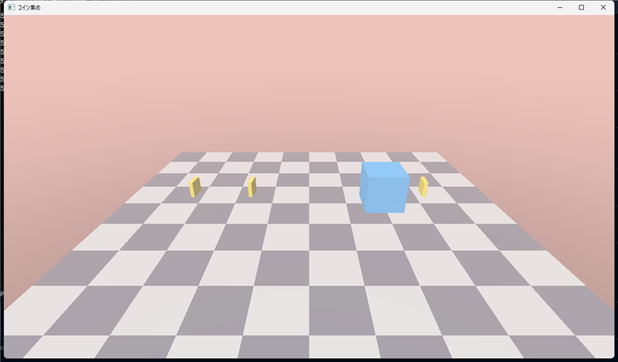

# MyClass

## 概要
ゲームの中に、**自分のクラス**(自機・敵・コイン・ステージなど)を作る方法。エンジンの `KR::Application` を継承するクラス(ゲームの本体)は **1 つだけ**。そのほかの物は、**ふつうの C++ のクラス**として作って、本体(`GameApp`)が持つ。

実際のゲーム(Action2D・すれすれ飛行)は、次の分け方をしている。

| 種類 | 役目 | 例 |
|---|---|---|
| **ゲームの本体**(`Application` を継承) | 1 つだけ。クラスを持って、`OnUpdate` で動かして、`OnRender` で描く | `GameApp` |
| **動きのクラス** | 位置・速度・HP などのデータと、`Update()`。**Renderer を知らない**(描かない) | `Player`・`Enemy`・`Coin` |
| **描くクラス**(必要なとき) | 形・画像・モデルを持って、`Init()` / `Draw()` / `Shutdown()` で、`Renderer` を使う | `Ground`・`AnimatedModel` |

**動きと描画を分ける**と、動きのクラスは、画面がなくても、動かして確かめられる。描く物(`MeshHandle`)は、本体が持って、`DrawMesh()` を呼ぶ。

守る決まり:
- ゲームが `#include` できるのは、**エンジンの公開ヘッダーだけ**(`<KR/...>`)。`src/` の中や DirectX の部品は、見えない。
- GPU の実体(形・画像)は、触らない。**番号札**(`MeshHandle`・`TextureHandle`)だけを持つ。
- **ゲーム固有の物(自機・コース・設定)は、ゲームのリポジトリに作る**。エンジンには、入れない。

## サンプルコード
**コインを拾うゲーム**を作る。ファイルは、次の 5 つ。

```
MyGame/
├─ CMakeLists.txt                ← ⑥ 3 行(ソースは、自動で集まる)
└─ src/
   ├─ GameApp.cpp                ← ⑤ ゲームの本体
   └─ Gameplay/
      ├─ Coin.h   Coin.cpp       ← ① ② 動きのクラス(描かない)
      └─ Ground.h Ground.cpp     ← ③ ④ 描くクラス(Renderer を使う)
```

**① src/Gameplay/Coin.h**
```cpp
#pragma once
#include <KR/KR.h>

// コイン 1 枚。回って、拾われたかを覚える。描くのは、ゲームの本体(Renderer を知らない)
class Coin
{
public:
    explicit Coin(const DirectX::XMFLOAT3& position) : m_Position(position) {}

    void Update(float deltaTime);                       // 毎フレーム:回す
    bool TryCollect(const KR::OBB& player);             // プレイヤーの箱と重なったら、拾われる(拾われたとき 1 回だけ true)
    bool IsCollected() const { return m_Collected; }
    DirectX::XMMATRIX GetWorldMatrix() const;           // 描くときの行列

private:
    DirectX::XMFLOAT3 m_Position;
    float m_Angle = 0.0f;
    bool m_Collected = false;
};
```

**② src/Gameplay/Coin.cpp**
```cpp
#include "Gameplay/Coin.h"

using namespace DirectX;

void Coin::Update(float deltaTime)
{
    if (m_Collected) { return; }
    m_Angle += deltaTime * 2.0f;                        // 1 秒に 2 ラジアン回る
}

bool Coin::TryCollect(const KR::OBB& player)
{
    if (m_Collected) { return false; }
    const KR::Sphere body{ m_Position, 0.3f };          // コインの判定:半径 0.3 m の球
    if (!KR::Intersects(body, player)) { return false; }
    m_Collected = true;
    return true;
}

XMMATRIX Coin::GetWorldMatrix() const
{
    return XMMatrixScaling(0.4f, 0.4f, 0.1f) * XMMatrixRotationY(m_Angle)
         * XMMatrixTranslation(m_Position.x, m_Position.y, m_Position.z);   // 拡大 × 回転 × 移動
}
```

**③ src/Gameplay/Ground.h**
```cpp
#pragma once
#include <KR/KR.h>

// 地面。形を持つので、Renderer を使う(Init で作って、Shutdown で返す)
class Ground
{
public:
    void Init(KR::Renderer& renderer);
    void Draw(KR::Renderer& renderer) const;
    void Shutdown(KR::Renderer& renderer);

private:
    KR::MeshHandle m_Mesh;
};
```

**④ src/Gameplay/Ground.cpp**
```cpp
#include "Gameplay/Ground.h"

void Ground::Init(KR::Renderer& renderer)
{
    m_Mesh = renderer.CreateMesh(KR::CreateCheckerPlaneMeshData(
        10, 10, 1.0f, { -5.0f, 0.0f, -5.0f }, { 0.8f, 0.8f, 0.8f, 1.0f }, { 0.35f, 0.35f, 0.4f, 1.0f }));
}

void Ground::Draw(KR::Renderer& renderer) const
{
    renderer.DrawMesh(m_Mesh, DirectX::XMMatrixIdentity());
}

void Ground::Shutdown(KR::Renderer& renderer)
{
    renderer.DestroyMesh(m_Mesh);
}
```

**⑤ src/GameApp.cpp**(ゲームの本体。クラスを持って、呼ぶ)
```cpp
#include <KR/KR.h>
#include <memory>
#include <vector>
#include "Gameplay/Coin.h"
#include "Gameplay/Ground.h"

using namespace DirectX;

class GameApp : public KR::Application
{
public:
    GameApp() : Application(KR::ApplicationDesc{ .title = "コイン集め" }) {}

protected:
    void OnInit() override
    {
        m_Ground.Init(GetRenderer());
        m_CubeMesh = GetRenderer().CreateMesh(KR::CreateCubeMeshData({ 0.2f, 0.6f, 1.0f, 1.0f }));
        m_CoinMesh = GetRenderer().CreateMesh(KR::CreateCubeMeshData({ 1.0f, 0.85f, 0.2f, 1.0f }));
        for (int i = 0; i < 5; ++i)
        {
            m_Coins.emplace_back(XMFLOAT3{ -3.0f + 1.5f * static_cast<float>(i), 0.5f, 1.0f });   // クラスを作って、並べる
        }
    }

    void OnUpdate(float dt) override
    {
        // プレイヤー(今回は 1 つの箱)を、A / D で動かす
        if (KR::Input::IsKeyDown(KR::Key::A)) { m_PlayerX -= 3.0f * dt; }
        if (KR::Input::IsKeyDown(KR::Key::D)) { m_PlayerX += 3.0f * dt; }
        const KR::OBB player = KR::MakeOBB({ m_PlayerX, 0.5f, 1.0f }, { 0.5f, 0.5f, 0.5f }, XMMatrixIdentity());

        for (Coin& coin : m_Coins)                          // 動きのクラスを、1 つずつ進める
        {
            coin.Update(dt);
            if (coin.TryCollect(player)) { ++m_Score; KR_LOG_INFO("コイン!得点 {}", m_Score); }
        }

        KR::Camera camera;
        camera.SetPosition({ 0.0f, 4.0f, -6.0f });
        camera.LookAt({ 0.0f, 0.5f, 1.0f });
        GetRenderer().SetCamera(camera);
    }

    void OnRender() override
    {
        m_Ground.Draw(GetRenderer());                       // 描くクラス
        GetRenderer().DrawMesh(m_CubeMesh, XMMatrixTranslation(m_PlayerX, 0.5f, 1.0f));
        for (const Coin& coin : m_Coins)                    // 動きのクラスは、本体が描く
        {
            if (!coin.IsCollected()) { GetRenderer().DrawMesh(m_CoinMesh, coin.GetWorldMatrix()); }
        }
    }

    void OnShutdown() override
    {
        GetRenderer().DestroyMesh(m_CoinMesh);
        GetRenderer().DestroyMesh(m_CubeMesh);
        m_Ground.Shutdown(GetRenderer());
    }

private:
    Ground m_Ground;
    KR::MeshHandle m_CubeMesh, m_CoinMesh;
    std::vector<Coin> m_Coins;
    float m_PlayerX = 0.0f;
    int m_Score = 0;
};

std::unique_ptr<KR::Application> KR::CreateApplication() { return std::make_unique<GameApp>(); }
```

**⑥ CMakeLists.txt**(ゲームの CMake。`kr_add_game` を使う。エンジン 0.14.0 から)
```cmake
cmake_minimum_required(VERSION 3.28)
project(MyGame LANGUAGES CXX)
add_subdirectory(External/KREngine)     # エンジン(サブモジュール)を取り込む
kr_add_game(MyGame)                     # src/ の下の .cpp・.h を、自動で集めて、exe を作る
```
**これだけ**。`src/` の下に、`.cpp` や `.h` を足しても、**この `CMakeLists.txt` は、直さなくてよい**(自動で集まる)。`#include "Gameplay/Coin.h"` と書けるようにする設定・エンジンへのリンク・DLL とアセットのコピーも、`kr_add_game` が行う。詳しくは、`docs/Usage.md` の 2-2(0.13.0 までの、ファイルを 1 つずつ書く方法も、そこにある)。

**実行画面**(A / D キーで、青い箱を動かして、コインを拾う。拾ったコインは、消える)



## 手順

### 手順 1　ファイルを作る
クラス 1 つにつき、**ヘッダーと実装**(`.h` と `.cpp`)を、`src/` の下の、役目ごとのフォルダー(`Gameplay/`・`Course/`・`Ui/` など)に作る。ファイルの名前は、クラスの名前と同じにする(`Coin` なら `Coin.h` と `Coin.cpp`)。

- ヘッダーの先頭に `#pragma once`。
- エンジンを使うなら `#include <KR/KR.h>`(主な物が、全部入る)。
- ヘッダーには、**宣言だけ**。長い処理は `.cpp` に書く(ビルドが速くなる)。

### 手順 2　ビルドする(CMake は、直さない)
`kr_add_game`(⑥)を使っていれば、**新しいファイルを `src/` の下に置くだけ**で、次のビルドで、自動で入る。**CMakeLists.txt に、ファイル名を書かなくてよい**。

**ビルドは、2 回走ることがある**:新しいファイルを足した後の、**1 回目のビルドで、CMake が、ファイルが増えたことに気づいて、プロジェクトを自動で作り直す**(ログに `CMake is re-running because ... is out-of-date.` と出る)。**そのビルドは、古いプロジェクトで進む**ので、新しいファイルは、**2 回目のビルドで**入る。リンクエラー(LNK2001・LNK2019)が出たら、**もう 1 回ビルド**する。Visual Studio では、プロジェクトが変わったと聞かれたら、「再読み込み」を選ぶ。

`#include "Gameplay/Coin.h"` のように、`src` からの場所で書けるのは、`kr_add_game` が、`src` を、`#include` の基点にしているため。

0.13.0 までの書き方(`add_executable` に、ファイルを 1 つずつ書く)のゲームは、新しいファイルを、`add_executable` に**書く**。書き忘れると、リンクエラー(LNK2019)になる。足したら、`cmake --preset vs2026` で、設定し直す。

### 手順 3　動きのクラスを作る
**位置・速度・HP などのデータ**と、`Update(float deltaTime)` を持つ。`Renderer` は、受け取らない。

- 動かす量には、`deltaTime` を掛ける(どのモニターでも、同じ速さになる)。
- 当たり判定は、`KR::OBB`・`KR::Sphere` と `KR::Intersects()` を使う。→ [Collision](Collision.md)
- 入力は、本体が読んで、**値を渡す**(`player.Update(dt, moveX)`)のが、おすすめ。クラスが `KR::Input` を直接読むと、確かめにくい。
- 数字(速さ・重力など)は、`GameSettings` のような**構造体にまとめて**渡す。ImGui で、実行中に、直せる。→ [ImGui](ImGui.md)

### 手順 4　描くクラスを作る
形・画像・モデルを持つクラスは、**Init(Renderer&)・Draw(Renderer&)・Shutdown(Renderer&)** の 3 つを持つ(`AnimatedModel` と同じ形)。

- `Init` で、`CreateMesh()` などで、番号札を作る。
- **Shutdown で、必ず返す**(`DestroyMesh()`)。`Renderer` が先に消えると、返せなくなるので、本体の `OnShutdown()` から呼ぶ。
- 番号札を持つクラスを、**コピーしない**。コピーすると、同じ番号札を 2 つの物が持って、片方が捨てると、もう片方が使えなくなる。コピーしたくないクラスには、`Ground(const Ground&) = delete;` と書く。

### 手順 5　本体に持たせて、呼ぶ
`GameApp`(`Application` を継承したクラス)の**メンバー**として持つ。

| 本体の関数 | 呼ぶ物 |
|---|---|
| `OnInit()` | 描くクラスの `Init(GetRenderer())`・動きのクラスを作る |
| `OnUpdate(float dt)` | 動きのクラスの `Update(dt)`・当たり判定・カメラを `SetCamera` |
| `OnRender()` | 描くクラスの `Draw(GetRenderer())`・動きのクラスの形を `DrawMesh` |
| `OnShutdown()` | 描くクラスの `Shutdown(GetRenderer())`・`DestroyMesh` |

クラスが増えたら、`GameApp` の中に、`m_Player`・`m_Coins`・`m_Ground` のように並べる。たくさんあって、`GameApp` が長くなったら、**まとめる係のクラス**(`GameSession`・`Stage` など)を作って、その中に持たせる(すれすれ飛行の `GameSession`)。

### 手順 6　ビルドして、確かめる
`cmake --build build --config Debug`。動いたら、`KR_LOG_INFO("...")` で、値をログに出して、確かめる。ウィンドウのタイトルが出て、エラーのダイアログが出ていないことも、確かめる。

## よくある間違い

### リンクエラー(LNK2001・LNK2019)が出る
- **ファイルを足した直後**なら、**もう 1 回ビルド**する(1 回目で、CMake がプロジェクトを作り直して、2 回目で、新しいファイルが入る)。
- 0.13.0 までの書き方なら、`.cpp` を `add_executable` に、書き忘れている。書いて、CMake を configure し直す。
- `.cpp` を、`kr_add_game` の `SOURCES`(省略すると `src`)の**外**に置いている。

### `#include "Gameplay/Coin.h"` が見つからない
`src` の下の場所が違う。`kr_add_game` を使っているなら、`src/Gameplay/Coin.h` に置いたかを確認する(`SOURCES` に、別のフォルダーを書いたなら、そのフォルダーが基点)。

### 形が出ない・落ちる
- `Shutdown` の後に `Draw` を呼んでいる(捨てた番号札は、描けない)。
- `Init` を呼び忘れている(`MeshHandle::IsValid()` が `false`)。
- `OnShutdown()` で、`Shutdown` を呼び忘れている(終了時に、エンジンが警告を出すことがある)。

### 同じ形を、たくさん描きたい
形(`MeshHandle`)は、**1 つだけ**作って、**行列だけを変えて、何度も `DrawMesh` する**。敵 100 体でも、形は 1 つ。

## 列挙型・構造体
なし。クラスの形は、上のサンプルコードを、そのまま、雛形にできる。

## アクセサー一覧
| 書き方 | 説明 |
|---|---|
| `const Box& GetBox() const { return m_Box; }` | 中の値を、**読むだけ**で返す(`const`)。外から直接、書き換えさせない |
| `bool IsAlive() const { return m_Alive; }` | 状態を返す。`const` を付けると、`const` のクラスからも呼べる |
| `void Reset();` | 全部を最初の状態に戻す(調整窓の「初期位置に戻す」ボタン用) |
