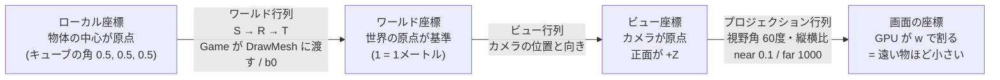
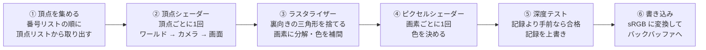
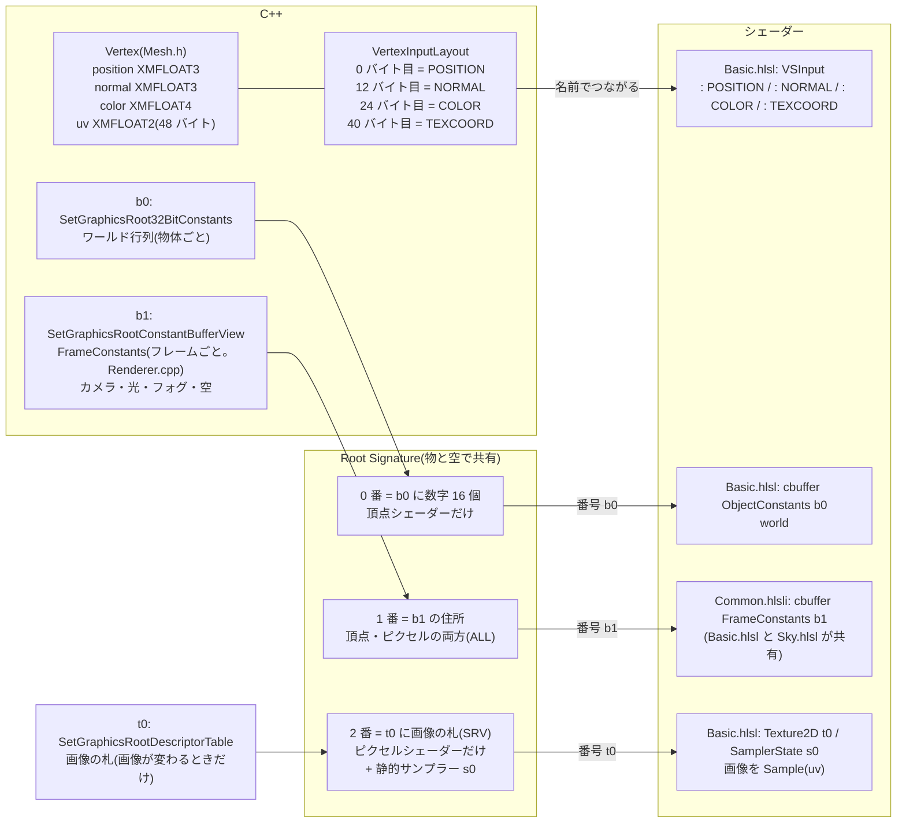

# 描画(座標変換・GPU・シェーダー)

座標がどう変換されて画面に出るか、GPU の描画パイプライン、C++ とシェーダーのつながり。

[← 資料の案内(Structure.md)に戻る](Structure.md)

## 座標変換の全体像

- ビュー行列 × プロジェクション行列は、CPU で1つにまとめて **b1(定数バッファ)**で渡す([Renderer.cpp:211](../src/Renderer/Renderer.cpp#L211))
- 行列の作り方:[Camera.cpp](../src/Renderer/Camera.cpp)
- シェーダーでの掛け算:[Basic.hlsl:29](../shaders/Basic.hlsl#L29)

---

## GPU の中の流れ(描画パイプライン)

| 段階 | 設定している場所 |
|---|---|
| ② ④ シェーダー | [Basic.hlsl](../shaders/Basic.hlsl)(物)/ [Sky.hlsl](../shaders/Sky.hlsl)(空) |
| ③ カリング(時計回りが表) | [DX12Pipeline.cpp](../src/Graphics/DX12/DX12Pipeline.cpp)(RasterizerState) |
| ⑤ 深度テスト(LESS・書き込みあり) | [DX12Pipeline.cpp](../src/Graphics/DX12/DX12Pipeline.cpp)(DepthStencilState) |
| ⑤ 深度バッファ | [DX12DepthBuffer.cpp](../src/Graphics/DX12/DX12DepthBuffer.cpp) |

---

## C++ とシェーダーのつながり

| つながり | C++ 側 | シェーダー側 |
|---|---|---|
| 頂点データ | [VertexInputLayout(Renderer.cpp)](../src/Renderer/Renderer.cpp) | [VSInput(Basic.hlsl)](../shaders/Basic.hlsl) |
| b0 / b1 / t0 / s0 の宣言 | [DX12Pipeline.cpp(`CreateRootSignature`)](../src/Graphics/DX12/DX12Pipeline.cpp) | b0:[Basic.hlsl](../shaders/Basic.hlsl)、b1:[Common.hlsli](../shaders/Common.hlsli) |
| b2(骨の行列の表。パレット) | 同上(`PaletteRootIndex = 3`。骨つきの物を描くときだけ設定) | `cbuffer SkinPalette`([Basic.hlsl](../shaders/Basic.hlsl)。`VSSkinned` だけが読む) |
| b1 の中身(別紙) | `FrameConstants`([Renderer.cpp](../src/Renderer/Renderer.cpp)。`float4` にそろえる) | `cbuffer FrameConstants`([Common.hlsli](../shaders/Common.hlsli)。並びと大きさは C++ と同じ) |

**食い違いを防ぐ工夫**:b1 の宣言は、共通のファイル(`Common.hlsli`)に **1 か所だけ**書いて、Basic.hlsl と Sky.hlsl の両方が `#include` する。C++ の `FrameConstants` と HLSL の `FrameConstants` は、並びと大きさを同じにする。

---

## 物の描画と、空の描画(2 つのパイプライン)

| | 物(地面・障害物・自機など) | 空 |
|---|---|---|
| シェーダー | [Basic.hlsl](../shaders/Basic.hlsl) | [Sky.hlsl](../shaders/Sky.hlsl) |
| 頂点データ | 頂点バッファ・番号バッファ | **なし**(頂点シェーダーが、頂点の番号から、画面全体を覆う三角形を作る) |
| 深度テスト・書き込み | あり | **なし**(深度バッファを「一番奥」のままにして、あとから描く物が、空の上に上書きされる) |
| カリング | 裏向きを捨てる | なし |
| 描く順番 | `ExecuteDrawList`(EndFrame) | `BeginFrame` の最後(**最初**) |
| Root Signature | 共有(設定は `BeginFrame` で 1 回) | 同じ物を共有 |

- 陰影・フォグ・空の計算は、[Lighting.md](Lighting.md) にまとめてある。
