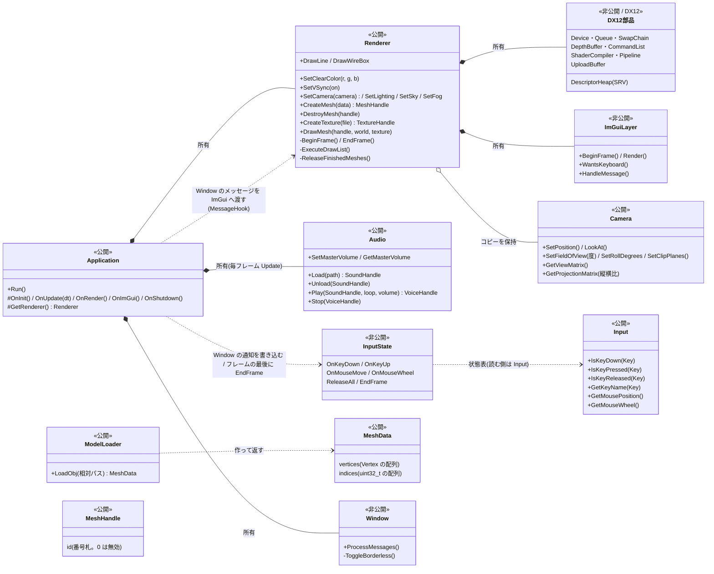
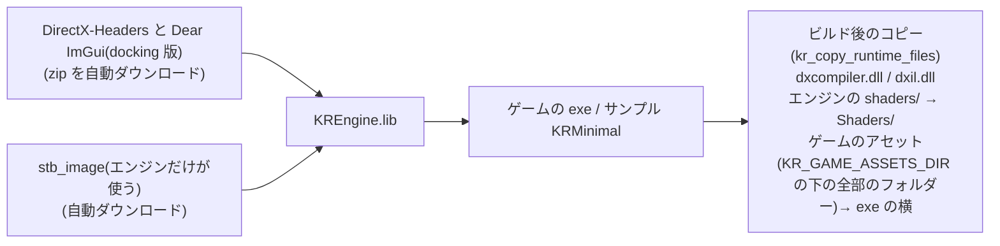

# KR エンジンの構成(フォルダ・クラス・ビルド)

KR エンジンの、どのフォルダに何があり、クラスがどう関係し、ビルドで何が行われるか。まず、使い方は [Usage.md](Usage.md)。

## 資料の案内
| 知りたいこと | ファイル |
|---|---|
| **使い方(最短の入門)** | [Usage.md](Usage.md) |
| 起動から終了までの流れ・初期化・メインループ | [Lifecycle.md](Lifecycle.md) |
| ウィンドウ・OS メッセージ・ログ | [Platform.md](Platform.md) |
| 描画の仕組み(DX12 の部品・描画の流れ) | [Rendering.md](Rendering.md) |
| 形(メッシュ)・OBJ の読み込み | [Mesh.md](Mesh.md) |
| 画像(テクスチャ) | [Textures.md](Textures.md) |
| 光・フォグ・空・共通のシェーダー | [Lighting.md](Lighting.md) |
| 入力(キーボード・マウス) | [Input.md](Input.md) |
| 当たり判定(OBB・線の描画) | [Collision.md](Collision.md) |
| 音(効果音・BGM。XAudio2) | [Audio.md](Audio.md) |
| デバッグ用の画面(ImGui) | [ImGui.md](ImGui.md) |
| ボーンアニメーション(調べ物・実装の記録) | [Animation.md](Animation.md) |
| **アニメーションの調整ツール**(骨・判定の形) | [AnimationEditor.md](AnimationEditor.md) |
| 敵の行動(ノードのグラフ・保存・読み込み。作成中) | [Behavior.md](Behavior.md) |
| **敵の行動の調整ツール**(ノードで作る。作成中) | [BehaviorEditor.md](BehaviorEditor.md) |
| **版(バージョン)の付け方** | [Versioning.md](Versioning.md)・[CHANGELOG.md](../CHANGELOG.md) |
| **開発の経緯(なぜ、こう作ったか・選ばなかった案)** | [History.md](History.md) |
| 調べ物:演出(爆発・シェーダーなど) | [Effects.md](Effects.md) |

---

## フォルダ構成

```
KREngine/
├─ include/KR/                   【公開】ゲームから見える
│   ├─ KR.h                        まとめヘッダー(主なヘッダーを、まとめて取り込む)
│   ├─ Core/                       Application, Log, Input(IsKeyDown / IsKeyPressed / IsKeyReleased), Assets(アセット・シェーダーの場所。SetAssetRoot で、実行時に切り替え), CommandLine(起動の引数)
│   ├─ Physics/                    Collision(OBB・MakeOBB・Intersects・GetCorners・Raycast・RayToSegmentDistance。当たり判定)・Ray(光線)
│   ├─ Animation/                  AnimatedModel(動くモデルの窓口)・Skeleton・AnimationClip・GltfLoader(LoadGltf。型 ModelData)・FbxLoader(LoadFbx)・LoadModel(拡張子で、glTF か FBX を選ぶ)・Hitbox(骨に追従する判定の形)・HitboxFile(判定の形の保存)・HitboxMirror(判定の形の左右反転・対の骨の名前)・SkeletonDebug(骨の表示)
│   ├─ Audio/                      Audio(音の窓口。Load / Play / Stop / 全体の音量。札 SoundHandle・VoiceHandle。Application の GetAudio())
│   └─ Renderer/                   Renderer, Camera, Mesh, Texture(TextureHandle), ModelLoader(LoadObj), Lighting(Lighting / Sky / Fog の設定)
├─ src/                          【非公開】ゲームからは見えない
│   ├─ Audio/                      Audio(XAudio2・声の管理)・SoundLoader(WAV = dr_wav / OGG = stb_vorbis / MP3 = dr_mp3 → 16 ビットの PCM)・AudioCodecs(ライブラリの本体)
│   ├─ Core/                       Application, EntryPoint(main), Log, Input(状態表), InputState(書き込み口), Assets
│   ├─ Platform/Windows/           Window(Win32)
│   ├─ Physics/                    Collision(判定の計算)
│   ├─ Animation/                  GltfLoader(cgltf で glTF を読み、エンジンのデータにする)・FbxLoader(ufbx で FBX を読む)・LoadModel(拡張子で振り分け)
│   ├─ Renderer/                   Renderer(描画の統括), Camera, Mesh(キューブなどのデータ), ModelLoader(OBJ を読む), Image(PNG をほどく。stb_image)
│   ├─ UI/                         ImGuiLayer(ImGui の準備・片付け・毎フレームの描画)
│   └─ Graphics/DX12/              DX12 の部品
│       ├─ DX12Common.h              ComPtr, KR_DX_CHECK, 定数
│       ├─ DX12Device                GPU の選択, Device
│       ├─ DX12CommandQueue          Queue + Fence
│       ├─ DX12SwapChain             バックバッファ 2枚, RTV(sRGB)
│       ├─ DX12DepthBuffer           深度バッファ(D32_FLOAT), DSV
│       ├─ DX12DescriptorHeap        シェーダーから見える札掛け(SRV ヒープ)と枠の貸し借り
│       ├─ DX12CommandList           Allocator 2つ + Command List
│       ├─ DX12ShaderCompiler        HLSL → GPU の機械語(DXC)
│       ├─ DX12Pipeline              Root Signature(b0, b1, t0 + 静的サンプラー s0)+ PSO
│       ├─ DX12Buffer                Upload ヒープのバッファ(頂点・番号・定数)
│       └─ DX12Texture               画像(Default ヒープ + SRV の札。Upload 経由でコピー)
├─ shaders/                      シェーダー(実行時にコンパイル): Basic.hlsl(物)/ Sky.hlsl(空)/ Line.hlsl(線。当たり判定の箱)/ Common.hlsli(共通の b1 の宣言)
├─ samples/                      サンプル(モデルの素材は、Assets/Models/Test/<モデル名>/ に、1 モデル 1 フォルダー:元の .blend・書き出した .glb / .fbx・判定の形 .hitboxes.json。Blender のバックアップ .blend1 は、Git に入れない): Minimal/(ウィンドウ + 回るキューブ + ImGui の FPS。新しいゲームの雛形)・Animated/(動くモデル AnimatedModel の使い方の見本)・Behavior/(敵の行動 KR::Behavior の使い方の見本。Walker.json を読んで、敵 1 体を動かす・今の状態のノードを光らせる)・Assets/(サンプル共通のアセット。テスト用のモデル・Enemies/Walker.json)
├─ third_party/ufbx/             ufbx(FBX を読むライブラリ)の CMake の定義(取得は最上位の CMakeLists.txt。ufbx だけ Debug でも最適化)
├─ tools/Publish-Tools.ps1       ツールの exe だけを dist に取り出す(-Build でビルドも。-Samples でサンプルも)。取り出した物は、build を消しても動く。dist は、Git に入れない
├─ tools/AnimationEditor/        ツール KRAnimationEditor(骨・判定の形を、見て、調整して、保存する)
├─ tools/Common/                 ツールの共通の部品 KRToolCommon(フォルダーを選ぶ窓 FolderDialog。調整ツールどうしで共有)
├─ tools/BehaviorEditor/         ツール KRBehaviorEditor(敵の行動のグラフを、ノードで作る。作成中)
├─ docs/                         この資料
├─ CMakeLists.txt                エンジンのビルド(ライブラリ KREngine・関数 kr_copy_runtime_files・サンプル)
└─ CMakePresets.json             エンジンを単体でビルドするときの設定(vs2026)
```

---

## クラスの関係



ゲームは、`Application` を継承して、`Renderer` に、`SetCamera` / `CreateMesh` / `DrawMesh` などを頼み、`Input` を読む。

**依存のルール**:ゲームが使えるのは公開側(`include/`)の Renderer・Camera・Mesh・ModelLoader・Input などだけ。入力の状態表への書き込み口(`InputState`)は `src/` にあり、ゲームからは見えない(読むだけ)。DX12 の部品は、ゲームからは見えない。ゲームは、形の実体(GPU のバッファ)に触らず、**番号札(MeshHandle)**だけを持つ。

---

## ビルド時に行われること


