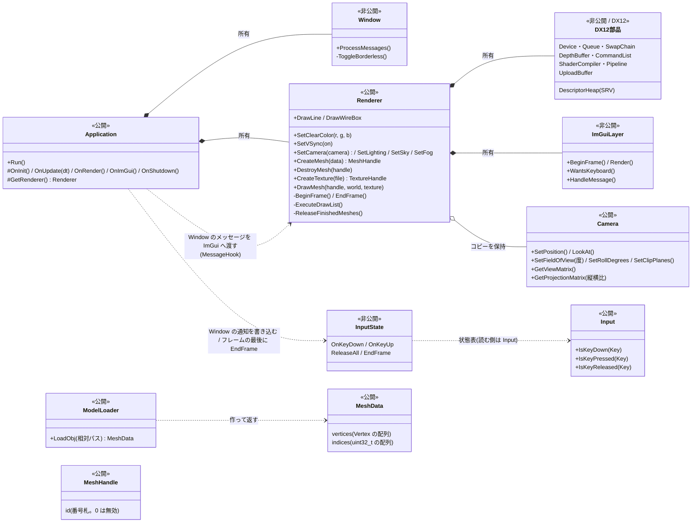
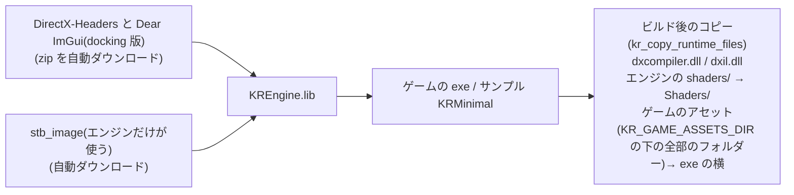

# KR エンジンの構成(フォルダ・クラス・ビルド)

KR エンジンの、どのフォルダに何があり、クラスがどう関係し、ビルドで何が行われるか。まず、使い方は [Usage.md](Usage.md)。

## 資料の案内
| 知りたいこと | ファイル |
|---|---|
| **使い方(最短の入門)** | [Usage.md](Usage.md) |
| 起動から終了までの流れ・初期化・メインループ | [Lifecycle.md](Lifecycle.md) |
| ウィンドウ・OS メッセージ・ログ | [Platform.md](Platform.md) |
| 描画の仕組み(DX12 の部品・描画の流れ) | [Rendering.md](Rendering.md) |
| 形(メッシュ)・OBJ の読み込み | [Mesh.md](Mesh.md) |
| 画像(テクスチャ) | [Textures.md](Textures.md) |
| 光・フォグ・空・共通のシェーダー | [Lighting.md](Lighting.md) |
| 入力(キーボード) | [Input.md](Input.md) |
| 当たり判定(OBB・線の描画) | [Collision.md](Collision.md) |
| デバッグ用の画面(ImGui) | [ImGui.md](ImGui.md) |
| 調べ物:ボーンアニメーション | [Animation.md](Animation.md) |
| 調べ物:演出(爆発・シェーダーなど) | [Effects.md](Effects.md) |

---

## フォルダ構成

```
KREngine/
├─ include/KR/                   【公開】ゲームから見える
│   ├─ KR.h                        まとめヘッダー(主なヘッダーを、まとめて取り込む)
│   ├─ Core/                       Application, Log, Input(IsKeyDown / IsKeyPressed / IsKeyReleased), Assets(アセット・シェーダーの場所)
│   ├─ Physics/                    Collision(OBB・MakeOBB・Intersects・GetCorners。当たり判定)
│   ├─ Animation/                  Skeleton(骨の階層)・AnimationClip(動き)・GltfLoader(LoadGltf。glTF を読む)
│   └─ Renderer/                   Renderer, Camera, Mesh, Texture(TextureHandle), ModelLoader(LoadObj), Lighting(Lighting / Sky / Fog の設定)
├─ src/                          【非公開】ゲームからは見えない
│   ├─ Core/                       Application, EntryPoint(main), Log, Input(状態表), InputState(書き込み口), Assets
│   ├─ Platform/Windows/           Window(Win32)
│   ├─ Physics/                    Collision(判定の計算)
│   ├─ Animation/                  GltfLoader(cgltf で glTF を読み、エンジンのデータにする)
│   ├─ Renderer/                   Renderer(描画の統括), Camera, Mesh(キューブなどのデータ), ModelLoader(OBJ を読む), Image(PNG をほどく。stb_image)
│   ├─ UI/                         ImGuiLayer(ImGui の準備・片付け・毎フレームの描画)
│   └─ Graphics/DX12/              DX12 の部品
│       ├─ DX12Common.h              ComPtr, KR_DX_CHECK, 定数
│       ├─ DX12Device                GPU の選択, Device
│       ├─ DX12CommandQueue          Queue + Fence
│       ├─ DX12SwapChain             バックバッファ 2枚, RTV(sRGB)
│       ├─ DX12DepthBuffer           深度バッファ(D32_FLOAT), DSV
│       ├─ DX12DescriptorHeap        シェーダーから見える札掛け(SRV ヒープ)と枠の貸し借り
│       ├─ DX12CommandList           Allocator 2つ + Command List
│       ├─ DX12ShaderCompiler        HLSL → GPU の機械語(DXC)
│       ├─ DX12Pipeline              Root Signature(b0, b1, t0 + 静的サンプラー s0)+ PSO
│       ├─ DX12Buffer                Upload ヒープのバッファ(頂点・番号・定数)
│       └─ DX12Texture               画像(Default ヒープ + SRV の札。Upload 経由でコピー)
├─ shaders/                      シェーダー(実行時にコンパイル): Basic.hlsl(物)/ Sky.hlsl(空)/ Line.hlsl(線。当たり判定の箱)/ Common.hlsli(共通の b1 の宣言)
├─ samples/Minimal/              最小のサンプル(ウィンドウ + 回るキューブ + ImGui の FPS)。新しいゲームの雛形。assets は samples/Minimal/Assets/(テスト用のモデル)
├─ docs/                         この資料
├─ CMakeLists.txt                エンジンのビルド(ライブラリ KREngine・関数 kr_copy_runtime_files・サンプル)
└─ CMakePresets.json             エンジンを単体でビルドするときの設定(vs2026)
```

---

## クラスの関係



ゲームは、`Application` を継承して、`Renderer` に、`SetCamera` / `CreateMesh` / `DrawMesh` などを頼み、`Input` を読む。

**依存のルール**:ゲームが使えるのは公開側(`include/`)の Renderer・Camera・Mesh・ModelLoader・Input などだけ。入力の状態表への書き込み口(`InputState`)は `src/` にあり、ゲームからは見えない(読むだけ)。DX12 の部品は、ゲームからは見えない。ゲームは、形の実体(GPU のバッファ)に触らず、**番号札(MeshHandle)**だけを持つ。

---

## ビルド時に行われること


